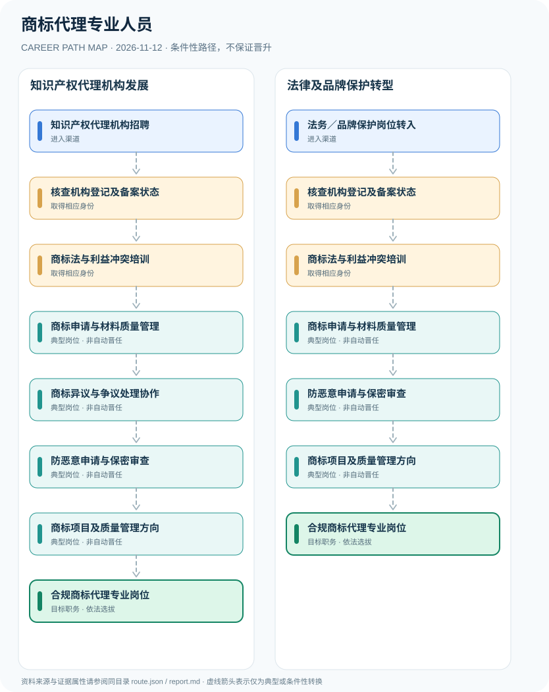

# 商标代理专业人员

> **B17 深度调查 · JR-114**　|　**适用地域及机构**：中国大陆·已依法登记及备案的商标代理机构、律师事务所；2026年11月核验　|　**核验时间**：2026-11-12

## 摘要：岗位身份、适用制度和效力

商标代理从业人员在依法备案的商标代理机构指派下承办商标申请、异议、无效宣告、续展等业务。2022年《商标代理监督管理规定》对机构备案和个人行为分别提出要求，不存在可替代机构备案的统一“商标代理师个人执业许可证”。2026年6月通过的全面修订《商标法》要到2027年1月1日施行，须区分已公布和已生效的规则。

**生效时间核验**：国家知识产权局刊载2026年《商标法》修订文本与主席令，明确2027年1月1日生效。故本职业研究以2022年已实施的《商标代理监督管理规定》为当前行为规范，2026新法仅列为过渡准备。商标代理机构备案信息包含代理从业人员资料，但不能据此创造独立个人“代理师执照”。

## 进入行业的合法渠道

- **知识产权代理机构招聘**：通过知识产权服务机构合法招聘进入助理岗位，熟悉商标分类、检索与法律文书，工作应由符合规定的机构安排。
- **法务／品牌保护岗位转入**：有企业法务或品牌保护经验者，可依商标代理机构岗位和人员行为规范应聘代理事务，不以专利代理师资格替代。

## 两条可比较的职业发展路径

### 路径 1：知识产权代理机构发展

从机构助理岗位学习法律与质量控制，受指派处理申请及争议工作，在岗位需求下发展。

**条件性节点序列**：知识产权代理机构招聘 → 核查机构登记及备案状态 → 商标法与利益冲突培训 → 商标申请与材料质量管理 → 商标异议与争议处理协作 → 防恶意申请与保密审查 → 商标项目及质量管理方向 → 合规商标代理专业岗位

路径只说明一种可解释的可能经历，后续岗位须满足新的资质、招聘、考核或任用要求。

### 路径 2：法律及品牌保护转型

法务人员经合法机构聘用和规则培训，从商标申请及风险防控业务进入专业代理岗位。

**条件性节点序列**：法务／品牌保护岗位转入 → 核查机构登记及备案状态 → 商标法与利益冲突培训 → 商标申请与材料质量管理 → 防恶意申请与保密审查 → 商标项目及质量管理方向 → 合规商标代理专业岗位

路径只说明一种可解释的可能经历，后续岗位须满足新的资质、招聘、考核或任用要求。

## 关键技能、项目实践与考核

核心成果为检索准确性、委托范围核对、避免恶意注册、文件期限管理、复审资料质量和客户保密。质量负责人由机构内部任用，不会凭另一专业的专利代理师证书自动取得商标代理项目职位。

- **商标申请与材料质量管理**：接受机构指派协助提交商标注册、变更、续展等资料，核查委托合同、代理范围与材料真实性。
- **商标异议与争议处理协作**：协助处理异议、复审和无效宣告等非诉商标事务；诉讼代理需要另核法定身份与权限。
- **防恶意申请与保密审查**：依法审查明知或应知恶意申请情形、利益冲突和商业秘密，不接受个人私下委托。
- **商标项目及质量管理方向**：在机构内部按经验和聘任可能担任团队管理，负责人岗位不等于国家个人执业牌照。

## 法定资格、制度区别与核查条目

- 《商标代理监督管理规定》2022年12月1日施行，第五条要求代理机构备案（有效期三年）；第十六条禁止代理从业人员以个人名义自行接受委托或同时在两家以上机构从业。
- 2026年6月26日修订通过《商标法》，主席令第77号规定2027年1月1日起施行。截至2026年11月新法尚未生效。
- 商标代理机构备案、商标代理人员职业能力与专利代理师法定职业资格不是同一法律制度；机构中的律师另遵守律师执业规则。

## 风险与地区、年度限制

- 新法第六十五至六十八条虽强化备案与代理行为要求，但尚不可作为2026年11月已生效处罚依据。
- 不同商标代理岗位是否涉及诉讼代理，必须独立核查律师执业及诉讼法要求。
- 商标申请获准与否取决于主管机关审查和权利冲突，不以代理工作年限保证成功率。

## 来源映射及路径证据

`route.json` 记录规范性文件、政策或招聘公告的原文 URL 和发布机构；节点引用 `source_ids`，每条岗位转换保守标为 `conditional`，而非保证升迁的 `normative` 法律权利。涉及真实法定准入的说明见上述条款，避免将机构权责套用到员工个人。

| 前一节点 | 后一节点 | 边属性 | 适用条件 |
|---|---|---|---|
| 知识产权代理机构招聘 | 核查机构登记及备案状态 | `conditional` | 「知识产权代理机构招聘」到「核查机构登记及备案状态」需要独立满足适用职位、资格、权限与机构安排，非自动晋升。 |
| 核查机构登记及备案状态 | 商标法与利益冲突培训 | `conditional` | 「核查机构登记及备案状态」到「商标法与利益冲突培训」需要独立满足适用职位、资格、权限与机构安排，非自动晋升。 |
| 商标法与利益冲突培训 | 商标申请与材料质量管理 | `conditional` | 「商标法与利益冲突培训」到「商标申请与材料质量管理」需要独立满足适用职位、资格、权限与机构安排，非自动晋升。 |
| 商标申请与材料质量管理 | 商标异议与争议处理协作 | `conditional` | 「商标申请与材料质量管理」到「商标异议与争议处理协作」需要独立满足适用职位、资格、权限与机构安排，非自动晋升。 |
| 商标异议与争议处理协作 | 防恶意申请与保密审查 | `conditional` | 「商标异议与争议处理协作」到「防恶意申请与保密审查」需要独立满足适用职位、资格、权限与机构安排，非自动晋升。 |
| 防恶意申请与保密审查 | 商标项目及质量管理方向 | `conditional` | 「防恶意申请与保密审查」到「商标项目及质量管理方向」需要独立满足适用职位、资格、权限与机构安排，非自动晋升。 |
| 商标项目及质量管理方向 | 合规商标代理专业岗位 | `conditional` | 「商标项目及质量管理方向」到「合规商标代理专业岗位」需要独立满足适用职位、资格、权限与机构安排，非自动晋升。 |
| 法务／品牌保护岗位转入 | 核查机构登记及备案状态 | `conditional` | 「法务／品牌保护岗位转入」到「核查机构登记及备案状态」需要独立满足适用职位、资格、权限与机构安排，非自动晋升。 |
| 商标申请与材料质量管理 | 防恶意申请与保密审查 | `conditional` | 「商标申请与材料质量管理」到「防恶意申请与保密审查」需要独立满足适用职位、资格、权限与机构安排，非自动晋升。 |

## 可复核的公开来源

1. **国家知识产权局**：[商标代理监督管理规定（市场监管总局第63号令）](https://www.cnipa.gov.cn/art/2026/3/5/art_2422_205030.html)（原始制度日期 2022-10-27）
2. **国家知识产权局**：[中华人民共和国商标法（2026年修订）](https://www.cnipa.gov.cn/art/2026/6/26/art_95_206942.html)（原始制度日期 2026-06-26）
3. **国家知识产权局**：[中华人民共和国主席令第七十七号（商标法2027-01-01生效）](https://www.cnipa.gov.cn/art/2026/6/26/art_3685_206934.html)（原始制度日期 2026-06-26）

> **研究说明**：来源的发布日期不代表法规施行日期；招聘公告不保证报名窗口仍开放。涉及跨地区或新版本制度时须重新核验。本路线不承诺个人晋升概率。
