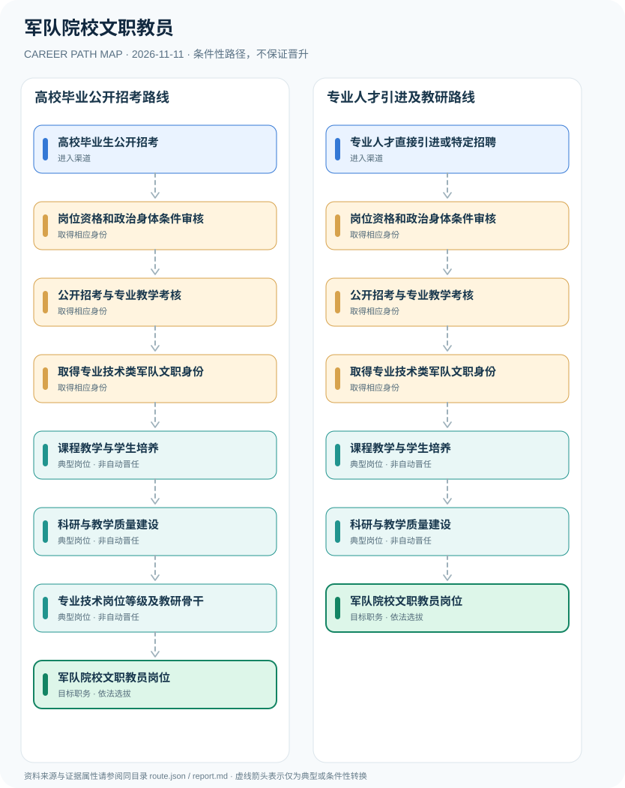

# 军队院校文职教员

> **B14 深度研究 · JR-107** · **适用范围**：中国大陆军队院校；2027年度军队文职公开招考为年度实例 · **官方资料核验日期**：2026-11-11

## 研究摘要与制度性质

军队院校文职教员属于军队文职人员专业技术岗位，人员身份、教学科研职责、专业技术岗位等级和教学职称需区分；2027年招考已有正式公告，是否采用统考、免笔试直接面试或专业面试以岗位计划为准。

2027年招考与上一年度不同，不能沿用2026年的资格时间表。本研究以军队人才网发布的2027年公告为主源，同时使用《文职人员条例》区分岗位类别；部分院校具体招考公告仅用作专业门槛案例，不能上升为全军统一学历要求。

## 一、入职渠道与资格核验

- **高校毕业生公开招考**：符合军队人才网2027年度教员专业技术岗位专业、学历、资格条件的高校毕业生按规定申请。
- **专业人才直接引进或特定招聘**：具有符合单位所需教学科研能力的专业人才，可按文职条例规定的适用引进渠道参与选拔。

## 二、两种职业发展路线

### 路线 1：高校毕业公开招考路线

从具备专业条件的高校毕业生报名，经资格和考核录用后开展教研并参与岗位等级评价。

**节点序列**：高校毕业生公开招考 → 岗位资格和政治身体条件审核 → 公开招考与专业教学考核 → 取得专业技术类军队文职身份 → 课程教学与学生培养 → 科研与教学质量建设 → 专业技术岗位等级及教研骨干 → 军队院校文职教员岗位

**任用边界**：本路线是一种合理的条件性发展关系；不因完成上一个岗位或取得某张证书自动获得下一个岗位。

### 路线 2：专业人才引进及教研路线

符合特定人才引进条件者按组织程序获得专业技术文职岗位后从事教学与研究。

**节点序列**：专业人才直接引进或特定招聘 → 岗位资格和政治身体条件审核 → 公开招考与专业教学考核 → 取得专业技术类军队文职身份 → 课程教学与学生培养 → 科研与教学质量建设 → 军队院校文职教员岗位

**任用边界**：本路线是一种合理的条件性发展关系；不因完成上一个岗位或取得某张证书自动获得下一个岗位。

## 三、岗位职责与长期成长

职业能力包括课程教学、学生培养、教学评价、学术研究与科研伦理。申请人可准备授课材料、可核实的科研成果和学术经历；是否能承担学科负责人或取得高级技术岗位由单位编制、考核和专业技术岗位制度决定。

- **岗位资格和政治身体条件审核**：依据具体岗位计划核验专业学位、学历、资格及政治身体条件，不能由军队院校名称倒推统一门槛。
- **公开招考与专业教学考核**：按照适用岗位参加笔试面试、免笔试直接面试或其他依法公布的选择程序。
- **取得专业技术类军队文职身份**：经录用聘任成为非服现役文职人员；不得与现役军官、普通高校事业编或聘用制兼职教师混同。
- **课程教学与学生培养**：按院校教学安排完成授课、教学设计、实验实训或基础课程指导，遵守教育教学和保密规范。
- **科研与教学质量建设**：参加课题、教研、课程评价与成果建设；学术岗位名称并不预设军衔。
- **专业技术岗位等级及教研骨干**：依据专业技术岗位等级和任职条件发展，文职岗位等级与高校职称聘任需要分别核实。

## 四、正式政策、准入门槛及制度区分

- 《中国人民解放军文职人员条例》区分管理类、专业技术类和专业技能类，专业技术文职岗位实行专业技术岗位等级制度。
- 军队人才网2027年度公开招考公告发布于2026年11月4日，社会公开招考专业技术类等岗位，资格和选拔方式以具体岗位计划为准。
- 军队院校文职教员并非现役军官，岗位等级不等于军衔或普通高校事业单位行政级别。

## 五、时效、地区和身份风险

- 2027年公开招考的普通报名期2026年11月5日至10日已经结束，调整报名或另批次招聘应单独查官方最新公告。
- 教学类不同岗位涉及马克思主义理论、外语、理工、体育等学科，专业限制及教员岗位等级不可一概而论。
- 具体军校教育科研任免与涉密专业信息不属于公开职业指南范围。

## 六、证据台账（图谱边）

每个转换都按 `conditional` 处理。法规和官方说明作为**节点依据**记入 `route.json` 的 `source_ids`；条件性箭头不代表法律保证、实际个人履历或确定晋升路径。任何法规变更均应同时更新数据与解释文本。

| 从 | 至 | 证据性质 | 适用限制 |
|---|---|---|---|
| 高校毕业生公开招考 | 岗位资格和政治身体条件审核 | conditional | 从「高校毕业生公开招考」发展至「岗位资格和政治身体条件审核」须独立满足职位、资格、考核及组织聘任要求，不能视为自动升级。 |
| 岗位资格和政治身体条件审核 | 公开招考与专业教学考核 | conditional | 从「岗位资格和政治身体条件审核」发展至「公开招考与专业教学考核」须独立满足职位、资格、考核及组织聘任要求，不能视为自动升级。 |
| 公开招考与专业教学考核 | 取得专业技术类军队文职身份 | conditional | 从「公开招考与专业教学考核」发展至「取得专业技术类军队文职身份」须独立满足职位、资格、考核及组织聘任要求，不能视为自动升级。 |
| 取得专业技术类军队文职身份 | 课程教学与学生培养 | conditional | 从「取得专业技术类军队文职身份」发展至「课程教学与学生培养」须独立满足职位、资格、考核及组织聘任要求，不能视为自动升级。 |
| 课程教学与学生培养 | 科研与教学质量建设 | conditional | 从「课程教学与学生培养」发展至「科研与教学质量建设」须独立满足职位、资格、考核及组织聘任要求，不能视为自动升级。 |
| 科研与教学质量建设 | 专业技术岗位等级及教研骨干 | conditional | 从「科研与教学质量建设」发展至「专业技术岗位等级及教研骨干」须独立满足职位、资格、考核及组织聘任要求，不能视为自动升级。 |
| 专业技术岗位等级及教研骨干 | 军队院校文职教员岗位 | conditional | 从「专业技术岗位等级及教研骨干」发展至「军队院校文职教员岗位」须独立满足职位、资格、考核及组织聘任要求，不能视为自动升级。 |
| 专业人才直接引进或特定招聘 | 岗位资格和政治身体条件审核 | conditional | 从「专业人才直接引进或特定招聘」发展至「岗位资格和政治身体条件审核」须独立满足职位、资格、考核及组织聘任要求，不能视为自动升级。 |
| 科研与教学质量建设 | 军队院校文职教员岗位 | conditional | 从「科研与教学质量建设」发展至「军队院校文职教员岗位」须独立满足职位、资格、考核及组织聘任要求，不能视为自动升级。 |

## 七、可核对来源（含发布日期）

1. **中华人民共和国国防部**：[中国人民解放军文职人员条例](https://www.mod.gov.cn/gfbw/qwfb/16198376.html)，原始发布日期 2022-12-10。
2. **中国人民解放军专业技术人才网·军队人才网**：[2027年军队文职人员公开招考公告](https://81rc.81.cn/sy/gzsd/16497837.html?t=1793790307708)，原始发布日期 2026-11-04。
3. **中国人民解放军专业技术人才网**：[2027年军队文职人员公开招考报考指南](https://81rc.81.cn/sy/gzsd/16497834_2.html)，原始发布日期 2026-11-04。
4. **南开大学就业服务中心（转载）**：[国防科技大学军政基础教育学院2027年军队文职人员公开招考](https://career.nankai.edu.cn/correcruit/content/id/120485.html)，原始发布日期 2026-11-05。

> **复核提醒**：年度岗位招聘及地方制度变化较快，申请前必须重新核验公告原文、适用人群及有效期。本研究仅公开制度与职业路线，不推断个人晋升概率。
