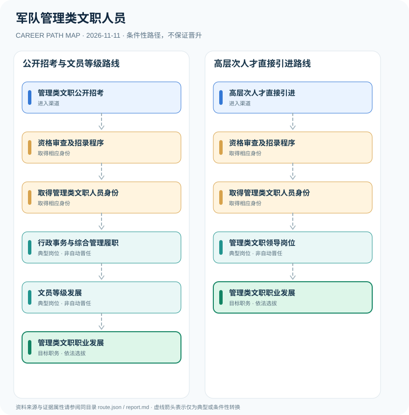

# 军队管理类文职人员

> **批次**：B11 · JR-105 · **适用范围**：中国大陆·中国人民解放军文职人员制度 · **核验日期**：2026-11-11

## 执行摘要

军队管理类文职并非现役军官，实行管理岗位职务层级与文员等级并行制度；公开招考、直接引进等入口必须与具体岗位资格相匹配。

《中国人民解放军文职人员条例》在2022年作第二次修订，明确文职人员为非服兵役的军队人员。管理类文职的制度轴线是“文员等级”和“岗位职务层级”，它们不同于现役军官的军衔序列。

## 一、准入方式及行政／招聘程序

2027年度军队文职公开招考公告针对管理类和专业技术类岗位发布岗位计划，报考者须核对所选具体职位的学历专业、从业经历与岗位等级。人才直接引进是条例规定的特定渠道，并不意味着免除其他审查与岗位需求。

- **管理类文职公开招考**：依年度军队人才网公告报考管理类文职人员职位，满足对应的专业、年龄与资格条件。
- **高层次人才直接引进**：符合高层次人才或特殊专业人才政策时，可按规定通过直接引进渠道，不等于所有岗位都开放。

## 二、常见路线与机构决定点

### 1. 公开招考与文员等级路线

普通社会人才或毕业生经过当年招录进入管理岗位，积累职责经验后按制度发展文员等级。

**阶段示意**：管理类文职公开招考 → 资格审查及招录程序 → 取得管理类文职人员身份 → 行政事务与综合管理履职 → 文员等级发展 → 管理类文职职业发展

**解释**：上述转换由岗位条件、资格确认、招聘或任用程序控制。即使具有上一阶段经历，也不保证任职下一阶段。

### 2. 高层次人才直接引进路线

仅适用于符合直接引进规定的高层次或特殊专业人才，并非一般岗位捷径。

**阶段示意**：高层次人才直接引进 → 资格审查及招录程序 → 取得管理类文职人员身份 → 管理类文职领导岗位 → 管理类文职职业发展

**解释**：上述转换由岗位条件、资格确认、招聘或任用程序控制。即使具有上一阶段经历，也不保证任职下一阶段。

## 三、关键职责与专业发展

行政事务、教育培训管理、组织综合协调等管理工作可构成不同履历。绩效、岗位任期、等级晋升和是否担任领导职务均需分别审核；不能用固定年数描述从普通文员直达处级岗位的过程。

- **资格审查及招录程序**：按适用招录方式接受资格审核、笔试或面试、体检与政治考核等程序。
- **取得管理类文职人员身份**：依法在军队编制的非服兵役岗位履职，遵守独立于现役军官的文职管理制度。
- **行政事务与综合管理履职**：根据岗位职责开展行政事务、综合协调和单位管理保障等工作，不预设统一级别。
- **文员等级发展**：依法按照文员等级制度评价任用，文员等级与担任领导职务不是一回事。
- **管理类文职领导岗位**：符合资格、领导岗位编制和组织任用条件时，可能担任相应管理类领导职务。

## 四、关键资格、执业条件与区别

- 文职人员条例第十三至十五条区分管理类、专业技术类、专业技能类岗位；管理类实行岗位职务层级与文员等级并行。
- 2027年度公开招考于2026年11月发布，具体管理岗位条件、招录数量和资格审查以当年的职位计划为准。
- 条例规定公开招考、直接引进和专项招录等不同渠道；不得把直接引进视为人人可报。
- 符合年龄、文化程度、专业与政治体检等要求；未满足岗位资格不因考试成绩自动录用。

## 五、证据分类和路线关系

本图把制度依据和职业经历分开：`normative` 表示有明确法规支持的规则，`official_description` 表示官方公开职责，`illustrative` 代表示意经历，`conditional` 代表资格、招聘、考核或任用控制的转换。本研究**不会把职业图谱中的箭头写成保证晋升**；全图边均显式标为条件性职业转换。职业身份、岗位层级、职称、行政职级和证书不可互换。

| 转换关系 | 证据分类 | 约束说明 |
|:--|:--|:--|
| 管理类文职公开招考 → 资格审查及招录程序 | `conditional` | 从「管理类文职公开招考」转向「资格审查及招录程序」须依本岗资格、机构要求和实际程序审核；不是任何人的自动晋升。 |
| 资格审查及招录程序 → 取得管理类文职人员身份 | `conditional` | 从「资格审查及招录程序」转向「取得管理类文职人员身份」须依本岗资格、机构要求和实际程序审核；不是任何人的自动晋升。 |
| 取得管理类文职人员身份 → 行政事务与综合管理履职 | `conditional` | 从「取得管理类文职人员身份」转向「行政事务与综合管理履职」须依本岗资格、机构要求和实际程序审核；不是任何人的自动晋升。 |
| 行政事务与综合管理履职 → 文员等级发展 | `conditional` | 从「行政事务与综合管理履职」转向「文员等级发展」须依本岗资格、机构要求和实际程序审核；不是任何人的自动晋升。 |
| 文员等级发展 → 管理类文职职业发展 | `conditional` | 从「文员等级发展」转向「管理类文职职业发展」须依本岗资格、机构要求和实际程序审核；不是任何人的自动晋升。 |
| 高层次人才直接引进 → 资格审查及招录程序 | `conditional` | 从「高层次人才直接引进」转向「资格审查及招录程序」须依本岗资格、机构要求和实际程序审核；不是任何人的自动晋升。 |
| 取得管理类文职人员身份 → 管理类文职领导岗位 | `conditional` | 从「取得管理类文职人员身份」转向「管理类文职领导岗位」须依本岗资格、机构要求和实际程序审核；不是任何人的自动晋升。 |
| 管理类文职领导岗位 → 管理类文职职业发展 | `conditional` | 从「管理类文职领导岗位」转向「管理类文职职业发展」须依本岗资格、机构要求和实际程序审核；不是任何人的自动晋升。 |

## 六、适用边界与更新风险

- 军队文职人员是军队编制岗位上的非服兵役人员，不是现役军官；文员等级不等于军衔。
- 任何领导岗位选拔必须另满足职务资格、编制与组织任命，不能按文员等级直接推算。
- 2027年度普通报名期在2026年11月5—10日，本文不表示目前仍可在原窗口报名。

## 七、官方和公开核验来源

1. [中国人民解放军文职人员条例（2022年第二次修订）](https://xzfg.moj.gov.cn/front/law/detail?LawID=1526) — 国家行政法规库，原文日期 2022-12-10。
2. [2027年军队文职人员公开招考公告](https://www.nq.gov.cn/nqzd/nqzwgk/sbfw/yfaz/202611/afdc9ff4595a4ad98f1beacc2d3e3d47.shtml) — 宁强县退役军人事务局（转载中央军委招考公告），原文日期 2026-11-04。

> **下一次更新检查**：实际申请时重新查当年岗位计划、地区特殊限制和新规替代情形。个人发展结果不作预测。
