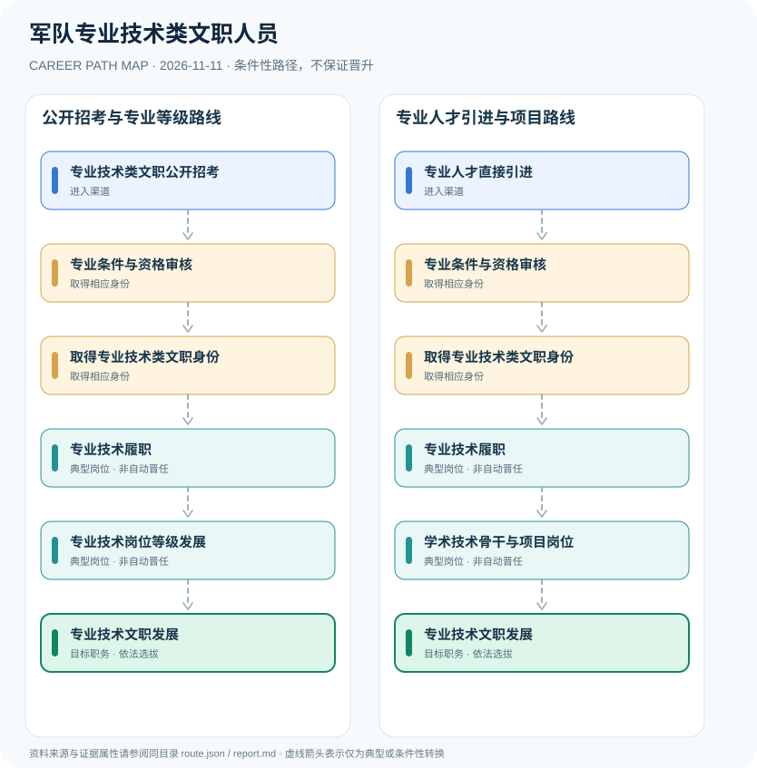

# 军队专业技术类文职人员

> **批次**：B11 · JR-106 · **适用范围**：中国大陆·军队文职专业技术岗位 · **核验日期**：2026-11-11

## 执行摘要

专业技术类文职通过岗位招考或特定人才引进进入军事科研、教学、工程及医疗等非现役岗位，依法按专业技术岗位等级管理，不等于取得军官军衔。

军队专业技术类文职是文职人员制度内的岗位类别，其岗位等级按《条例》第十五条设置。需与管理类文职的文员等级、军官的专业技术职务和医师等行业法定执业资格分开建模。

## 一、准入方式及行政／招聘程序

2027年度招考同时覆盖技术岗位，公开招考一般存在资格初审、笔试、面试、体检、政考等程序；个别岗位有不同的专业测评和选拔方式。直接引进的适用范围以军队和单位正式公告为准。

- **专业技术类文职公开招考**：根据年度军队人才网公布的专业技术岗位报考，符合专业资格与职位具体要求。
- **专业人才直接引进**：符合高层次或特殊专业人才条件者可考虑依法直接引进，实际由岗位计划决定。

## 二、常见路线与机构决定点

### 1. 公开招考与专业等级路线

从公开招考专业技术职位入职，形成技术成果及绩效，按岗位等级制度发展。

**阶段示意**：专业技术类文职公开招考 → 专业条件与资格审核 → 取得专业技术类文职身份 → 专业技术履职 → 专业技术岗位等级发展 → 专业技术文职发展

**解释**：上述转换由岗位条件、资格确认、招聘或任用程序控制。即使具有上一阶段经历，也不保证任职下一阶段。

### 2. 专业人才引进与项目路线

符合直接引进条件者，经资格及组织程序进入专业岗位，再依能力和工作需要承担技术项目。

**阶段示意**：专业人才直接引进 → 专业条件与资格审核 → 取得专业技术类文职身份 → 专业技术履职 → 学术技术骨干与项目岗位 → 专业技术文职发展

**解释**：上述转换由岗位条件、资格确认、招聘或任用程序控制。即使具有上一阶段经历，也不保证任职下一阶段。

## 三、关键职责与专业发展

科研教学岗位可关注学术质量、成果与教学绩效；工程技术岗位看系统可靠性、技术报告和成果交付；医疗岗位还必须履行医疗行业注册规则。项目骨干不是统一法定技术等级。

- **专业条件与资格审核**：按岗位要求核验学历、专业、职称或执业资格，参加相应选拔程序。
- **取得专业技术类文职身份**：在军队文职人员制度下聘用或任职，不因此成为现役军官。
- **专业技术履职**：根据具体单位岗位从事科研、工程技术、教育教学或医药卫生工作，遵守相应专业伦理。
- **专业技术岗位等级发展**：按专业技术岗位等级制度和岗位聘任条件管理，条例规定等级为一至十三级。
- **学术技术骨干与项目岗位**：在科研教学工程等领域积累绩效和专业成果，是否任骨干岗位取决于单位需求与考核。

## 四、关键资格、执业条件与区别

- 《文职人员条例》第十五条规定专业技术类文职实行岗位职务层级和专业技术岗位等级管理；专业技术岗位等级共13级。
- 2027年度公开招考以管理类和专业技术类为主体，具体应聘条件依岗位计划，不得将所有科研、医疗或教学岗位视为同一资格。
- 职业资格、专业技术职称、岗位等级及实际聘任分别审核，不因拥有毕业证自动取得相应等级。

## 五、证据分类和路线关系

本图把制度依据和职业经历分开：`normative` 表示有明确法规支持的规则，`official_description` 表示官方公开职责，`illustrative` 代表示意经历，`conditional` 代表资格、招聘、考核或任用控制的转换。本研究**不会把职业图谱中的箭头写成保证晋升**；全图边均显式标为条件性职业转换。职业身份、岗位层级、职称、行政职级和证书不可互换。

| 转换关系 | 证据分类 | 约束说明 |
|:--|:--|:--|
| 专业技术类文职公开招考 → 专业条件与资格审核 | `conditional` | 从「专业技术类文职公开招考」转向「专业条件与资格审核」须依本岗资格、机构要求和实际程序审核；不是任何人的自动晋升。 |
| 专业条件与资格审核 → 取得专业技术类文职身份 | `conditional` | 从「专业条件与资格审核」转向「取得专业技术类文职身份」须依本岗资格、机构要求和实际程序审核；不是任何人的自动晋升。 |
| 取得专业技术类文职身份 → 专业技术履职 | `conditional` | 从「取得专业技术类文职身份」转向「专业技术履职」须依本岗资格、机构要求和实际程序审核；不是任何人的自动晋升。 |
| 专业技术履职 → 专业技术岗位等级发展 | `conditional` | 从「专业技术履职」转向「专业技术岗位等级发展」须依本岗资格、机构要求和实际程序审核；不是任何人的自动晋升。 |
| 专业技术岗位等级发展 → 专业技术文职发展 | `conditional` | 从「专业技术岗位等级发展」转向「专业技术文职发展」须依本岗资格、机构要求和实际程序审核；不是任何人的自动晋升。 |
| 专业人才直接引进 → 专业条件与资格审核 | `conditional` | 从「专业人才直接引进」转向「专业条件与资格审核」须依本岗资格、机构要求和实际程序审核；不是任何人的自动晋升。 |
| 专业技术履职 → 学术技术骨干与项目岗位 | `conditional` | 从「专业技术履职」转向「学术技术骨干与项目岗位」须依本岗资格、机构要求和实际程序审核；不是任何人的自动晋升。 |
| 学术技术骨干与项目岗位 → 专业技术文职发展 | `conditional` | 从「学术技术骨干与项目岗位」转向「专业技术文职发展」须依本岗资格、机构要求和实际程序审核；不是任何人的自动晋升。 |

## 六、适用边界与更新风险

- 专业技术类文职不同于现役专业技术军官，也不同于管理类文职的文员等级。
- 从事医疗、教育等准入类专业还需符合对应行业的法定执业要求。
- 直接引进适用于条例明确的特殊人才范围，实际岗位并非自动开放。

## 七、官方和公开核验来源

1. [中国人民解放军文职人员条例（2022年修订）](https://xzfg.moj.gov.cn/front/law/detail?LawID=1526) — 国家行政法规库，原文日期 2022-12-10。
2. [2027年军队文职人员公开招考公告](https://www.nq.gov.cn/nqzd/nqzwgk/sbfw/yfaz/202611/afdc9ff4595a4ad98f1beacc2d3e3d47.shtml) — 宁强县退役军人事务局，原文日期 2026-11-04。

> **下一次更新检查**：实际申请时重新查当年岗位计划、地区特殊限制和新规替代情形。个人发展结果不作预测。
