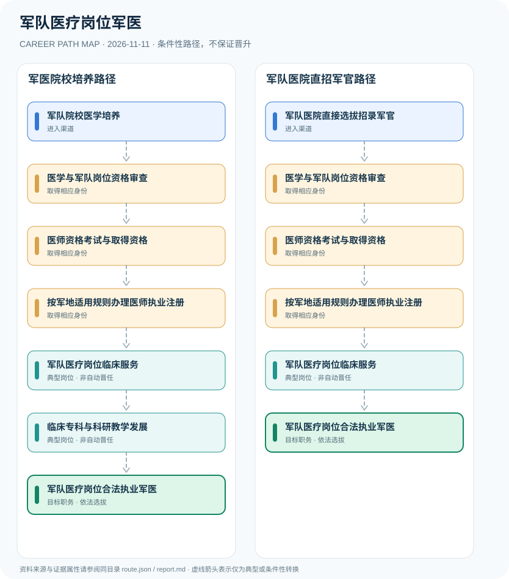

# 军队医疗岗位军医

> **批次 B13 · JR-104** · 研究范围：中国大陆·军队医院及军队医疗机构；以2027年度军医院直招军官公告为例 · **核验日期 2026-11-11**

## 职业定位与证据边界

军队医疗岗位需要区分现役军官、军队文职人员与依法从事诊疗的医师身份；医师资格考试、执业注册和军队岗位选拔属于不同程序。2026年医师资格考试公告明确军队现役及文职人员须加试军事医学。

以公开的2027年度海军军医大学第二附属医院直招军官公告为入口实例，说明“招军官”和“成为合格医师”是两个独立要求。既有医学执业资格人员的军队岗位录用条件需以对应公告核对，不能据此宣称所有军医都必须通过同一军校路线。

## 一、两种主要职业进入方向

- **军队院校医学培养**：通过符合条件的军队医学教育和军官培养渠道积累临床能力，是否任现役军官以具体培养与任命为准。
- **军队医院直接选拔招录军官**：符合军队医院特定岗位专业、学历和政治身体条件的毕业生，按年度直接选拔招录公告报考。

## 二、典型发展路线与适用条件

### 1. 军医院校培养路径

从军队医学培养进入岗位管理体系，依法取得医师资格并按适用要求注册后承担诊疗职责。

**路线图**：军队院校医学培养 → 医学与军队岗位资格审查 → 医师资格考试与取得资格 → 按军地适用规则办理医师执业注册 → 军队医疗岗位临床服务 → 临床专科与科研教学发展 → 军队医疗岗位合法执业军医

以上各岗位转换均受任用、选拔、执业资格或招聘控制，不构成保证晋升的链条。

### 2. 军队医院直招军官路径

符合定向医学院校和职位条件者，通过军官直接选拔程序并独立满足医师资格和注册条件。

**路线图**：军队医院直接选拔招录军官 → 医学与军队岗位资格审查 → 医师资格考试与取得资格 → 按军地适用规则办理医师执业注册 → 军队医疗岗位临床服务 → 军队医疗岗位合法执业军医

以上各岗位转换均受任用、选拔、执业资格或招聘控制，不构成保证晋升的链条。

## 三、岗位职责与专业发展能力

职业能力包括临床安全、规范病历、医患沟通、循证实践、医学科研和教学；未来担任科室负责人或技术骨干取决于职数、岗位要求和组织聘任，不存在固定年龄或保证晋升时间表。

- **医学与军队岗位资格审查**：分别核验学历、相应医学专业条件、军队岗位招录程序和人员身份；军官与文职不得混为同一渠道。
- **医师资格考试与取得资格**：符合相应医师资格考试报考条件，通过法定考试；军队现役和文职考生按公告加试军事医学。
- **按军地适用规则办理医师执业注册**：取得医师资格不意味着已获准执业；军队相关执业注册管理应按适用现行制度和主管机关核查。
- **军队医疗岗位临床服务**：在核准执业范围内开展患者诊疗与医学保障工作，遵守医疗质量、保密、职业伦理等要求。
- **临床专科与科研教学发展**：根据专业训练、科研及教学业绩发展专业能力，卫生专业技术职务和军衔不是同一序列。

## 四、现行法规、任职资格及关键区别

- 军队医院的军官直接选拔招录有单独岗位计划和资格审查，医师执业资格不能替代军官录用任命。
- 国家卫健委2026年医师资格考试公告明确军队现役人员、文职人员加试军事医学。
- 依法从事医师执业应取得医师资格并完成相应执业注册；2026年修订注册办法应结合军队适用专门规定核对。

## 五、法律与数据风险提示

- 2000年《军队医师执业管理办法》公开文本沿用已调整的军区和原军队机关名称，不可直接将历史办证流程认定为2026年现行军队内部程序。
- 军队文职医师不是现役军官；军官军衔、卫生专业技术岗位与医学职称之间不能直接对应。
- 任何军事医疗任务、机密机构岗位及内部任免细节不在公开研究范围内。

## 六、证据分类和引用对应

**职业路径中所有转换为 `conditional`：满足条件时才可能发生。** `normative` 指法律明确规定的权利或义务；`official_description` 指官方发布的岗位事实；`illustrative` 只代表一种合理的示例经历。本报告不混淆行政领导职务、职级、执业资格、技术等级和雇主自行定义的岗位。

| 图中转换 | 证据属性 | 解释 |
|---|---|---|
| 军队院校医学培养 → 医学与军队岗位资格审查 | conditional | 从「军队院校医学培养」到「医学与军队岗位资格审查」取决于对应资格、空缺职位或机构选任，不是必然晋升。 |
| 医学与军队岗位资格审查 → 医师资格考试与取得资格 | conditional | 从「医学与军队岗位资格审查」到「医师资格考试与取得资格」取决于对应资格、空缺职位或机构选任，不是必然晋升。 |
| 医师资格考试与取得资格 → 按军地适用规则办理医师执业注册 | conditional | 从「医师资格考试与取得资格」到「按军地适用规则办理医师执业注册」取决于对应资格、空缺职位或机构选任，不是必然晋升。 |
| 按军地适用规则办理医师执业注册 → 军队医疗岗位临床服务 | conditional | 从「按军地适用规则办理医师执业注册」到「军队医疗岗位临床服务」取决于对应资格、空缺职位或机构选任，不是必然晋升。 |
| 军队医疗岗位临床服务 → 临床专科与科研教学发展 | conditional | 从「军队医疗岗位临床服务」到「临床专科与科研教学发展」取决于对应资格、空缺职位或机构选任，不是必然晋升。 |
| 临床专科与科研教学发展 → 军队医疗岗位合法执业军医 | conditional | 从「临床专科与科研教学发展」到「军队医疗岗位合法执业军医」取决于对应资格、空缺职位或机构选任，不是必然晋升。 |
| 军队医院直接选拔招录军官 → 医学与军队岗位资格审查 | conditional | 从「军队医院直接选拔招录军官」到「医学与军队岗位资格审查」取决于对应资格、空缺职位或机构选任，不是必然晋升。 |
| 军队医疗岗位临床服务 → 军队医疗岗位合法执业军医 | conditional | 从「军队医疗岗位临床服务」到「军队医疗岗位合法执业军医」取决于对应资格、空缺职位或机构选任，不是必然晋升。 |

## 七、官方和公开参考资料

1. [海军军医大学第二附属医院2027年度直接选拔招录军官公告](https://tyjr.sh.gov.cn/shtyjrswj/tzgg/20260922/893a543ea8a24db08fb751827a6345ea.html) — 上海市退役军人事务局（转载军医院公告）（发布日期 2026-09-22）
2. [国家卫生健康委员会医师资格考试委员会2026年第1号公告](https://www.nhc.gov.cn/yzygj/c100067/202601/134520df641b4e99b8f8db7c64abc7f3.shtml) — 国家卫生健康委员会（发布日期 2026-01-26）
3. [医师执业注册管理办法（2026年修订）](https://www.moj.gov.cn/pub/sfbgw/flfggz/flfggzbmgz/202608/t20260819_538650.html) — 中华人民共和国司法部（发布日期 2026-06-05）
4. [2026年军校招生政策解读](https://www.mod.gov.cn/gfbw/gffw/zs/16469121.html) — 中华人民共和国国防部（发布日期 2026-06-23）

> 资料只反映所列地域、法规和核验日期的公开信息。报名、岗位计划或法规发生变化时，必须重新核对原文，不能沿用过时条件。
