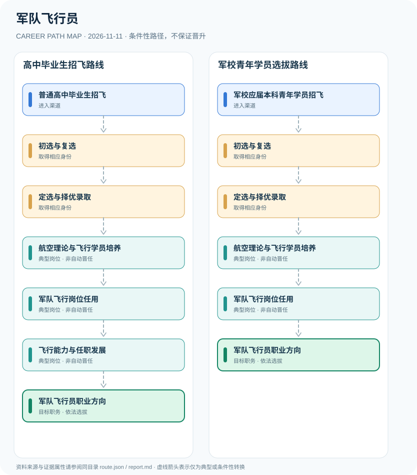

# 军队飞行员

> **研究批次** B12 · JR-101　|　**范围**：中国大陆；以2026年度空军招飞华东地区公告及2026军校政策为实例　|　**核验日期**：2026-11-11

## 摘要与职业定位

军队飞行员是军事飞行岗位方向而非民航飞行员资格；2026年度空军招飞覆盖高中毕业生及符合条件的军校应届青年学员，经历初选、复选、定选与培养，但录取或毕业不保证固定机型或具体部队岗位。

**制度分析**：空军招飞属于军队飞行学员招收培养，公开招生条件与普通军队院校、地方高校和民航飞行员存在区别。不同入口的人群须分别满足公告所列学历、年龄与专业要求。

## 进入职业的合法渠道

- **普通高中毕业生招飞**：按所在地当年空军招飞公告报名，核查年龄、选考科目、政治条件与飞行身体心理条件。
- **军校应届本科青年学员招飞**：2026年度东部空军招飞另列符合专业和年龄等要求的军队院校应届青年学员。

## 2 种代表性职业发展路线

### 1. 高中毕业生招飞路线

从符合地区条件的高中生报名，到招飞定选、学员培养及军队飞行岗位的条件性发展。

**岗位序列（条件性示意）**：普通高中毕业生招飞 → 初选与复选 → 定选与择优录取 → 航空理论与飞行学员培养 → 军队飞行岗位任用 → 飞行能力与任职发展 → 军队飞行员职业方向

### 2. 军校青年学员选拔路线

东部空军2026年招生公告中的另一法定公告人群，须按其专门条件审核后再培养或分配。

**岗位序列（条件性示意）**：军校应届本科青年学员招飞 → 初选与复选 → 定选与择优录取 → 航空理论与飞行学员培养 → 军队飞行岗位任用 → 军队飞行员职业方向

## 重要职责、技能和岗位发展

**岗位发展**：航空理论、基本飞行训练、机型适应、任务训练和岗位履职构成可能的经历；每一阶段的具体设置由军队培养及组织管理规定控制，公开资料不足以推出唯一的任职年龄或必经机型。

- **航空理论与飞行学员培养**：进入相应培养体系接受航空理论、军政素质和训练课程；不预设录取者均完成全部飞行训练。
- **军队飞行岗位任用**：在满足后续培养、考核与组织分配条件后从事有关部队飞行岗位工作。
- **飞行能力与任职发展**：服役期间依培训、岗位资格、飞行经验和组织选拔参与后续专业或管理任职。

## 准入门槛与任职规则

- 2026年度东部空军招飞简章明示高中生、符合条件的军校应届本科青年学员两类选拔对象；该年度年龄、性别、科目条件不应推定为全国永久统一标准。
- 高中生一般经过初选、复选、定选及综合择优录取，招飞同时受到政治、身体、心理等专项条件约束。
- 军队院校军官培养与飞行岗位专业训练不是民航商业驾驶员执照训练，军衔与飞行等级不得合并建模。

## 证据状态与实际约束

路线图中的箭头均为 `conditional`：即使前一节点的经历成立，后续任用、考试、职业资格、选拔或招聘仍需独立满足制度要求。`normative` 专指法律直接规定的关系，`official_description` 指官方机构说明，`illustrative` 指仅用于理解的示例；具体证据来源链接见下文。

- 2026年华东六省市招飞说明是地区和年度案例，2027及其他地区公告需另核。
- 飞行岗位涉及人员安全与非公开军事资料，本报告不收集战备部署、飞行战术、装备参数或敏感编制。
- 未被定选录取、培训不合格或未获得相应岗位任用的人员不得视为已成为军队飞行员。

## 可复核原始资料

1. [2026年度空军招收飞行学员简章（华东五省一市）](https://gaokao.chsi.com.cn/gkxx/kjzf/202509/20250905/2293401119.html)，教育部阳光高考平台／东部空军招飞，2025-09-05。
2. [2026年军校招生政策解读](https://www.mod.gov.cn/gfbw/gffw/zs/16469121.html)，中华人民共和国国防部，2026-06-23。

> **复核提醒**：跨地区、跨机构或新招录年度，必须重新核查原始政策、职位计划及生效状态。此报告不推测晋升概率和个人任职结果。
