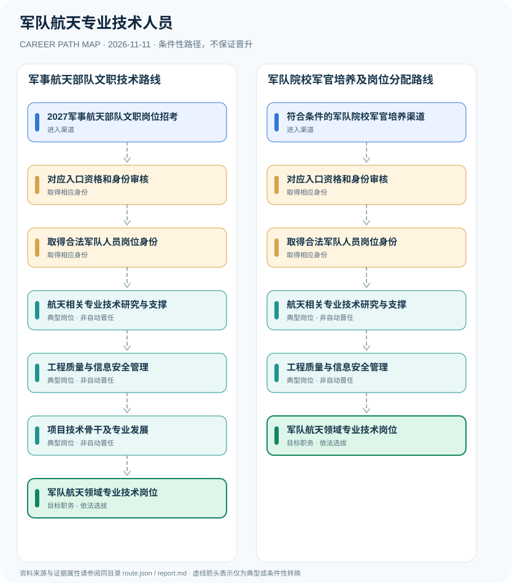

# 军队航天专业技术人员

> **B16 深度研究 · JR-103** · 机构与地域：中国大陆；2027年度军事航天部队文职招考及一般军队军官培养制度 · **核验日期：2026-11-11**

## 一、职业定义与现行制度

2024年4月19日军兵种结构调整后，军事航天部队列入公开的新型兵种布局。军队航天技术人才可以涉及现役军官与军队文职等不同人员制度。军队人才网2027年度公开招考已列军事航天部队为用人单位，但这是文职人员招考，不代表报考者自动取得军官军衔、涉密科研资格或特定航天项目岗位。

**2026年11月版本核验**：军队人才网2027年公开招考已发布，军事航天部队作为用人单位在官方咨询名单中出现。报考对象包含毕业生与符合条件的社会人才，但招考类型明确为军队文职，不是军官。另一方面，2026年军校招生政策说明军官培养的一般入口；目前公开证据不足以保证某个军校专业会分配到军事航天部队，故图中只用条件性路线，不能填入具体军官航天岗位晋升年限。

## 二、两类准入与身份确认

- **2027军事航天部队文职岗位招考**：普通高校毕业生或社会人才依军队人才网2027岗位计划，核对学历、专业及政治身体等资格并按公告报名。
- **符合条件的军队院校军官培养渠道**：军队院校生长军官培养可作为现役军官职业入口，但是否分配军事航天专业岗位依军队实际培养和组织安排。

## 三、法规、资质和考试的判断

- 国防部2024年4月19日专题新闻发布会明确，在新型军兵种结构布局中列有军事航天部队，并调整相关兵种领导管理关系；不应继续沿用已撤销的战略支援部队番号。

- 军队人才网2027年公告列管理类和专业技术类文职人员公开招考，2026年11月5日8:00至10日18:00为该轮正常报名时间，现已结束。
- 2027年度军事航天部队用人单位在军队人才网的咨询单位清单中单列，不能因此宣称任何工程技术专业毕业生均可直入该部队。
- 《中国人民解放军文职人员条例》将文职列为非服兵役军队人员，建立与军官、公务员及事业单位不同的人员制度。
- 军校培养属于现役军官入口参考，与文职直接招考不能互相替代。

## 四、职业发展路径与条件性节点

### 路线1｜军事航天部队文职技术路线

通过2027年度文职岗位选报、资格审查及考核后，可能在专业技术岗位开展研发与质量管理。

**条件性路径**：2027军事航天部队文职岗位招考 → 对应入口资格和身份审核 → 取得合法军队人员岗位身份 → 航天相关专业技术研究与支撑 → 工程质量与信息安全管理 → 项目技术骨干及专业发展 → 军队航天领域专业技术岗位

该路线仅表示可能存在的职业经历；下一阶段均须重新核查资格、机构岗位和考核任职制度，不意味着保证录用或晋升。

### 路线2｜军队院校军官培养及岗位分配路线

通过不同于文职招考的军官培养、组织任职，符合特定军队航天需求时可能承担相关技术任务。

**条件性路径**：符合条件的军队院校军官培养渠道 → 对应入口资格和身份审核 → 取得合法军队人员岗位身份 → 航天相关专业技术研究与支撑 → 工程质量与信息安全管理 → 军队航天领域专业技术岗位

该路线仅表示可能存在的职业经历；下一阶段均须重新核查资格、机构岗位和考核任职制度，不意味着保证录用或晋升。

## 五、工作能力、项目与成果评价

公开可讨论的能力包括数学与物理、软件质量、可靠性工程、实验记录、科研伦理和跨学科协同。成果评价必须在合法可公开范围内进行，涉密项目人员不能公开具体任务作为普通求职作品。

- **对应入口资格和身份审核**：文职按2027公开招考程序审查，军官培养按军队院校与现役军官制度审查，不能混用考试及录用规定。
- **取得合法军队人员岗位身份**：文职经过招考与聘用进入专业技术岗位；现役军官须经培养、毕业与组织任职，不由工程学位自动产生军衔。
- **航天相关专业技术研究与支撑**：开展计算、工程验证、设备软件和科研支撑等授权任务；具体专业及涉密范围由单位岗位规定。
- **工程质量与信息安全管理**：从技术需求、保密规范、验证记录和项目协作提升交付可靠性，不披露作战细节或敏感部署。
- **项目技术骨干及专业发展**：符合岗位条件时承担跨团队研发和专业技术指导，专业岗位等级、军官军衔与职务分别管理。

## 六、适用地区、生效版本及风险

- 2024年调整组建军事航天部队后，不能继续将原战略支援部队称为现行的统一招考用人单位。
- 不能由文职岗位等级推断军衔、现役身份或特定航天装备权限；所列军官方向仅是有条件的军队专业培养示意。
- 未公开的航天任务、基地位置、人员编制和系统技术参数不在公开研究范围内。

## 七、证据与图谱的映射

对每一节点，`route.json` 中的 `source_ids` 指向下文的可核查公开来源；每条转换边均标为 `conditional`，不会冒充有明确法律规定的 `normative` 自动晋升。不同的法定资格、机构选聘、职位级别及劳动关系各自独立。

| 转换前 | 转换后 | 证据属性 | 适用限制 |
|---|---|---|---|
| 2027军事航天部队文职岗位招考 | 对应入口资格和身份审核 | `conditional` | 从「2027军事航天部队文职岗位招考」至「对应入口资格和身份审核」取决于法定资格、岗位条件或独立选聘考核，绝非自动晋升。 |
| 对应入口资格和身份审核 | 取得合法军队人员岗位身份 | `conditional` | 从「对应入口资格和身份审核」至「取得合法军队人员岗位身份」取决于法定资格、岗位条件或独立选聘考核，绝非自动晋升。 |
| 取得合法军队人员岗位身份 | 航天相关专业技术研究与支撑 | `conditional` | 从「取得合法军队人员岗位身份」至「航天相关专业技术研究与支撑」取决于法定资格、岗位条件或独立选聘考核，绝非自动晋升。 |
| 航天相关专业技术研究与支撑 | 工程质量与信息安全管理 | `conditional` | 从「航天相关专业技术研究与支撑」至「工程质量与信息安全管理」取决于法定资格、岗位条件或独立选聘考核，绝非自动晋升。 |
| 工程质量与信息安全管理 | 项目技术骨干及专业发展 | `conditional` | 从「工程质量与信息安全管理」至「项目技术骨干及专业发展」取决于法定资格、岗位条件或独立选聘考核，绝非自动晋升。 |
| 项目技术骨干及专业发展 | 军队航天领域专业技术岗位 | `conditional` | 从「项目技术骨干及专业发展」至「军队航天领域专业技术岗位」取决于法定资格、岗位条件或独立选聘考核，绝非自动晋升。 |
| 符合条件的军队院校军官培养渠道 | 对应入口资格和身份审核 | `conditional` | 从「符合条件的军队院校军官培养渠道」至「对应入口资格和身份审核」取决于法定资格、岗位条件或独立选聘考核，绝非自动晋升。 |
| 工程质量与信息安全管理 | 军队航天领域专业技术岗位 | `conditional` | 从「工程质量与信息安全管理」至「军队航天领域专业技术岗位」取决于法定资格、岗位条件或独立选聘考核，绝非自动晋升。 |

## 八、来源及原始发布日期

5. **中华人民共和国国防部**：[国防部关于信息支援部队成立和新型军兵种结构布局的专题发布会](https://www.mod.gov.cn/gfbw/xwfyr/ztjzh/16302133.html)（原文件或规定日期：2024-04-19）。

1. **军队人才网**：[2027年军队文职人员公开招考公告](https://81rc.81.cn/sy/tzgg_210284/16498336.html)（原文件或规定日期：2026-11-04）。
2. **军队人才网**：[2027年军队文职公开招考咨询单位（含军事航天部队）](https://81rc.81.cn/sy/gzdt_210283/16497846.html)（原文件或规定日期：2026-11-04）。
3. **中华人民共和国国防部**：[中国人民解放军文职人员条例（2022年第二次修订）](https://www.mod.gov.cn/gfbw/qwfb/16196990.html)（原文件或规定日期：2022-12-10）。
4. **中华人民共和国国防部**：[2026年军校招生政策解读](https://www.mod.gov.cn/gfbw/gffw/zs/16469121.html)（原文件或规定日期：2026-06-23）。

> **研究限制**：法规发布日期和实施日期可能不同；2027招录的专项条件以招聘公告实时版本及具体职位表为准。本研究不作个人晋升概率预测，不公开非公开的军队、警务、医疗或个人数据。
