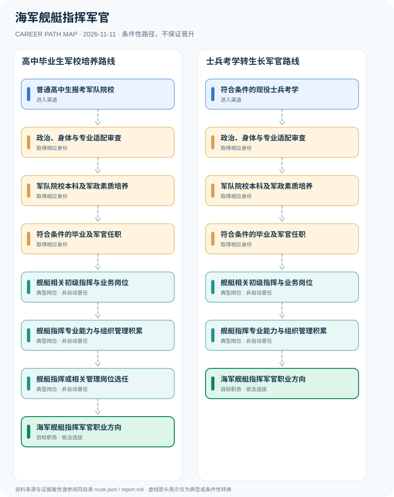

# 海军舰艇指挥军官

> **B15 深度研究 · JR-102**　｜　**地域与机构**：中国大陆·海军舰艇指挥相关军官职业方向；2026年军校招生政策为实例　｜　**核验日期**：2026-11-11

## 01 职业定位与现行制度版本

海军舰艇指挥军官属于现役军官指挥岗位，不是民用船长或海事部门船员资格。2025年起军校招生计划不再简单按“指挥/非指挥”两类划分，而强调专业培养目标；2026年军队院校面向普通高中毕业生及符合条件的士兵学员开展不同的生长军官培养渠道。录取院校、专业培养、首次任职和后续指挥岗位并非自动连续晋升。

**深搜版本差异**：2025年国防部招生改革明确取消老式“指挥/非指挥”招生分法；2026年继续实施生长军官贯通培养。2026年海军大连舰艇学院对社会公布的计划展示“专业＋培养目标”，与军官首次任职方向有关，但不构成对具体舰艇指挥职务的保证。士兵学员属于另一条独立招生入口，不能用高中生分数线替代。

## 02 两类准入及真实制度门槛

- **普通高中生报考军队院校**：依据当年省份招录计划报考含海军舰艇相关培养目标的军事院校，按高考、政治考核、面试与体检要求择优录取。
- **符合条件的现役士兵考学**：按《军队院校招收士兵学员工作办法》与当年度部队招生指标参加生长军官学员选拔；并非所有士兵及岗位均开放舰艇指挥方向。

- 2026年国防部军校招生政策说明，报考普通高中生军校需满足学籍、高考成绩、政治考核、体检及年龄等当年条件；仅作为2026年度实例。
- 2024年生效的《军队院校招收士兵学员工作办法》建立士兵报考生长军官教育等渠道；士兵招生计划与高中生计划不同。
- 2025年军校招生不再区分“指挥/非指挥”类别，专业名称与首次任职培养目标对接，不能从旧的指挥类标签推断岗位。
- 海军大连舰艇学院2026年本科招生专业包含舰艇类培养目标，具体省份、性别、名额与专业均需核对当年计划。

## 03 典型发展路线及任职决定点

### 路线1：高中毕业生军校培养路线

面向招生省份的高中生，经军校招录与贯通培养进入部队，再根据实际任职岗位发展舰艇指挥能力。

**条件性节点**：普通高中生报考军队院校 → 政治、身体与专业适配审查 → 军队院校本科及军政素质培养 → 符合条件的毕业及军官任职 → 舰艇相关初级指挥与业务岗位 → 舰艇指挥专业能力与组织管理积累 → 舰艇指挥或相关管理岗位选任 → 海军舰艇指挥军官职业方向

应在每次考试、身份取得、聘用、晋升或岗位任命时重新审核条件；不能把这条示意路径当作法律规定的必然晋升链条。

### 路线2：士兵考学转生长军官路线

现役士兵经符合法规的军校招考成为军官学员，完成毕业任用后可根据专业匹配进入舰艇相关岗位。

**条件性节点**：符合条件的现役士兵考学 → 政治、身体与专业适配审查 → 军队院校本科及军政素质培养 → 符合条件的毕业及军官任职 → 舰艇相关初级指挥与业务岗位 → 舰艇指挥专业能力与组织管理积累 → 海军舰艇指挥军官职业方向

应在每次考试、身份取得、聘用、晋升或岗位任命时重新审核条件；不能把这条示意路径当作法律规定的必然晋升链条。

## 04 工作职责、核心能力与评价方式

**专业成长**：安全意识、舰艇业务、协同组织、领导沟通、军事法律与专业课程学习等可作为公开层面的能力框架。课程完成后的岗位任用和指挥职位由组织选拔与实际考核决定，本图采用条件性箭头而不是职位晋升的法定时间线。

- **政治、身体与专业适配审查**：接受不同入口的体格、政治和专业适配考核，满足院校培养目标，并按招生计划录取。
- **军队院校本科及军政素质培养**：按专业与培养目标接受通识教育、基础指挥素质与专业学习，具体训练安排服从公开培养计划和军事教育制度。
- **符合条件的毕业及军官任职**：完成毕业考核后，军官身份、岗位授予和部队分配须依军队任用安排；不因院校录取即保证特定舰艇岗位。
- **舰艇相关初级指挥与业务岗位**：根据岗位分配与专业资格开展舰艇业务管理、官兵组织和依法规定的军事工作，本报告不涉及战术与装备部署。
- **舰艇指挥专业能力与组织管理积累**：从航海、舰艇业务与官兵管理方向积累适岗能力，岗位职务、军衔、院校学位分别评价。
- **舰艇指挥或相关管理岗位选任**：在岗位空缺、选拔考核和组织任职条件满足时，可能承担相应舰艇管理或指挥责任。

## 05 适用边界、时效与容易混淆的身份

- 民用船员海船船长适任证书并不自动赋予军队军官身份，军队舰艇指挥岗位也不等于获得民用船长资质。
- 军队院校录取、军官任用、舰艇业务资格、指挥岗位、军衔属于不同节点；不能推断固定年龄或逐级升迁概率。
- 不提供现役舰艇编制、战术作战、军队部署或非公开考核标准。

## 06 证据台账与图谱解释

规范性文件、机构职责和招聘公告分别记录在 `route.json` 的 `sources` 中，并由岗位节点使用 `source_ids` 引用。所有边标记为 `conditional`（条件性转换），**不得因来源中存在某项资格就推定本人必获后续岗位**。若需要标注法律明确规定的资格，应在研究说明中具体引用相关条款，而不能把一个推测性职位转换伪装成 `normative`。

| 转换前 | 转换后 | 证据类型 | 约束说明 |
|---|---|---|---|
| 普通高中生报考军队院校 | 政治、身体与专业适配审查 | `conditional` | 从「普通高中生报考军队院校」到「政治、身体与专业适配审查」须独立满足资格、岗位要求及考试或组织安排；示意路线不构成保证晋任。 |
| 政治、身体与专业适配审查 | 军队院校本科及军政素质培养 | `conditional` | 从「政治、身体与专业适配审查」到「军队院校本科及军政素质培养」须独立满足资格、岗位要求及考试或组织安排；示意路线不构成保证晋任。 |
| 军队院校本科及军政素质培养 | 符合条件的毕业及军官任职 | `conditional` | 从「军队院校本科及军政素质培养」到「符合条件的毕业及军官任职」须独立满足资格、岗位要求及考试或组织安排；示意路线不构成保证晋任。 |
| 符合条件的毕业及军官任职 | 舰艇相关初级指挥与业务岗位 | `conditional` | 从「符合条件的毕业及军官任职」到「舰艇相关初级指挥与业务岗位」须独立满足资格、岗位要求及考试或组织安排；示意路线不构成保证晋任。 |
| 舰艇相关初级指挥与业务岗位 | 舰艇指挥专业能力与组织管理积累 | `conditional` | 从「舰艇相关初级指挥与业务岗位」到「舰艇指挥专业能力与组织管理积累」须独立满足资格、岗位要求及考试或组织安排；示意路线不构成保证晋任。 |
| 舰艇指挥专业能力与组织管理积累 | 舰艇指挥或相关管理岗位选任 | `conditional` | 从「舰艇指挥专业能力与组织管理积累」到「舰艇指挥或相关管理岗位选任」须独立满足资格、岗位要求及考试或组织安排；示意路线不构成保证晋任。 |
| 舰艇指挥或相关管理岗位选任 | 海军舰艇指挥军官职业方向 | `conditional` | 从「舰艇指挥或相关管理岗位选任」到「海军舰艇指挥军官职业方向」须独立满足资格、岗位要求及考试或组织安排；示意路线不构成保证晋任。 |
| 符合条件的现役士兵考学 | 政治、身体与专业适配审查 | `conditional` | 从「符合条件的现役士兵考学」到「政治、身体与专业适配审查」须独立满足资格、岗位要求及考试或组织安排；示意路线不构成保证晋任。 |
| 舰艇指挥专业能力与组织管理积累 | 海军舰艇指挥军官职业方向 | `conditional` | 从「舰艇指挥专业能力与组织管理积累」到「海军舰艇指挥军官职业方向」须独立满足资格、岗位要求及考试或组织安排；示意路线不构成保证晋任。 |

## 07 官方与公开资料（可追溯）

1. [2026年军校招生政策解读](https://www.mod.gov.cn/gfbw/gffw/zs/16469121.html) — 中华人民共和国国防部；来源原始日期 2026-06-23。
2. [海军大连舰艇学院2026年招收普通高中毕业生计划](https://m.thepaper.cn/newsDetail_forward_33372533) — 海军大连舰艇学院（澎湃政务转载）；来源原始日期 2026-06-13。
3. [中央军委办公厅印发《军队院校招收士兵学员工作办法》](https://www.mod.gov.cn/gfbw/qwfb/16280923.html) — 中华人民共和国国防部；来源原始日期 2024-01-17。
4. [2025年军队院校招生政策解读](https://www.mod.gov.cn/gfbw/gfjy_index/jsyxgfs/16391936.html) — 中华人民共和国国防部；来源原始日期 2025-06-17。

> **复核协议**：跨年度招生公告、法律修订、专业等级与机构设置可能变化。实际申请和转岗前，须核对当前官方原文、所在地文件及单位职位要求，尤其注意来源发布日期与生效日期未必一致。
