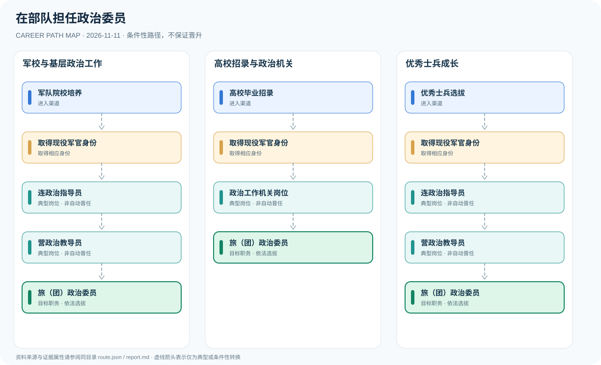

# 在部队担任政治委员

> 中国大陆 · 中国人民解放军 · 资料核验 2026-11-11

## 职业定位

从军队院校、高校毕业招录或优秀士兵选拔成为军官，认识基层政治主官到旅团政治委员之间需要组织选拔的职业发展关系。

## 常见职业路径

### 军校与基层政治工作

军校进入军官队伍，积累基层政治工作经验。

军队院校培养 → 取得现役军官身份 → 连政治指导员 → 营政治教导员 → 旅（团）政治委员

### 高校招录与政治机关

高校招录进入军官队伍，可能交流到机关岗位。

高校毕业招录 → 取得现役军官身份 → 政治工作机关岗位 → 旅（团）政治委员

### 优秀士兵成长

通过选拔成为军官后再接受政治主官岗位选任。

优秀士兵选拔 → 取得现役军官身份 → 连政治指导员 → 营政治教导员 → 旅（团）政治委员

## 岗位说明

- **取得现役军官身份**：军官身份不等于必然获得政治主官岗位。
- **连政治指导员**：连级政治主官，对连队政治工作负主要责任。
- **营政治教导员**：营级政治主官，对营队政治工作负主要责任。
- **政治工作机关岗位**：可能通过机关任职积累政治工作经验。
- **旅（团）政治委员**：旅团单位政治主官职位，具体任命依组织安排。

## 任职资格与条件

- 依法取得现役军官身份，并具备对应岗位任职资格。
- 政治指导员、政治教导员、政治委员属于不同层级岗位。
- 关注当年军校招生和军官招录正式公告。

## 注意事项与事实边界

- 岗位与军衔不等同，不能据此推断固定军衔。
- 箭头仅表示可能或典型发展关系，并非保证晋升。
- 不应编造未公开岗位名额、考核标准或个人晋升概率。

职业发展路线是制度说明与可能经历的图谱，**不是保证晋升的承诺**。所有跨岗位箭头均须依照职位条件及组织任用程序解释。

## 官方资料

1. [中华人民共和国兵役法（第三十三条）](https://www.mva.gov.cn/gongkai/zfxxgkpt/fdzdgknr/fgzc/202112/t20211224_54634.html) — 退役军人事务部（2021-08-20）
2. [中国人民解放军内务条令](https://www.mod.gov.cn/gfbw/qwfb/16371391.html) — 国防部（2025-02-26）
3. [国防科技大学新设政治工作本科专业](https://www.nudt.edu.cn/xwgg/xydt/a915fafcb6314b56a0cff4aef16f18c8.htm) — 国防科技大学（2026-06-18）
