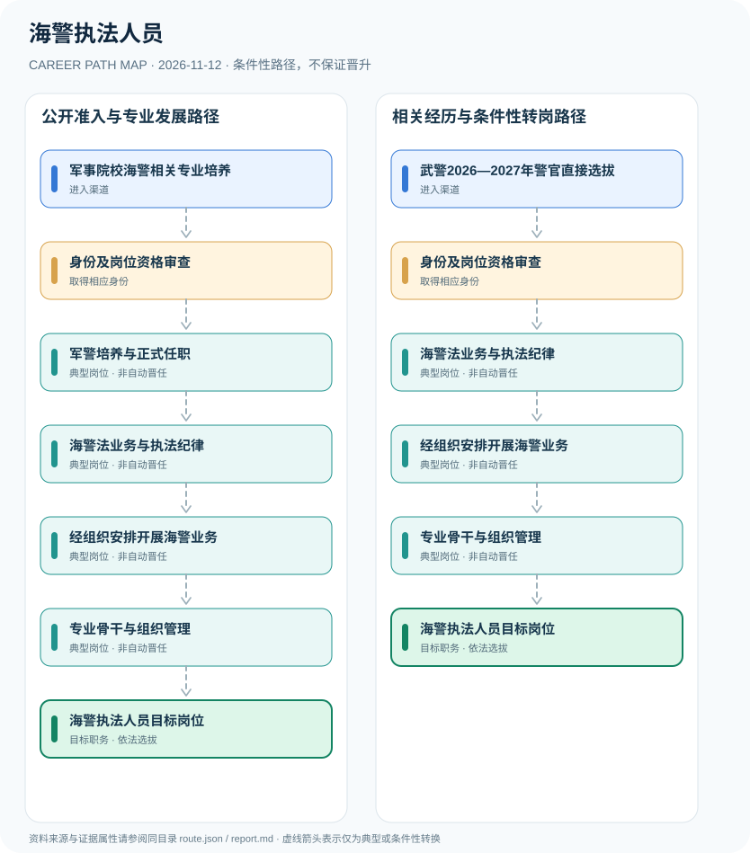

# 海警执法人员

> **B18 Deep Search | JR-136** · 核验 2026-11-12 · 中国大陆中国海警机构；武警警官与军校培养，区别交通运输海事行政执法

## 一、职业定位与制度效力

《海警法》规定人民武装警察部队海警部队为海警机构，统一履行海上维权执法职责。武警警官、文职人员、民用海事公务员的人员身份和业务权限不同。2025年海警学院相关本科专业调整为部分‘2+2’联合培养，2026—2027武警警官直招是另一公开入口，但不能保证直招人员被分配至海警单位。

海警学院2025招生调整是职业培养链重大变化；国防部2026军校整体招录信息提供一般要求，但不能独立确认每个培养方向。武警直招警官与进入海警部门之间存在组织岗位分配条件，不是法定必然关系。

## 二、两类正式进入渠道

- **军事院校海警相关专业培养**：按当年武警工程大学、海军大连舰艇学院等专业计划核对海警培养目标，完成政治身体考核及军校培养。
- **武警2026—2027年警官直接选拔**：符合应届毕业生资格者按武警警官直招公告申报具体职位；实际海警岗位应以原始计划核对。

## 三、发展路径与任职关口

### 路径1：公开准入与专业发展路径

按当年武警工程大学、海军大连舰艇学院等专业计划核对海警培养目标，完成政治身体考核及军校培养。

**节点序列**：军事院校海警相关专业培养 → 身份及岗位资格审查 → 军警培养与正式任职 → 海警法业务与执法纪律 → 经组织安排开展海警业务 → 专业骨干与组织管理 → 海警执法人员目标岗位

> 此路径是条件性职业示意，不是职务晋升承诺，也不赋予法定许可。

### 路径2：相关经历与条件性转岗路径

符合应届毕业生资格者按武警警官直招公告申报具体职位；实际海警岗位应以原始计划核对。

**节点序列**：武警2026—2027年警官直接选拔 → 身份及岗位资格审查 → 海警法业务与执法纪律 → 经组织安排开展海警业务 → 专业骨干与组织管理 → 海警执法人员目标岗位

> 此路径是条件性职业示意，不是职务晋升承诺，也不赋予法定许可。

## 四、岗位活动与专业能力

职业能力涉及海上法治、纪律与职业伦理、通信协作、公共服务和规范记录，具体执行仍受机构授权。

- **身份及岗位资格审查**：分清现役武警警官、军队文职与交通运输部门海事公务员的组织关系。
- **军警培养与正式任职**：按合法培养、体检、政治考核和组织分配取得相应人员身份。
- **海警法业务与执法纪律**：学习海警机构法定职责、程序保障及执法对象合法权益。
- **经组织安排开展海警业务**：在公开制度范围内履行海警机构授权工作，不披露非公开部署。
- **专业骨干与组织管理**：依武警人员管理和岗位选任发展，警衔不自动换算成职务。

## 五、法规与可核查准入条件

- 《海警法》第二条明确海警部队属于武警部队，海警局及下属机构与海事局不是同一个体系。
- 海警学院2025招生调整明确部分本科专业转为与武警工程大学、海军大连舰艇学院‘2+2’联合培养。
- 军队人才网2026—2027武警警官直招公告面向符合条件的应届生，但不能推断全部武警职位均对应海警岗位。

## 六、边界、时效与主要风险

- 2025联合培养安排并非2026全部专业的确定招生名额，须查看当年计划。
- 武警警官报名已过2026年9月常规窗口，不能承诺现在仍可报名。
- 不涉及海警执法战术、海上部署或内部训练。

## 七、逐边证据台账

说明：节点关联 `source_ids` 指向下列公开资料；各边为条件性关系而非法定自动晋升。适用法律与岗位招聘需按年度、地区和用人单位独立审核。

| 前置节点 | 后续节点 | 证据属性 | 条件 |
|---|---|---|---|
| 军事院校海警相关专业培养 | 身份及岗位资格审查 | `conditional` | 从「军事院校海警相关专业培养」到「身份及岗位资格审查」须独立满足适用招聘、岗位资格、机构授权及组织考核，不保证晋升。 |
| 身份及岗位资格审查 | 军警培养与正式任职 | `conditional` | 从「身份及岗位资格审查」到「军警培养与正式任职」须独立满足适用招聘、岗位资格、机构授权及组织考核，不保证晋升。 |
| 军警培养与正式任职 | 海警法业务与执法纪律 | `conditional` | 从「军警培养与正式任职」到「海警法业务与执法纪律」须独立满足适用招聘、岗位资格、机构授权及组织考核，不保证晋升。 |
| 海警法业务与执法纪律 | 经组织安排开展海警业务 | `conditional` | 从「海警法业务与执法纪律」到「经组织安排开展海警业务」须独立满足适用招聘、岗位资格、机构授权及组织考核，不保证晋升。 |
| 经组织安排开展海警业务 | 专业骨干与组织管理 | `conditional` | 从「经组织安排开展海警业务」到「专业骨干与组织管理」须独立满足适用招聘、岗位资格、机构授权及组织考核，不保证晋升。 |
| 专业骨干与组织管理 | 海警执法人员目标岗位 | `conditional` | 从「专业骨干与组织管理」到「海警执法人员目标岗位」须独立满足适用招聘、岗位资格、机构授权及组织考核，不保证晋升。 |
| 武警2026—2027年警官直接选拔 | 身份及岗位资格审查 | `conditional` | 从「武警2026—2027年警官直接选拔」到「身份及岗位资格审查」须独立满足适用招聘、岗位资格、机构授权及组织考核，不保证晋升。 |
| 身份及岗位资格审查 | 海警法业务与执法纪律 | `conditional` | 从「身份及岗位资格审查」到「海警法业务与执法纪律」须独立满足适用招聘、岗位资格、机构授权及组织考核，不保证晋升。 |

## 八、来源与发布机构（原始日期）

1. **共产党员网（全国人大法律）**：[中华人民共和国海警法](https://www.12371.cn/2021/01/23/ARTI1611368612525782.shtml)（2021-01-22）
2. **央广网**：[武警海警学院2025年招生调整告知信](https://military.cnr.cn/zdgz/20250616/t20250616_527214501.shtml)（2025-06-16）
3. **军队人才网**：[2026—2027年度武警部队直接选拔招录警官公告](https://81rc.81.cn/sy/gzdt_210283/16484209.html)（2026-09-07）
4. **中华人民共和国国防部**：[2026年军队院校招生政策解读](https://www.mod.gov.cn/gfbw/gffw/zs/16469121.html)（2026-06-23）

> **复核提醒**：发布日期不等于生效日期；已经结束的招聘不可作为仍开放的报名窗口。岗位身份、职业许可、业务权限和组织任用不可互换。
