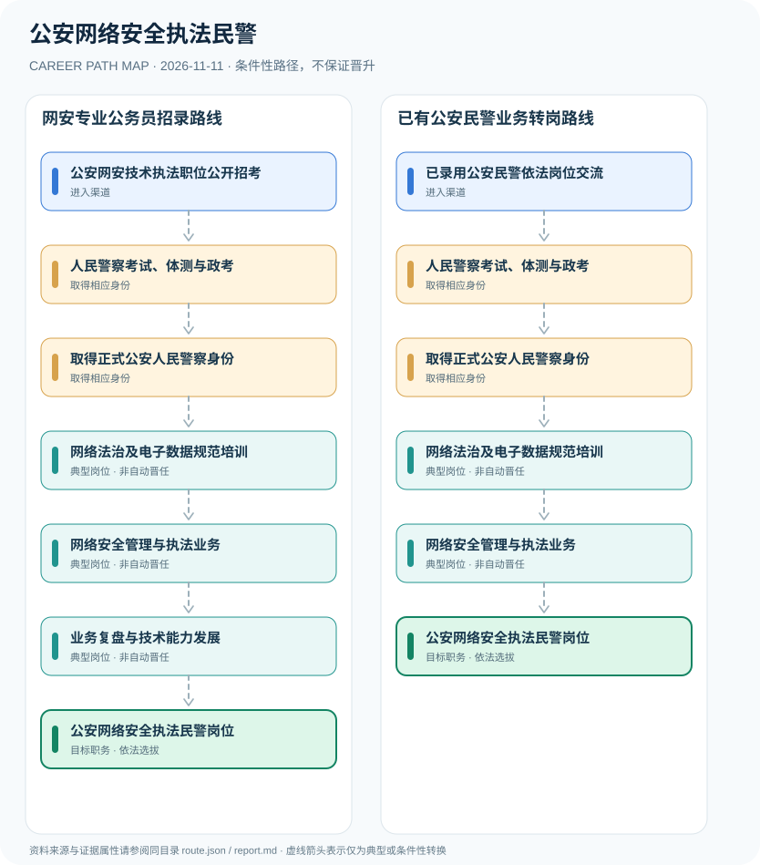

# 公安网络安全执法民警

> **B14 深度研究 · JR-134** · **适用范围**：中国大陆公安机关网络安全管理与执法岗位；2027山东与北京岗位为地方实例 · **官方资料核验日期**：2026-11-11

## 研究摘要与制度性质

公安网安执法岗位在正式人民警察制度内运行，既要求警察公务员准入，也强调网络安全技术能力。2027山东和北京分别公布了网络安全与执法或网络技术相关职位，但专业、年龄和考核项目不能相互套用。

公安机关网络安全岗位同时涉及公务员、警察和网络专业技术三个维度。山东2027年招录说明展示网络安全与执法职位是公安人民警察正式职位，而不是普通网安工程师入职公安系统的自动转换。

## 一、入职渠道与资格核验

- **公安网安技术执法职位公开招考**：按照省市2027年公务员录用公告选择网络安全管理与执法或网络技术岗位，查看职位表与专项要求。
- **已录用公安民警依法岗位交流**：已有正式人民警察身份者可在符合岗位技术资格及单位安排时申请内部岗位选配。

## 二、两种职业发展路线

### 路线 1：网安专业公务员招录路线

以2027年省市招聘公告中的网络安全职位为入口，依法通过人民警察录用流程并开展网安执法。

**节点序列**：公安网安技术执法职位公开招考 → 人民警察考试、体测与政考 → 取得正式公安人民警察身份 → 网络法治及电子数据规范培训 → 网络安全管理与执法业务 → 业务复盘与技术能力发展 → 公安网络安全执法民警岗位

**任用边界**：本路线是一种合理的条件性发展关系；不因完成上一个岗位或取得某张证书自动获得下一个岗位。

### 路线 2：已有公安民警业务转岗路线

满足岗位资格的正式警察经组织安排进入网安岗位，依法完成相关培训再执法。

**节点序列**：已录用公安民警依法岗位交流 → 人民警察考试、体测与政考 → 取得正式公安人民警察身份 → 网络法治及电子数据规范培训 → 网络安全管理与执法业务 → 公安网络安全执法民警岗位

**任用边界**：本路线是一种合理的条件性发展关系；不因完成上一个岗位或取得某张证书自动获得下一个岗位。

## 三、岗位职责与长期成长

合规工作涵盖网络安全法适用、数字证据合法性、技术分析和警务文书。后续可成为技术骨干，具体专业技术警务职级和领导岗位需按岗位及选任规则另审。

- **人民警察考试、体测与政考**：适用公务员录用及人民警察专项条件，不可仅凭信息安全证书取得警察身份。
- **取得正式公安人民警察身份**：依法录用或转任，属于公安机关警察身份而非企业安全工程师或警务辅助人员。
- **网络法治及电子数据规范培训**：学习依法取证、个人信息保护、网络安全行政管理与程序规范，服从法定执法权限。
- **网络安全管理与执法业务**：在合法执法授权下参与网络安全检查、网络违法犯罪线索处理和电子数据检验辅助等工作。
- **业务复盘与技术能力发展**：积累可审计的执法文书、网络技术能力和合法数据处理经验，领导任用独立考核。

## 四、正式政策、准入门槛及制度区分

- 2027年度山东省公安机关录用简章有网络安全管理、网络安全与执法等警务技术职位的专项身体条件要求。
- 2027年北京市公安局公告含网络技术职位附件，并要求公安专业科目考试及后续体测、心理测试等。
- 信息安全岗位技能或厂商认证不能代替正式人民警察身份、依法执法资格与录用考核程序。

## 五、时效、地区和身份风险

- 网络安全工程师、企业红队测试员及公安网安执法民警是不同身份；技术能力不自动授予公安行政执法权。
- 2027北京与山东招录的体测、年龄、学历等因单位和职位不同而有差异，必须查当年原职位表。
- 不提供敏感执法战术、内部侦查系统或越权电子数据获取操作细节。

## 六、证据台账（图谱边）

每个转换都按 `conditional` 处理。法规和官方说明作为**节点依据**记入 `route.json` 的 `source_ids`；条件性箭头不代表法律保证、实际个人履历或确定晋升路径。任何法规变更均应同时更新数据与解释文本。

| 从 | 至 | 证据性质 | 适用限制 |
|---|---|---|---|
| 公安网安技术执法职位公开招考 | 人民警察考试、体测与政考 | conditional | 从「公安网安技术执法职位公开招考」发展至「人民警察考试、体测与政考」须独立满足职位、资格、考核及组织聘任要求，不能视为自动升级。 |
| 人民警察考试、体测与政考 | 取得正式公安人民警察身份 | conditional | 从「人民警察考试、体测与政考」发展至「取得正式公安人民警察身份」须独立满足职位、资格、考核及组织聘任要求，不能视为自动升级。 |
| 取得正式公安人民警察身份 | 网络法治及电子数据规范培训 | conditional | 从「取得正式公安人民警察身份」发展至「网络法治及电子数据规范培训」须独立满足职位、资格、考核及组织聘任要求，不能视为自动升级。 |
| 网络法治及电子数据规范培训 | 网络安全管理与执法业务 | conditional | 从「网络法治及电子数据规范培训」发展至「网络安全管理与执法业务」须独立满足职位、资格、考核及组织聘任要求，不能视为自动升级。 |
| 网络安全管理与执法业务 | 业务复盘与技术能力发展 | conditional | 从「网络安全管理与执法业务」发展至「业务复盘与技术能力发展」须独立满足职位、资格、考核及组织聘任要求，不能视为自动升级。 |
| 业务复盘与技术能力发展 | 公安网络安全执法民警岗位 | conditional | 从「业务复盘与技术能力发展」发展至「公安网络安全执法民警岗位」须独立满足职位、资格、考核及组织聘任要求，不能视为自动升级。 |
| 已录用公安民警依法岗位交流 | 人民警察考试、体测与政考 | conditional | 从「已录用公安民警依法岗位交流」发展至「人民警察考试、体测与政考」须独立满足职位、资格、考核及组织聘任要求，不能视为自动升级。 |
| 网络安全管理与执法业务 | 公安网络安全执法民警岗位 | conditional | 从「网络安全管理与执法业务」发展至「公安网络安全执法民警岗位」须独立满足职位、资格、考核及组织聘任要求，不能视为自动升级。 |

## 七、可核对来源（含发布日期）

1. **烟台市人民政府（转载省级公告）**：[2027年度山东省公安机关考试录用公务员（人民警察）简章](https://www.yantai.gov.cn/col/col51398/art/2026/art_392b24699429449b94f68a8391911b4d.html)，原始发布日期 2026-11-04。
2. **北京市公安局**：[北京市公安局2027年度面向社会招录人民警察公告](https://gaj.beijing.gov.cn/zhuanti/zlxx/tzgg/202611/t20261109_4938297.html)，原始发布日期 2026-11-09。
3. **北京市公安局公安交通管理局**：[中华人民共和国人民警察法](https://jtgl.beijing.gov.cn/jgj/jgxx/flfg/fl/203770/index.html)，原始发布日期 1995-02-28。

> **复核提醒**：年度岗位招聘及地方制度变化较快，申请前必须重新核验公告原文、适用人群及有效期。本研究仅公开制度与职业路线，不推断个人晋升概率。
