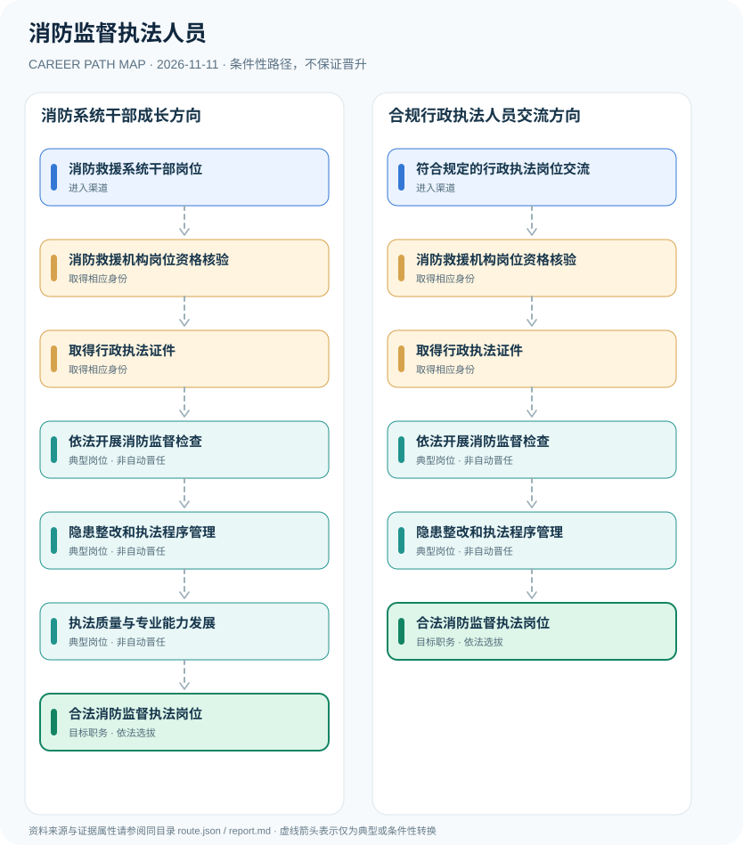

# 消防监督执法人员

> **批次 B13 · JR-139** · 研究范围：中国大陆·消防救援机构实施消防监督检查的执法人员 · **核验日期 2026-11-11**

## 职业定位与证据边界

消防监督检查的主体依法是消防救援机构，消防监督检查人员应在执法岗位工作并取得行政执法证件；政府专职消防员、消防技术服务企业和第三方评估机构不因服务合同取得法定监督执法权。

最大风险是混淆**消防技术服务**与**行政监督执法**。消防监督执法的法定主体和个人资格均受约束，岗位工作首先必须有依法授权的身份与证件，再开展监督检查。

## 一、两种主要职业进入方向

- **消防救援系统干部岗位**：通过法定招聘、培养或管理任用渠道取得消防救援机构相关岗位身份，具体招录以正式公告核验。
- **符合规定的行政执法岗位交流**：已有机关或消防相关管理人员符合人员管理及岗位资格时，通过组织程序进入消防监督执法岗位。

## 二、典型发展路线与适用条件

### 1. 消防系统干部成长方向

经机构合法岗位安排与执法资格审查，再从监督检查和隐患整改工作积累专业经验。

**路线图**：消防救援系统干部岗位 → 消防救援机构岗位资格核验 → 取得行政执法证件 → 依法开展消防监督检查 → 隐患整改和执法程序管理 → 执法质量与专业能力发展 → 合法消防监督执法岗位

以上各岗位转换均受任用、选拔、执业资格或招聘控制，不构成保证晋升的链条。

### 2. 合规行政执法人员交流方向

符合干部交流与执法资格规定者通过组织程序取得执法岗位和执法证件，依法履职。

**路线图**：符合规定的行政执法岗位交流 → 消防救援机构岗位资格核验 → 取得行政执法证件 → 依法开展消防监督检查 → 隐患整改和执法程序管理 → 合法消防监督执法岗位

以上各岗位转换均受任用、选拔、执业资格或招聘控制，不构成保证晋升的链条。

## 三、岗位职责与专业发展能力

核心能力包括消防法适用、检查文书、风险隐患识别与行政程序保障。未来承担复杂项目或部门管理需要合法选任，不凭执法次数自动提拔。

- **消防救援机构岗位资格核验**：确认归属依法有权实施消防监督检查的机构，属于合法执法岗位而非外包第三方。
- **取得行政执法证件**：国家消防救援局2025年通知明确检查人员必须取得行政执法证件且在消防执法岗位工作。
- **依法开展消防监督检查**：按法律和权责清单对单位遵守消防法规的情况开展监督检查并出示证件。
- **隐患整改和执法程序管理**：依法律职责形成检查记录、监督整改及行政执法程序并落实全过程记录等要求。
- **执法质量与专业能力发展**：在依法履职、执法审核与专业培训基础上增强工作能力，岗位领导任用不自动发生。

## 四、现行法规、任职资格及关键区别

- 《中华人民共和国消防法》第五十三条规定消防救援机构依法实施消防监督检查，检查人员应出示证件。
- 国家消防救援局2025年《关于严格规范消防监督检查的通知》明确消防救援机构是实施主体，检查人员必须取得行政执法证件并在消防执法岗位工作。
- 2025年《消防行政执法责任制规定》规范执法责任分工与过程管理，不能把技术检测外包公司当作法定执法主体。

## 五、法律与数据风险提示

- 政府专职消防员承担的救援或辅助岗位不当然具有监督检查行政执法权。
- 2025年消防监管制度有改革调整，实际机关和人员身份仍需按当地消防救援机构与执法证件有效性核实。
- 本研究仅公开执法制度和人才路径，不涉及检查战术、警力部署或内部敏感运行。

## 六、证据分类和引用对应

**职业路径中所有转换为 `conditional`：满足条件时才可能发生。** `normative` 指法律明确规定的权利或义务；`official_description` 指官方发布的岗位事实；`illustrative` 只代表一种合理的示例经历。本报告不混淆行政领导职务、职级、执业资格、技术等级和雇主自行定义的岗位。

| 图中转换 | 证据属性 | 解释 |
|---|---|---|
| 消防救援系统干部岗位 → 消防救援机构岗位资格核验 | conditional | 从「消防救援系统干部岗位」到「消防救援机构岗位资格核验」取决于对应资格、空缺职位或机构选任，不是必然晋升。 |
| 消防救援机构岗位资格核验 → 取得行政执法证件 | conditional | 从「消防救援机构岗位资格核验」到「取得行政执法证件」取决于对应资格、空缺职位或机构选任，不是必然晋升。 |
| 取得行政执法证件 → 依法开展消防监督检查 | conditional | 从「取得行政执法证件」到「依法开展消防监督检查」取决于对应资格、空缺职位或机构选任，不是必然晋升。 |
| 依法开展消防监督检查 → 隐患整改和执法程序管理 | conditional | 从「依法开展消防监督检查」到「隐患整改和执法程序管理」取决于对应资格、空缺职位或机构选任，不是必然晋升。 |
| 隐患整改和执法程序管理 → 执法质量与专业能力发展 | conditional | 从「隐患整改和执法程序管理」到「执法质量与专业能力发展」取决于对应资格、空缺职位或机构选任，不是必然晋升。 |
| 执法质量与专业能力发展 → 合法消防监督执法岗位 | conditional | 从「执法质量与专业能力发展」到「合法消防监督执法岗位」取决于对应资格、空缺职位或机构选任，不是必然晋升。 |
| 符合规定的行政执法岗位交流 → 消防救援机构岗位资格核验 | conditional | 从「符合规定的行政执法岗位交流」到「消防救援机构岗位资格核验」取决于对应资格、空缺职位或机构选任，不是必然晋升。 |
| 隐患整改和执法程序管理 → 合法消防监督执法岗位 | conditional | 从「隐患整改和执法程序管理」到「合法消防监督执法岗位」取决于对应资格、空缺职位或机构选任，不是必然晋升。 |

## 七、官方和公开参考资料

1. [国家消防救援局关于严格规范消防监督检查的通知（2025）](https://www.119.gov.cn/zfxxgk/fdzdgknr/zcfg/2025/50085.shtml) — 国家消防救援局（发布日期 2025-06-09）
2. [中华人民共和国消防法](https://www.samr.gov.cn/zw/zfxxgk/fdzdgknr/bgt/art/2023/art_e9e34f0731c249a891ea9c925e17f237.html) — 国家市场监督管理总局（转载法律）（发布日期 2021-04-29）
3. [消防行政执法责任制规定（2025）](https://www.119.gov.cn/site1/zfxxgk/fdzdgknr/zcfg/2025/47833.shtml) — 国家消防救援局（发布日期 2025-01-12）

> 资料只反映所列地域、法规和核验日期的公开信息。报名、岗位计划或法规发生变化时，必须重新核对原文，不能沿用过时条件。
