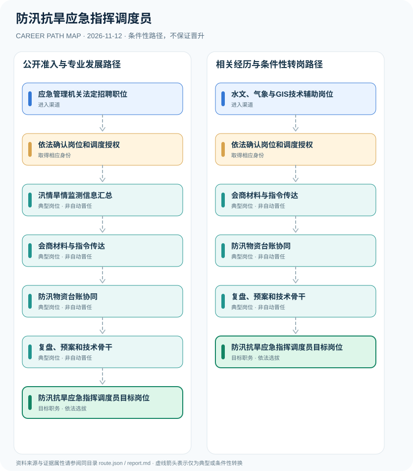

# 防汛抗旱应急指挥调度员

> **B18 Deep Search | JR-141** · 核验 2026-11-12 · 中国大陆防汛抗旱指挥办事机构及应急部门值守、信息支持岗位

## 一、职业定位与制度效力

防汛抗旱调度员是应急管理、防汛办事机构或专业服务项目中的信息值守和会商支持岗位，并不自动取得政府防汛抗旱行政指挥权。2022年国家防汛抗旱应急预案明确国家防办设在应急管理部，与旧《防汛条例》对部分机构设置的表述存在版本差异，研究须明确两种来源的适用背景。

旧行政法规与2022年应急预案的机构表述存在变化。报告采用当前国家防办官方组织信息解释实际运行，并保留应独立核对制度效力的风险说明。

## 二、两类正式进入渠道

- **应急管理机关法定招聘职位**：按照公务员录用或参公岗位安排进入应急防汛业务部门，实际机构职能和人员身份依职位表核对。
- **水文、气象与GIS技术辅助岗位**：在合法技术项目或岗位聘用中从事监测预警、信息收集和会商支持，不因此成为防汛行政负责人。

## 三、发展路径与任职关口

### 路径1：公开准入与专业发展路径

按照公务员录用或参公岗位安排进入应急防汛业务部门，实际机构职能和人员身份依职位表核对。

**节点序列**：应急管理机关法定招聘职位 → 依法确认岗位和调度授权 → 汛情旱情监测信息汇总 → 会商材料与指令传达 → 防汛物资台账协同 → 复盘、预案和技术骨干 → 防汛抗旱应急指挥调度员目标岗位

> 此路径是条件性职业示意，不是职务晋升承诺，也不赋予法定许可。

### 路径2：相关经历与条件性转岗路径

在合法技术项目或岗位聘用中从事监测预警、信息收集和会商支持，不因此成为防汛行政负责人。

**节点序列**：水文、气象与GIS技术辅助岗位 → 依法确认岗位和调度授权 → 会商材料与指令传达 → 防汛物资台账协同 → 复盘、预案和技术骨干 → 防汛抗旱应急指挥调度员目标岗位

> 此路径是条件性职业示意，不是职务晋升承诺，也不赋予法定许可。

## 四、岗位活动与专业能力

可核验工作包括值守日志、监测数据准确性、会商材料、物资调拨记录、演练评估和灾情复盘。

- **依法确认岗位和调度授权**：区分国家防总、地方指挥部的行政责任人和防汛办日常信息工作人员。
- **汛情旱情监测信息汇总**：协同水文、气象和水利部门校验预警及值守日志，确保数据与传递时间可追溯。
- **会商材料与指令传达**：按授权编制会商纪要和应急信息传达，不越权发布转移或蓄滞洪区启用命令。
- **防汛物资台账协同**：按2026国家防办通知辅助物资数据更新与调拨申请，统一调用由有权机构决定。
- **复盘、预案和技术骨干**：参加演练、质量改进及跨部门联动，专业经历不自动赋予行政指挥权。

## 五、法规与可核查准入条件

- 国务院办公厅2022年国家防汛抗旱应急预案明确国家防办设置在应急管理部。
- 国家防总2026年通报2810名防汛抗旱责任人，依法确定的行政负责人与值班工作人员有不同责任。
- 应急管理部2026年物资通知强调统一台账和快速调拨流程；技术岗位应服从法定指挥链。

## 六、边界、时效与主要风险

- 不能单凭旧《防汛条例》的旧机构表述推断2026年国家防办所在部门。
- 事业编、公务员、合同技术人员和防汛指挥负责人不属于同一人员制度。
- 不提供未经授权的实际洪水调度指令和危险操作流程。

## 七、逐边证据台账

说明：节点关联 `source_ids` 指向下列公开资料；各边为条件性关系而非法定自动晋升。适用法律与岗位招聘需按年度、地区和用人单位独立审核。

| 前置节点 | 后续节点 | 证据属性 | 条件 |
|---|---|---|---|
| 应急管理机关法定招聘职位 | 依法确认岗位和调度授权 | `conditional` | 从「应急管理机关法定招聘职位」到「依法确认岗位和调度授权」须独立满足适用招聘、岗位资格、机构授权及组织考核，不保证晋升。 |
| 依法确认岗位和调度授权 | 汛情旱情监测信息汇总 | `conditional` | 从「依法确认岗位和调度授权」到「汛情旱情监测信息汇总」须独立满足适用招聘、岗位资格、机构授权及组织考核，不保证晋升。 |
| 汛情旱情监测信息汇总 | 会商材料与指令传达 | `conditional` | 从「汛情旱情监测信息汇总」到「会商材料与指令传达」须独立满足适用招聘、岗位资格、机构授权及组织考核，不保证晋升。 |
| 会商材料与指令传达 | 防汛物资台账协同 | `conditional` | 从「会商材料与指令传达」到「防汛物资台账协同」须独立满足适用招聘、岗位资格、机构授权及组织考核，不保证晋升。 |
| 防汛物资台账协同 | 复盘、预案和技术骨干 | `conditional` | 从「防汛物资台账协同」到「复盘、预案和技术骨干」须独立满足适用招聘、岗位资格、机构授权及组织考核，不保证晋升。 |
| 复盘、预案和技术骨干 | 防汛抗旱应急指挥调度员目标岗位 | `conditional` | 从「复盘、预案和技术骨干」到「防汛抗旱应急指挥调度员目标岗位」须独立满足适用招聘、岗位资格、机构授权及组织考核，不保证晋升。 |
| 水文、气象与GIS技术辅助岗位 | 依法确认岗位和调度授权 | `conditional` | 从「水文、气象与GIS技术辅助岗位」到「依法确认岗位和调度授权」须独立满足适用招聘、岗位资格、机构授权及组织考核，不保证晋升。 |
| 依法确认岗位和调度授权 | 会商材料与指令传达 | `conditional` | 从「依法确认岗位和调度授权」到「会商材料与指令传达」须独立满足适用招聘、岗位资格、机构授权及组织考核，不保证晋升。 |

## 八、来源与发布机构（原始日期）

1. **生态环境部（转载国务院办公厅文件）**：[国务院办公厅关于印发国家防汛抗旱应急预案的通知](https://www.mee.gov.cn/zcwj/gwywj/202207/t20220707_987881.shtml)（2022-07-07）
2. **中华人民共和国应急管理部**：[国家防总通报2026年全国防汛抗旱责任人名单](https://www.mem.gov.cn/xw/yjglbgzdt/202604/t20260426_601788.shtml)（2026-04-26）
3. **中华人民共和国应急管理部**：[国家防办部署防汛抗旱物资储备管理工作](https://www.mem.gov.cn/xw/yjglbgzdt/202607/t20260724_677941.shtml)（2026-07-24）
4. **中华人民共和国应急管理部**：[中华人民共和国应急管理部机构及职责](https://www.mem.gov.cn/jg/)（2018-04-16）

> **复核提醒**：发布日期不等于生效日期；已经结束的招聘不可作为仍开放的报名窗口。岗位身份、职业许可、业务权限和组织任用不可互换。
