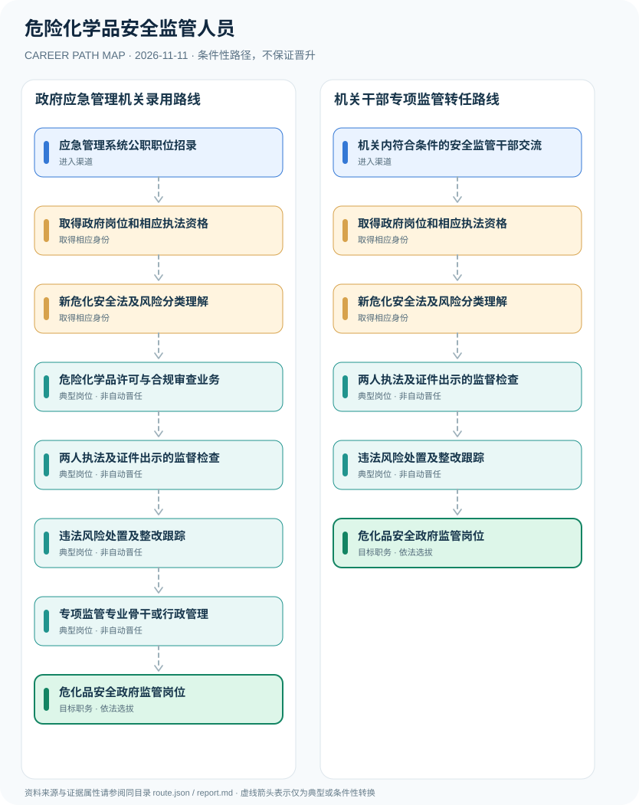

# 危险化学品安全监管人员

> **B15 深度研究 · JR-140**　｜　**地域与机构**：中国大陆应急管理等负有危险化学品安全监督管理职责的政府机关；以2026年法为核心　｜　**核验日期**：2026-11-11

## 01 职业定位与现行制度版本

《中华人民共和国危险化学品安全法》2025年12月27日通过并自2026年5月1日起施行，明确应急管理部门等按职责监管。危险化学品安全监管人员若承担行政监督检查，需要合法机关岗位、执法资格和至少两名执法人员现场检查并出示证件；注册安全工程师或企业EHS经理不是自动取得政府行政执法权的凭证。

**制度更新时间线**：2025年12月全国人大通过新法，2026年5月正式生效。此前《危险化学品安全管理条例》及旧部门规章的适用，需要与新法协调核对。应急管理部2026年涉企检查事项清单已使用新法第七条，说明不能仍以十年前法规摘要替代当前监管职责。

## 02 两类准入及真实制度门槛

- **应急管理系统公职职位招录**：按照国家或地方公务员、行政执法职位公告，通过相应资格审查及录用程序进入政府应急管理岗位。
- **机关内符合条件的安全监管干部交流**：已有合法行政机关身份者按照干部管理与职位要求交流至危化安全监管职责岗位。

- 《危险化学品安全法》自2026年5月1日施行，第七条区分应急管理、公安、生态环境、交通运输等部门职责，第八条对执法检查人数和出示证件作出规定。
- 应急管理部2026年发布涉企行政检查清单，将新危化安全法和安全生产法并列作为危化生产经营监管依据。
- 政府行政执法岗位与企业注册安全工程师、危化企业专职安全生产管理人员制度不同。
- 企业安全责任和监管行政权限独立；不能通过培训证书从企业安全工程师直接取得国家行政检查权。

## 03 典型发展路线及任职决定点

### 路线1：政府应急管理机关录用路线

经公务员或执法职位招录、执法资格核验后从事危化许可和监督检查，积累监管专业经验。

**条件性节点**：应急管理系统公职职位招录 → 取得政府岗位和相应执法资格 → 新危化安全法及风险分类理解 → 危险化学品许可与合规审查业务 → 两人执法及证件出示的监督检查 → 违法风险处置及整改跟踪 → 专项监管专业骨干或行政管理 → 危化品安全政府监管岗位

应在每次考试、身份取得、聘用、晋升或岗位任命时重新审核条件；不能把这条示意路径当作法律规定的必然晋升链条。

### 路线2：机关干部专项监管转任路线

已有机关干部依岗位条件转入危化监管职责，依法取得执法资格后参与执法与风险整改。

**条件性节点**：机关内符合条件的安全监管干部交流 → 取得政府岗位和相应执法资格 → 新危化安全法及风险分类理解 → 两人执法及证件出示的监督检查 → 违法风险处置及整改跟踪 → 危化品安全政府监管岗位

应在每次考试、身份取得、聘用、晋升或岗位任命时重新审核条件；不能把这条示意路径当作法律规定的必然晋升链条。

## 04 工作职责、核心能力与评价方式

核心公共能力为风险识别、行政法和程序规则、许可业务、事故预防政策、跨部门协作和合法检查记录。注册安全工程师证可辅助专业理解，但不能取代行政执法资格。具体是否能任监管处室负责人仍取决于法定干部管理程序。

- **取得政府岗位和相应执法资格**：核验机关法定职责、个人行政执法证和执法授权，不能仅凭企业安全证书入场执法。
- **新危化安全法及风险分类理解**：掌握2026年新法关于生产、储存、经营、使用和运输等部门分工、许可与事故应急的法定框架。
- **危险化学品许可与合规审查业务**：协助依法进行危险化学品安全生产许可、经营许可或建设项目安全条件审查等工作。
- **两人执法及证件出示的监督检查**：依法在权限内进行监督检查，监督检查人员不得少于二人且应出示执法证件；坚持程序记录。
- **违法风险处置及整改跟踪**：按法定程序发现问题、出具检查文书、推进安全隐患整改，涉及处罚须按权限及证据要求。
- **专项监管专业骨干或行政管理**：通过依法行政、风险监管和跨部门协调实践发展，科室领导任用与个人职级另行评估。

## 05 适用边界、时效与容易混淆的身份

- 与2026年新法不符的旧法规条款和部门名称不能继续未经核实地作为现行适用依据。
- 对生产储存、运输、废弃处置等类别不同的监管事项，主管部门不尽相同，不能宣称应急部门独管所有危化业务。
- 岗位研究只讨论法定人员资格、文书及安全程序，不提供可被滥用的危险化学品制造、规避监管或仓储操作指令。

## 06 证据台账与图谱解释

规范性文件、机构职责和招聘公告分别记录在 `route.json` 的 `sources` 中，并由岗位节点使用 `source_ids` 引用。所有边标记为 `conditional`（条件性转换），**不得因来源中存在某项资格就推定本人必获后续岗位**。若需要标注法律明确规定的资格，应在研究说明中具体引用相关条款，而不能把一个推测性职位转换伪装成 `normative`。

| 转换前 | 转换后 | 证据类型 | 约束说明 |
|---|---|---|---|
| 应急管理系统公职职位招录 | 取得政府岗位和相应执法资格 | `conditional` | 从「应急管理系统公职职位招录」到「取得政府岗位和相应执法资格」须独立满足资格、岗位要求及考试或组织安排；示意路线不构成保证晋任。 |
| 取得政府岗位和相应执法资格 | 新危化安全法及风险分类理解 | `conditional` | 从「取得政府岗位和相应执法资格」到「新危化安全法及风险分类理解」须独立满足资格、岗位要求及考试或组织安排；示意路线不构成保证晋任。 |
| 新危化安全法及风险分类理解 | 危险化学品许可与合规审查业务 | `conditional` | 从「新危化安全法及风险分类理解」到「危险化学品许可与合规审查业务」须独立满足资格、岗位要求及考试或组织安排；示意路线不构成保证晋任。 |
| 危险化学品许可与合规审查业务 | 两人执法及证件出示的监督检查 | `conditional` | 从「危险化学品许可与合规审查业务」到「两人执法及证件出示的监督检查」须独立满足资格、岗位要求及考试或组织安排；示意路线不构成保证晋任。 |
| 两人执法及证件出示的监督检查 | 违法风险处置及整改跟踪 | `conditional` | 从「两人执法及证件出示的监督检查」到「违法风险处置及整改跟踪」须独立满足资格、岗位要求及考试或组织安排；示意路线不构成保证晋任。 |
| 违法风险处置及整改跟踪 | 专项监管专业骨干或行政管理 | `conditional` | 从「违法风险处置及整改跟踪」到「专项监管专业骨干或行政管理」须独立满足资格、岗位要求及考试或组织安排；示意路线不构成保证晋任。 |
| 专项监管专业骨干或行政管理 | 危化品安全政府监管岗位 | `conditional` | 从「专项监管专业骨干或行政管理」到「危化品安全政府监管岗位」须独立满足资格、岗位要求及考试或组织安排；示意路线不构成保证晋任。 |
| 机关内符合条件的安全监管干部交流 | 取得政府岗位和相应执法资格 | `conditional` | 从「机关内符合条件的安全监管干部交流」到「取得政府岗位和相应执法资格」须独立满足资格、岗位要求及考试或组织安排；示意路线不构成保证晋任。 |
| 新危化安全法及风险分类理解 | 两人执法及证件出示的监督检查 | `conditional` | 从「新危化安全法及风险分类理解」到「两人执法及证件出示的监督检查」须独立满足资格、岗位要求及考试或组织安排；示意路线不构成保证晋任。 |
| 违法风险处置及整改跟踪 | 危化品安全政府监管岗位 | `conditional` | 从「违法风险处置及整改跟踪」到「危化品安全政府监管岗位」须独立满足资格、岗位要求及考试或组织安排；示意路线不构成保证晋任。 |

## 07 官方与公开资料（可追溯）

1. [中华人民共和国危险化学品安全法（2025年通过，2026年实施）](https://www.samr.gov.cn/zw/zfxxgk/fdzdgknr/bgt/art/2026/art_4e160e51cc134696a183a5f531f097e5.html) — 国家市场监督管理总局（转载全国人大法律）；来源原始日期 2025-12-27。
2. [应急管理部涉企行政检查信息清单（2026年）](https://www.mem.gov.cn/fw/xzzfgs/202608/t20260810_680062.shtml) — 中华人民共和国应急管理部；来源原始日期 2026-08-10。
3. [中华人民共和国公务员法](https://www.stats.gov.cn/gk/tjfg/xgfxfg/202503/t20250310_1958920.html) — 国家统计局；来源原始日期 2018-12-29。

> **复核协议**：跨年度招生公告、法律修订、专业等级与机构设置可能变化。实际申请和转岗前，须核对当前官方原文、所在地文件及单位职位要求，尤其注意来源发布日期与生效日期未必一致。
