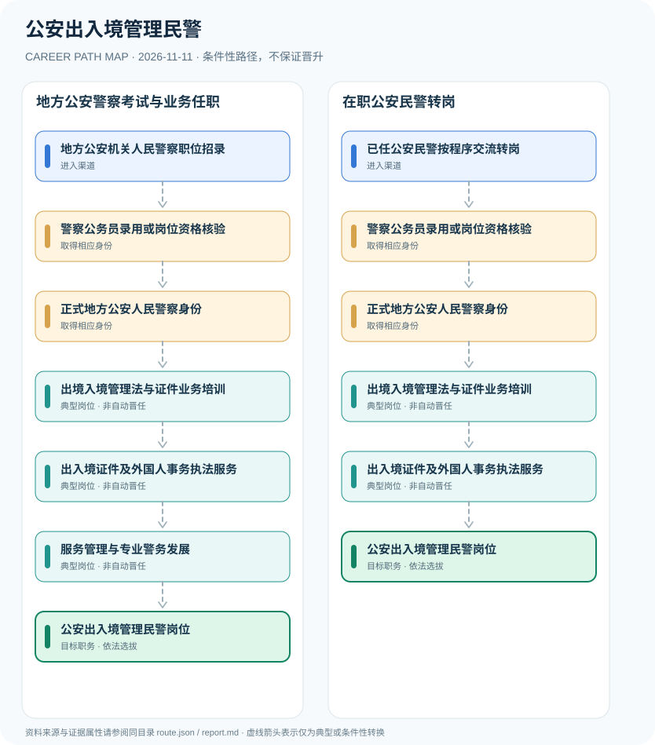

# 公安出入境管理民警

> **B14 深度研究 · JR-135** · **适用范围**：中国大陆地方公安机关出入境管理部门；区别于国家移民管理局垂直管理的口岸边检总站 · **官方资料核验日期**：2026-11-11

## 研究摘要与制度性质

地方公安出入境管理民警依法办理出入境证件与外国人停留居留管理等工作，属于地方公安机关人民警察岗位。国家移民管理局指导地方公安出入境业务，但其垂直管理的出入境边防检查总站属于另一组织系统。

2018年国家移民管理局成立后，机构关系已调整，必须将**全国业务指导**与**地方公安人事隶属**分开。国家移民管理机构2027招录是垂管系统的实例，不能被误写成地方公安机关统一招警公告。

## 一、入职渠道与资格核验

- **地方公安机关人民警察职位招录**：从各省市公安机关公务员职位表中核查出入境管理或相关综合警务职位并参加相应招考。
- **已任公安民警按程序交流转岗**：正式公安民警可在资格、警力岗位和组织安排允许时交流至地方出入境管理业务岗位。

## 二、两种职业发展路线

### 路线 1：地方公安警察考试与业务任职

参加地方公安警察岗位招录、完成人民警察程序，随后通过业务培训从事出入境管理。

**节点序列**：地方公安机关人民警察职位招录 → 警察公务员录用或岗位资格核验 → 正式地方公安人民警察身份 → 出境入境管理法与证件业务培训 → 出入境证件及外国人事务执法服务 → 服务管理与专业警务发展 → 公安出入境管理民警岗位

**任用边界**：本路线是一种合理的条件性发展关系；不因完成上一个岗位或取得某张证书自动获得下一个岗位。

### 路线 2：在职公安民警转岗

已有人民警察身份经组织交流与业务学习进入地方公安出入境岗位。

**节点序列**：已任公安民警按程序交流转岗 → 警察公务员录用或岗位资格核验 → 正式地方公安人民警察身份 → 出境入境管理法与证件业务培训 → 出入境证件及外国人事务执法服务 → 公安出入境管理民警岗位

**任用边界**：本路线是一种合理的条件性发展关系；不因完成上一个岗位或取得某张证书自动获得下一个岗位。

## 三、岗位职责与长期成长

岗位工作侧重法律法规、证件规范、外国人停留居留、窗口服务与行政程序保障。成长为管理岗位需要岗位资格及干部任用，不因接待量或工作年资自动晋升。

- **警察公务员录用或岗位资格核验**：参加适用的公务员录用、体检体测及考察等法定程序，岗位交流亦须符合岗位要求。
- **正式地方公安人民警察身份**：取得公安机关民警身份，与边检总站系统岗位、行政服务外包人员不同。
- **出境入境管理法与证件业务培训**：学习护照、签证、居留、外国人管理等法定程序和行政服务规范。
- **出入境证件及外国人事务执法服务**：依法从事公民证件、外国人停留居留和相关公安管理服务，实际权限依机构分工。
- **服务管理与专业警务发展**：按依法行政、便民服务与业务质量评价成长；领导岗位由组织选拔。

## 四、正式政策、准入门槛及制度区分

- 《中华人民共和国出境入境管理法》第四条明确县级以上地方公安机关及其出入境管理机构负责外国人停留居留管理；口岸出入境边防检查是另一机构职责。
- 国家移民管理局官网说明：其指导各省自治区直辖市公安出入境管理机构业务工作，垂直管理边检总站等机构。
- 地方公安出入境人民警察职位应按所属省市的公务员及人民警察招录规则录用，国家移民管理机构2027年中央机关招录公告并非所有地方公安出入境职位表。

## 五、时效、地区和身份风险

- 不能把公安出入境支队自动视作国家移民管理局垂直管理的出入境边检总站。
- 出入境部门非警务辅助人员、窗口外包服务人员与正式警察身份差异明显。
- 不公开非公开办证审查规则、警务内部系统和敏感执法信息。

## 六、证据台账（图谱边）

每个转换都按 `conditional` 处理。法规和官方说明作为**节点依据**记入 `route.json` 的 `source_ids`；条件性箭头不代表法律保证、实际个人履历或确定晋升路径。任何法规变更均应同时更新数据与解释文本。

| 从 | 至 | 证据性质 | 适用限制 |
|---|---|---|---|
| 地方公安机关人民警察职位招录 | 警察公务员录用或岗位资格核验 | conditional | 从「地方公安机关人民警察职位招录」发展至「警察公务员录用或岗位资格核验」须独立满足职位、资格、考核及组织聘任要求，不能视为自动升级。 |
| 警察公务员录用或岗位资格核验 | 正式地方公安人民警察身份 | conditional | 从「警察公务员录用或岗位资格核验」发展至「正式地方公安人民警察身份」须独立满足职位、资格、考核及组织聘任要求，不能视为自动升级。 |
| 正式地方公安人民警察身份 | 出境入境管理法与证件业务培训 | conditional | 从「正式地方公安人民警察身份」发展至「出境入境管理法与证件业务培训」须独立满足职位、资格、考核及组织聘任要求，不能视为自动升级。 |
| 出境入境管理法与证件业务培训 | 出入境证件及外国人事务执法服务 | conditional | 从「出境入境管理法与证件业务培训」发展至「出入境证件及外国人事务执法服务」须独立满足职位、资格、考核及组织聘任要求，不能视为自动升级。 |
| 出入境证件及外国人事务执法服务 | 服务管理与专业警务发展 | conditional | 从「出入境证件及外国人事务执法服务」发展至「服务管理与专业警务发展」须独立满足职位、资格、考核及组织聘任要求，不能视为自动升级。 |
| 服务管理与专业警务发展 | 公安出入境管理民警岗位 | conditional | 从「服务管理与专业警务发展」发展至「公安出入境管理民警岗位」须独立满足职位、资格、考核及组织聘任要求，不能视为自动升级。 |
| 已任公安民警按程序交流转岗 | 警察公务员录用或岗位资格核验 | conditional | 从「已任公安民警按程序交流转岗」发展至「警察公务员录用或岗位资格核验」须独立满足职位、资格、考核及组织聘任要求，不能视为自动升级。 |
| 出入境证件及外国人事务执法服务 | 公安出入境管理民警岗位 | conditional | 从「出入境证件及外国人事务执法服务」发展至「公安出入境管理民警岗位」须独立满足职位、资格、考核及组织聘任要求，不能视为自动升级。 |

## 七、可核对来源（含发布日期）

1. **中国驻瑞士大使馆（转载现行法律）**：[中华人民共和国出境入境管理法](https://ch.china-embassy.gov.cn/ls_fw_s/flfgmqxy/202608/t20260821_12008304.htm)，原始发布日期 2012-06-30。
2. **国家移民管理局**：[国家移民管理局机构概况](https://www.nia.gov.cn/)，原始发布日期 2018-04-02。
3. **江苏省人力资源和社会保障厅**：[江苏省2027年度考试录用公安机关公务员（人民警察）简章](https://jshrss.jiangsu.gov.cn/art/2026/10/30/art_93733_11852175.html)，原始发布日期 2026-10-30。
4. **北京市公安局公安交通管理局**：[中华人民共和国人民警察法](https://jtgl.beijing.gov.cn/jgj/jgxx/flfg/fl/203770/index.html)，原始发布日期 1995-02-28。

> **复核提醒**：年度岗位招聘及地方制度变化较快，申请前必须重新核验公告原文、适用人群及有效期。本研究仅公开制度与职业路线，不推断个人晋升概率。
