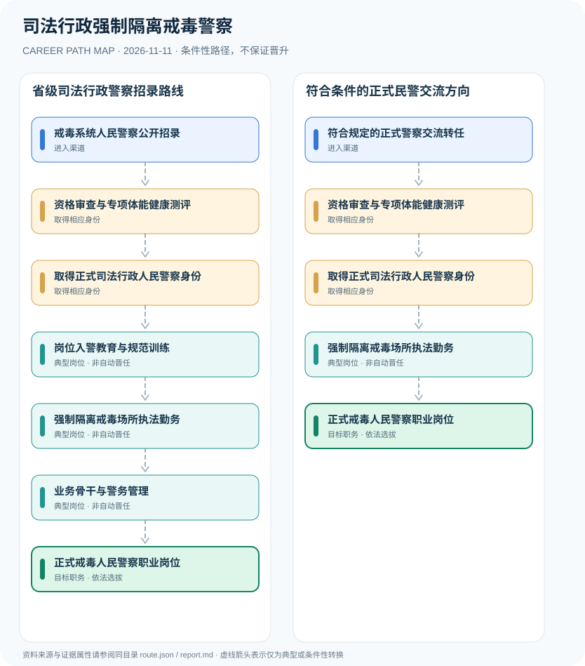

# 司法行政强制隔离戒毒警察

> **研究批次** B12 · JR-142　|　**范围**：中国大陆；以江苏省2027年度司法行政系统公务员招录为地方实例　|　**核验日期**：2026-11-11

## 摘要与职业定位

司法行政强制隔离戒毒人民警察是司法行政系统的正式人民警察职位，按省级公务员录用与人民警察专项条件进入；与法院法警、公安民警、监狱警察、聘用辅警不同。

**考录边界**：2027年江苏公告对司法行政系统人民警察分别设置特定要求，不能使用面向普通综合管理岗位的一般年龄条件来代替警察专岗标准。年龄、专业与体能标准在不同省份和年度均需复核。

## 进入职业的合法渠道

- **戒毒系统人民警察公开招录**：报考省级年度司法行政系统的强制隔离戒毒单位人民警察职位，依当年职位表审查。
- **符合规定的正式警察交流转任**：已是正式人民警察且符合人员管理条件者，可能通过组织交流转任至戒毒系统警察岗位。

## 2 种代表性职业发展路线

### 1. 省级司法行政警察招录路线

经适用省级招录、专项测评与任职程序进入戒毒系统岗位，工作后接受规范培训和业务考核。

**岗位序列（条件性示意）**：戒毒系统人民警察公开招录 → 资格审查与专项体能健康测评 → 取得正式司法行政人民警察身份 → 岗位入警教育与规范训练 → 强制隔离戒毒场所执法勤务 → 业务骨干与警务管理 → 正式戒毒人民警察职业岗位

### 2. 符合条件的正式民警交流方向

已有合法人民警察身份且组织安排允许时，需核对戒毒单位岗位资格再转任。

**岗位序列（条件性示意）**：符合规定的正式警察交流转任 → 资格审查与专项体能健康测评 → 取得正式司法行政人民警察身份 → 强制隔离戒毒场所执法勤务 → 正式戒毒人民警察职业岗位

## 重要职责、技能和岗位发展

**合法履职**：主要理解戒毒场所的规范执法、法定管理程序、在押人员权益保障与教育支持等公共安全职责。具体警员职级和领导职位由相应岗位、年资与干部任用规则决定，不设置必然晋升路径。

- **岗位入警教育与规范训练**：按单位规定接受执法规范、安全管理、戒毒法律服务与管理相关培训。
- **强制隔离戒毒场所执法勤务**：依法在强制隔离戒毒场所履职，保障法定管理、权益和安全，不涉及战术或敏感布防。
- **业务骨干与警务管理**：在岗位考核与组织选拔条件下，可能发展为业务骨干或警务管理岗位。

## 准入门槛与任职规则

- 江苏省2027年度司法行政系统公务员（人民警察）简章要求戒毒系统岗位满足人民警察专项政治、年龄、专业、身心等条件；属于江苏2027年度地方示例。
- 江苏省该轮报名期为2026年11月3日至9日，现已结束；未来报考应按下一轮公告和具体职位表办理。
- 司法行政机关强制隔离戒毒单位的警察与监狱人民警察、法院司法警察机构有所不同；警衔、警员职级和领导职务独立管理。

## 证据状态与实际约束

路线图中的箭头均为 `conditional`：即使前一节点的经历成立，后续任用、考试、职业资格、选拔或招聘仍需独立满足制度要求。`normative` 专指法律直接规定的关系，`official_description` 指官方机构说明，`illustrative` 指仅用于理解的示例；具体证据来源链接见下文。

- 关于强制隔离戒毒法律制度的存续与适用须持续核对最新国家立法和地方规定，不推定所有地区均有同一岗位编制。
- 基层辅助民警或事业编聘用身份不自动变成正式人民警察。
- 不提供安全部署、战术处置、内部警力配置等非公开执法细节。

## 可复核原始资料

1. [江苏省2027年度司法行政系统公务员（人民警察）简章](https://jshrss.jiangsu.gov.cn/art/2026/10/30/art_93733_11852171.html)，江苏省人力资源和社会保障厅，2026-10-30。
2. [中华人民共和国人民警察法](https://jtgl.beijing.gov.cn/jgj/jgxx/flfg/fl/203770/index.html)，北京市公安局公安交通管理局，1995-02-28。
3. [戒毒条例（2018年修订）](https://www.moj.gov.cn/pub/sfbgw/zwxxgk/fdzdgknr/fdzdgknrlzyj/lzyjsfxzxgflfg/202101/t20210119_205852.html)，中国政府网，2018-09-18。

> **复核提醒**：跨地区、跨机构或新招录年度，必须重新核查原始政策、职位计划及生效状态。此报告不推测晋升概率和个人任职结果。
