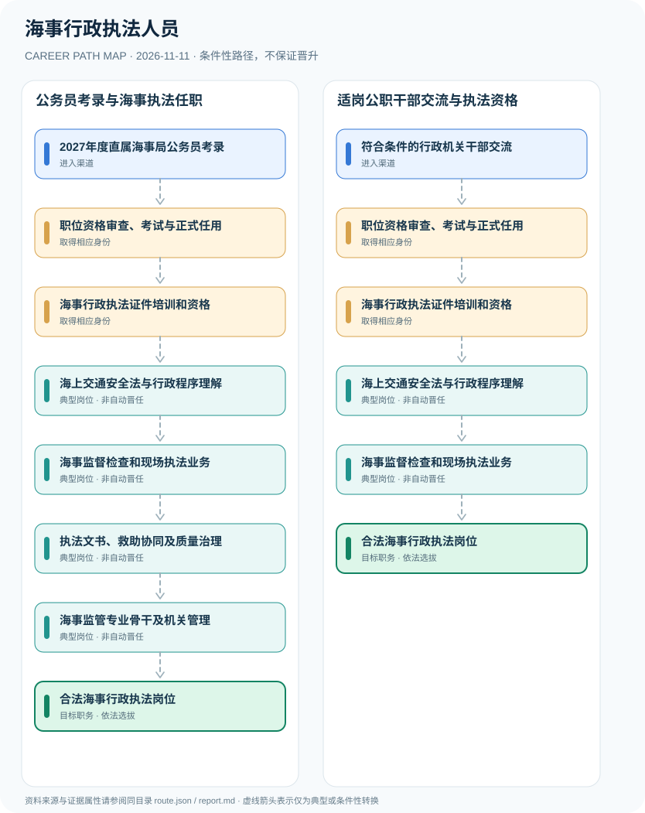

# 海事行政执法人员

> **B16 深度研究 · JR-137** · 机构与地域：中国大陆交通运输部直属海事管理机构；2027年度13家直属海事局招录资格审查为实例 · **核验日期：2026-11-11**

## 一、职业定义与现行制度

海事行政执法人员通常是在依法具备海事监管职责的海事机关中从事水上交通安全、船舶船员管理及相应行政监管的工作人员。2027年度直属海事局公务员招录有专门资格审查说明，依法开展海事执法还要求《海事行政执法证》。这与人民武装警察部队海警机构的海上维权执法是不同执法体系。

**两个法定身份环节**：国考录用使申请人获得特定职位人员身份，但是否可以独立实施海事行政执法还受海事行政执法证资格规则约束。2027年官方文件明确适用的直属海事局范围，故不能把全部地方交通执法岗位视为同一录用系统。海警的组织和法律权限另见《海警法》。

## 二、两类准入与身份确认

- **2027年度直属海事局公务员考录**：报考中央机关及直属机构国考中的海事系统职位，逐岗核查航海、法学、语言或技术专业要求。
- **符合条件的行政机关干部交流**：已有合法行政机关任职身份者如符合组织交流和海事专业要求，可依法调整到海事业务岗位；不保证转岗。

## 三、法规、资质和考试的判断

- 2026年10月14日交通运输部海事局发布2027直属海事系统国考资格审查说明，适用于上海、天津、辽宁等13家直属海事局；部分专业船长、轮机长岗位具有特殊年龄条件。
- 《交通运输行政执法证件管理规定》第二条规定海事执法人员应当持有《海事行政执法证》，第五条要求执行公务出示证件；该2011年规章目前在交通运输部网站发布。
- 《中华人民共和国海上交通安全法》2021年修订后由海事管理机构承担法定海上交通安全监管职责。
- 《海警法》规定海警机构为人民武装警察部队海警部队，海事行政人员不自动具有海警警察身份与执法权限。

## 四、职业发展路径与条件性节点

### 路线1｜公务员考录与海事执法任职

由2027海事国考职位录用、取得海事执法证后依法从事海事监管和专业业务。

**条件性路径**：2027年度直属海事局公务员考录 → 职位资格审查、考试与正式任用 → 海事行政执法证件培训和资格 → 海上交通安全法与行政程序理解 → 海事监督检查和现场执法业务 → 执法文书、救助协同及质量治理 → 海事监管专业骨干及机关管理 → 合法海事行政执法岗位

该路线仅表示可能存在的职业经历；下一阶段均须重新核查资格、机构岗位和考核任职制度，不意味着保证录用或晋升。

### 路线2｜适岗公职干部交流与执法资格

符合人员管理条件的公职干部经海事岗位资格审核，另考核取得执法证后参与监管。

**条件性路径**：符合条件的行政机关干部交流 → 职位资格审查、考试与正式任用 → 海事行政执法证件培训和资格 → 海上交通安全法与行政程序理解 → 海事监督检查和现场执法业务 → 合法海事行政执法岗位

该路线仅表示可能存在的职业经历；下一阶段均须重新核查资格、机构岗位和考核任职制度，不意味着保证录用或晋升。

## 五、工作能力、项目与成果评价

公开能力包括法律文书、海事安全法、海事调查质量、数据分析、职业伦理和跨部门协作。不提供执法战术、海上巡查部署或具体敏感监管方案。

- **职位资格审查、考试与正式任用**：按2027国考与直属海事局要求完成材料核验、笔试面试、体检及考察，航海资历放宽仅适用于特定专业职位。
- **海事行政执法证件培训和资格**：依交通运输部令第1号参加资格培训及考试，依法取得《海事行政执法证》后方可从事海事执法。
- **海上交通安全法与行政程序理解**：学习海上交通安全管理、船舶与船员行政制度、行政执法记录及监管边界。
- **海事监督检查和现场执法业务**：在职责授权内规范检查水上交通安全和船舶活动并出示执法证件，不越权行使海警海上治安刑事职权。
- **执法文书、救助协同及质量治理**：参加依法行政文书审核、水上安全风险提示和事故调查协作，具体权限由海事机构法定职责决定。
- **海事监管专业骨干及机关管理**：在专业培训与岗位考核条件下承担更复杂监管任务；行政领导职务或职级由公职制度独立管理。

## 六、适用地区、生效版本及风险

- 2027年海事系统国考并不保证每一个职位都属于一线执法岗位，机关管理、船员考试和其他技术岗位应逐项核验。
- 民航海事、民用船长证书、海警与海事局职位之间没有自动互换制度。
- 2011年海事证件规章如有此后替代的统一证件标准，仍需核对交通运输部的实时证件管理通知。

## 七、证据与图谱的映射

对每一节点，`route.json` 中的 `source_ids` 指向下文的可核查公开来源；每条转换边均标为 `conditional`，不会冒充有明确法律规定的 `normative` 自动晋升。不同的法定资格、机构选聘、职位级别及劳动关系各自独立。

| 转换前 | 转换后 | 证据属性 | 适用限制 |
|---|---|---|---|
| 2027年度直属海事局公务员考录 | 职位资格审查、考试与正式任用 | `conditional` | 从「2027年度直属海事局公务员考录」至「职位资格审查、考试与正式任用」取决于法定资格、岗位条件或独立选聘考核，绝非自动晋升。 |
| 职位资格审查、考试与正式任用 | 海事行政执法证件培训和资格 | `conditional` | 从「职位资格审查、考试与正式任用」至「海事行政执法证件培训和资格」取决于法定资格、岗位条件或独立选聘考核，绝非自动晋升。 |
| 海事行政执法证件培训和资格 | 海上交通安全法与行政程序理解 | `conditional` | 从「海事行政执法证件培训和资格」至「海上交通安全法与行政程序理解」取决于法定资格、岗位条件或独立选聘考核，绝非自动晋升。 |
| 海上交通安全法与行政程序理解 | 海事监督检查和现场执法业务 | `conditional` | 从「海上交通安全法与行政程序理解」至「海事监督检查和现场执法业务」取决于法定资格、岗位条件或独立选聘考核，绝非自动晋升。 |
| 海事监督检查和现场执法业务 | 执法文书、救助协同及质量治理 | `conditional` | 从「海事监督检查和现场执法业务」至「执法文书、救助协同及质量治理」取决于法定资格、岗位条件或独立选聘考核，绝非自动晋升。 |
| 执法文书、救助协同及质量治理 | 海事监管专业骨干及机关管理 | `conditional` | 从「执法文书、救助协同及质量治理」至「海事监管专业骨干及机关管理」取决于法定资格、岗位条件或独立选聘考核，绝非自动晋升。 |
| 海事监管专业骨干及机关管理 | 合法海事行政执法岗位 | `conditional` | 从「海事监管专业骨干及机关管理」至「合法海事行政执法岗位」取决于法定资格、岗位条件或独立选聘考核，绝非自动晋升。 |
| 符合条件的行政机关干部交流 | 职位资格审查、考试与正式任用 | `conditional` | 从「符合条件的行政机关干部交流」至「职位资格审查、考试与正式任用」取决于法定资格、岗位条件或独立选聘考核，绝非自动晋升。 |
| 海事监督检查和现场执法业务 | 合法海事行政执法岗位 | `conditional` | 从「海事监督检查和现场执法业务」至「合法海事行政执法岗位」取决于法定资格、岗位条件或独立选聘考核，绝非自动晋升。 |

## 八、来源及原始发布日期

1. **交通运输部海事局／上海海事局**：[交通运输部直属海事系统2027年度考录公务员资格审查说明](https://www.sh.msa.gov.cn/ryklu/107800.jhtml)（原文件或规定日期：2026-10-14）。
2. **中华人民共和国交通运输部**：[交通运输行政执法证件管理规定（2011年第1号）](https://xxgk.mot.gov.cn/2020/gz/202112/t20211227_3633455.html)（原文件或规定日期：2011-01-04）。
3. **商务部全球法规网（转载全国人大法律）**：[中华人民共和国海上交通安全法（2021年修订）](https://policy.mofcom.gov.cn/claw/clawContent.shtml?id=88906)（原文件或规定日期：2021-04-29）。
4. **新华网（受权发布全国人大法律）**：[中华人民共和国海警法](https://www.xinhuanet.com/politics/2021-01/23/c_1127015293.htm)（原文件或规定日期：2021-01-22）。

> **研究限制**：法规发布日期和实施日期可能不同；2027招录的专项条件以招聘公告实时版本及具体职位表为准。本研究不作个人晋升概率预测，不公开非公开的军队、警务、医疗或个人数据。
