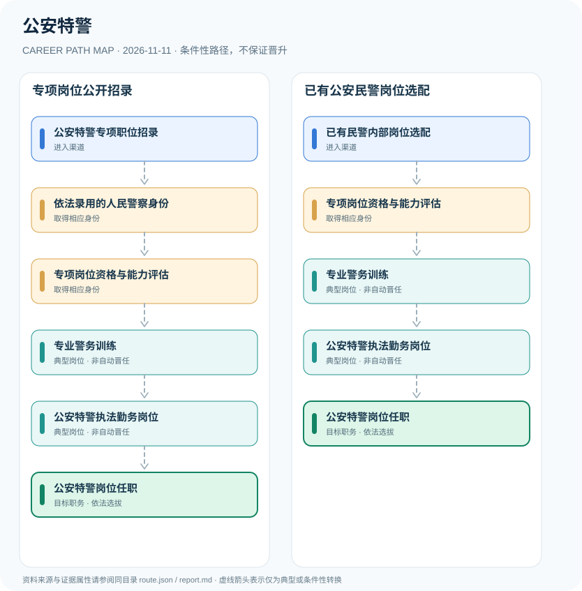

# 公安特警

> **批次**：B11 · JR-133 · **适用范围**：中国大陆·公安机关（北京2027年度招录为地方示例） · **核验日期**：2026-11-11

## 执行摘要

公安特警是公安机关人民警察体系中的专业警务岗位，常见入口是符合专项职位条件的公开招录，也可能经公安民警内部岗位选配，招考方式与体能标准必须看当年当地公告。

特警是公安机关执行相应执法勤务任务的专业岗位类型，而不是独立于人民警察法的另一种民事身份。岗位管理与一般警员职务、警衔等级不能互换。

## 一、准入方式及行政／招聘程序

2027年北京公安招警公告列出公共科目、专业科目以及特警队员体能身体素质标准附件。实际需要查看拟报考职位计划表，不能把某个地区的一项录用安排替代全国各地制度。

- **公安特警专项职位招录**：报考当地当年度公安机关特警等具体职位，满足专业、体能、身体及资格要求。
- **已有民警内部岗位选配**：正式在职人民警察在符合条件时参加警务岗位选配，不能视为社会普通公开录用。

## 二、常见路线与机构决定点

### 1. 专项岗位公开招录

面向符合条件的报考者，通过录用、专项体能资格与警务训练进入特警岗位。

**阶段示意**：公安特警专项职位招录 → 依法录用的人民警察身份 → 专项岗位资格与能力评估 → 专业警务训练 → 公安特警执法勤务岗位 → 公安特警岗位任职

**解释**：上述转换由岗位条件、资格确认、招聘或任用程序控制。即使具有上一阶段经历，也不保证任职下一阶段。

### 2. 已有公安民警岗位选配

现役（在职）正式公安民警经岗位选配与专项训练，可能进入特警职责岗位。

**阶段示意**：已有民警内部岗位选配 → 专项岗位资格与能力评估 → 专业警务训练 → 公安特警执法勤务岗位 → 公安特警岗位任职

**解释**：上述转换由岗位条件、资格确认、招聘或任用程序控制。即使具有上一阶段经历，也不保证任职下一阶段。

## 三、关键职责与专业发展

进入特警岗位后，核心在依法履职、警务训练、团队配合和执法安全。晋升业务骨干或领导职务须另依组织考核、职位需求和管理权限，不存在“入队若干年自动当队长”的固定制度。

- **依法录用的人民警察身份**：参加公务员考试与专业科目、面试、心理测评、体检与考察等环节，依法取得正式警察身份。
- **专项岗位资格与能力评估**：通过公安机关特警岗位的专项体能与身体素质标准等资格审查；具体项目随地区和年度变化。
- **专业警务训练**：依合法岗位管理开展与执法勤务相关的专业训练，持续遵守执法规范和安全纪律。
- **公安特警执法勤务岗位**：在具体岗位职责与公安机关管理制度范围内执行警务工作，不以内部战术或敏感编制为研究对象。

## 四、关键资格、执业条件与区别

- 北京市公安局2027年度公告公布特警队员体能及身体素质标准附件，考录环节包括笔试、面试、心理测试、体能测评、体检与考察，岗位细节以附件职位表为准。
- 公安特警属于人民警察执法岗位，不能把辅警、安保人员等同于正式公安民警。
- 2027年度北京公安招考报名2026年11月12—18日，属于地区年度实例，不构成全国统一报名期限。

## 五、证据分类和路线关系

本图把制度依据和职业经历分开：`normative` 表示有明确法规支持的规则，`official_description` 表示官方公开职责，`illustrative` 代表示意经历，`conditional` 代表资格、招聘、考核或任用控制的转换。本研究**不会把职业图谱中的箭头写成保证晋升**；全图边均显式标为条件性职业转换。职业身份、岗位层级、职称、行政职级和证书不可互换。

| 转换关系 | 证据分类 | 约束说明 |
|:--|:--|:--|
| 公安特警专项职位招录 → 依法录用的人民警察身份 | `conditional` | 从「公安特警专项职位招录」转向「依法录用的人民警察身份」须依本岗资格、机构要求和实际程序审核；不是任何人的自动晋升。 |
| 依法录用的人民警察身份 → 专项岗位资格与能力评估 | `conditional` | 从「依法录用的人民警察身份」转向「专项岗位资格与能力评估」须依本岗资格、机构要求和实际程序审核；不是任何人的自动晋升。 |
| 专项岗位资格与能力评估 → 专业警务训练 | `conditional` | 从「专项岗位资格与能力评估」转向「专业警务训练」须依本岗资格、机构要求和实际程序审核；不是任何人的自动晋升。 |
| 专业警务训练 → 公安特警执法勤务岗位 | `conditional` | 从「专业警务训练」转向「公安特警执法勤务岗位」须依本岗资格、机构要求和实际程序审核；不是任何人的自动晋升。 |
| 公安特警执法勤务岗位 → 公安特警岗位任职 | `conditional` | 从「公安特警执法勤务岗位」转向「公安特警岗位任职」须依本岗资格、机构要求和实际程序审核；不是任何人的自动晋升。 |
| 已有民警内部岗位选配 → 专项岗位资格与能力评估 | `conditional` | 从「已有民警内部岗位选配」转向「专项岗位资格与能力评估」须依本岗资格、机构要求和实际程序审核；不是任何人的自动晋升。 |

## 六、适用边界与更新风险

- 各省市的特警专项测试项目、身高体能和专业特长条件可能不同，必须使用当年职位附件，不得套用通用标准。
- 不提供警务战术、部署、装备配置或敏感内部组织运行资料。
- 警衔晋升和特警岗位安排是不同的管理维度。

## 七、官方和公开核验来源

1. [北京市公安局2027年度面向社会招录人民警察公告](https://gaj.beijing.gov.cn/zhuanti/zlxx/tzgg/202611/t20261109_4938297.html) — 北京市公安局，原文日期 2026-11-09。
2. [北京市公安机关2026年考试录用人民警察公告](https://gaj.beijing.gov.cn/zhuanti/zlxx/tzgg/202609/t20260916_4866082.html) — 北京市公安局，原文日期 2026-09-16。
3. [中华人民共和国人民警察法](https://jtgl.beijing.gov.cn/jgj/jgxx/flfg/fl/203770/index.html) — 北京市公安局公安交通管理局，原文日期 1995-02-28。

> **下一次更新检查**：实际申请时重新查当年岗位计划、地区特殊限制和新规替代情形。个人发展结果不作预测。
