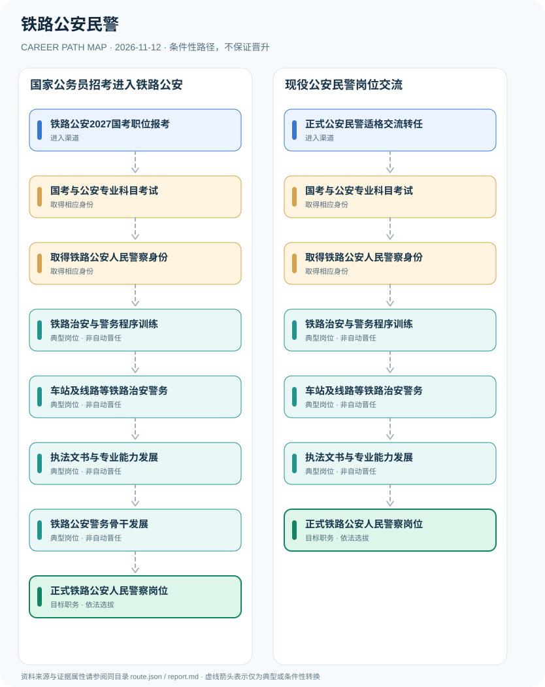

# 铁路公安民警

> **B17 深度调查 · JR-138**　|　**适用地域及机构**：中国大陆铁路公安机关正式人民警察岗位；2027年度中央机关及直属机构考试为例　|　**核验时间**：2026-11-12

## 摘要：岗位身份、适用制度和效力

铁路公安民警属于铁路公安机关人民警察公务员，依法承担辖区铁路站车与线路相关警务职责。2027年中央机关国考对公安机关人民警察职位另有专业科目考试，铁路公安职位的专业、学历、体测及工作地点还须查真实招考职位表。不能把铁路企业安保、车站安检、铁路辅警和正式人民警察混为一体。

**身份验证**：官方2027国考公告清晰列出公安专业考试要求；铁路公安机关职位可见于该年度国考职位表，但不同地区铁路公安局有不同部门代码及基层所队实际岗位。仅用官方全国招考规则说明共通环节，不从第三方职位查询页面直接采信竞争比或预测分数。

## 进入行业的合法渠道

- **铁路公安2027国考职位报考**：依中央机关及直属机构2027年度招考简章，核查铁路公安局具体基层所队职位要求并在公告期内报名。
- **正式公安民警适格交流转任**：具有合法人民警察身份者，在职位空缺和干部管理政策允许下经组织程序交流到铁路公安岗位。

## 两条可比较的职业发展路径

### 路径 1：国家公务员招考进入铁路公安

从2027铁路公安职位报名，通过国考和公安专业考核，依法录用并在铁路警务岗位积累经验。

**条件性节点序列**：铁路公安2027国考职位报考 → 国考与公安专业科目考试 → 取得铁路公安人民警察身份 → 铁路治安与警务程序训练 → 车站及线路等铁路治安警务 → 执法文书与专业能力发展 → 铁路公安警务骨干发展 → 正式铁路公安人民警察岗位

路径只说明一种可解释的可能经历，后续岗位须满足新的资质、招聘、考核或任用要求。

### 路径 2：现役公安民警岗位交流

正式人民警察依法经适用干部交流程序进入铁路公安，按岗位安排接受专项培训依法履职。

**条件性节点序列**：正式公安民警适格交流转任 → 国考与公安专业科目考试 → 取得铁路公安人民警察身份 → 铁路治安与警务程序训练 → 车站及线路等铁路治安警务 → 执法文书与专业能力发展 → 正式铁路公安人民警察岗位

路径只说明一种可解释的可能经历，后续岗位须满足新的资质、招聘、考核或任用要求。

## 关键技能、项目实践与考核

合规能力包括法律法规、旅客沟通、执法程序、证据记录及突发情况协同。由普通民警发展为带班骨干或所队负责人必须经组织考核及岗位任用，不能从警龄推导。

- **铁路治安与警务程序训练**：学习《人民警察法》与警务程序、铁路交通场景治安管理及旅客权益保护，按岗位授权执勤。
- **车站及线路等铁路治安警务**：在实际派驻与授权区域依法处理治安事件、开展秩序维护及警务服务，不推断非公开布防和装备。
- **执法文书与专业能力发展**：从规范记录、法律文书和群众沟通等方面提高合规能力，领导职务与警衔分别管理。
- **铁路公安警务骨干发展**：在组织考察、岗位条件与实践基础上可能担任专业骨干，职级警衔和领导职位不可自动换算。

## 法定资格、制度区别与核查条目

- 中央机关及其直属机构2027年度国考公告将公安机关人民警察职位列为需要加试专业科目并明确笔试日程和报考条件。
- 2027年度国考报考指南规定公安机关人民警察职位笔试成绩按照行测40%、申论30%、公安专业科目30%合成；仅适用于2027国考公安岗位。
- 铁路公安职位应核对国考招考简章及公安部补充公告；民间职位查询页面仅作为线索，不作为人员身份和精确门槛的最终依据。
- 人民警察正式身份、辅警、铁路车站安保员工为不同法律制度，铁路公安警衔及行政职级不是同一评价体系。

## 风险与地区、年度限制

- 2027年国家公务员普通网上报名期已于2026年10月24日结束，不能引导用户继续通过该报名窗口申请。
- 铁路公安局与地方普通派出所的管辖职责、岗位地点及管理关系可能不同，招录要求以当年职位表为准。
- 具体警务部署、内部安保措施和敏感侦查工作不纳入职业研究。

## 来源映射及路径证据

`route.json` 记录规范性文件、政策或招聘公告的原文 URL 和发布机构；节点引用 `source_ids`，每条岗位转换保守标为 `conditional`，而非保证升迁的 `normative` 法律权利。涉及真实法定准入的说明见上述条款，避免将机构权责套用到员工个人。

| 前一节点 | 后一节点 | 边属性 | 适用条件 |
|---|---|---|---|
| 铁路公安2027国考职位报考 | 国考与公安专业科目考试 | `conditional` | 「铁路公安2027国考职位报考」到「国考与公安专业科目考试」需要独立满足适用职位、资格、权限与机构安排，非自动晋升。 |
| 国考与公安专业科目考试 | 取得铁路公安人民警察身份 | `conditional` | 「国考与公安专业科目考试」到「取得铁路公安人民警察身份」需要独立满足适用职位、资格、权限与机构安排，非自动晋升。 |
| 取得铁路公安人民警察身份 | 铁路治安与警务程序训练 | `conditional` | 「取得铁路公安人民警察身份」到「铁路治安与警务程序训练」需要独立满足适用职位、资格、权限与机构安排，非自动晋升。 |
| 铁路治安与警务程序训练 | 车站及线路等铁路治安警务 | `conditional` | 「铁路治安与警务程序训练」到「车站及线路等铁路治安警务」需要独立满足适用职位、资格、权限与机构安排，非自动晋升。 |
| 车站及线路等铁路治安警务 | 执法文书与专业能力发展 | `conditional` | 「车站及线路等铁路治安警务」到「执法文书与专业能力发展」需要独立满足适用职位、资格、权限与机构安排，非自动晋升。 |
| 执法文书与专业能力发展 | 铁路公安警务骨干发展 | `conditional` | 「执法文书与专业能力发展」到「铁路公安警务骨干发展」需要独立满足适用职位、资格、权限与机构安排，非自动晋升。 |
| 铁路公安警务骨干发展 | 正式铁路公安人民警察岗位 | `conditional` | 「铁路公安警务骨干发展」到「正式铁路公安人民警察岗位」需要独立满足适用职位、资格、权限与机构安排，非自动晋升。 |
| 正式公安民警适格交流转任 | 国考与公安专业科目考试 | `conditional` | 「正式公安民警适格交流转任」到「国考与公安专业科目考试」需要独立满足适用职位、资格、权限与机构安排，非自动晋升。 |
| 执法文书与专业能力发展 | 正式铁路公安人民警察岗位 | `conditional` | 「执法文书与专业能力发展」到「正式铁路公安人民警察岗位」需要独立满足适用职位、资格、权限与机构安排，非自动晋升。 |

## 可复核的公开来源

1. **国家税务总局上海市税务局（转载中央机关公告）**：[中央机关及其直属机构2027年度考试录用公务员公告](https://shanghai.chinatax.gov.cn/tax/xxgk/rsxx/202610/t481763.html)（原始制度日期 2026-10-14）
2. **国家税务总局上海市税务局（转载中央报考指南）**：[中央机关及其直属机构2027年度考试录用公务员报考指南](https://shanghai.chinatax.gov.cn/tax/xxgk/rsxx/202610/t481764.html)（原始制度日期 2026-10-14）
3. **北京市公安局公安交通管理局（转载法律）**：[中华人民共和国人民警察法](https://jtgl.beijing.gov.cn/jgj/jgxx/flfg/fl/203770/index.html)（原始制度日期 1995-02-28）
4. **北京大学法宝劳动法律法规库（转载公安部）**：[公安部2027年度公务员招录补充公告（公告信息）](https://labor.pkulaw.com/docbook/chl/5354028.html)（原始制度日期 2026-10-14）

> **研究说明**：来源的发布日期不代表法规施行日期；招聘公告不保证报名窗口仍开放。涉及跨地区或新版本制度时须重新核验。本路线不承诺个人晋升概率。
