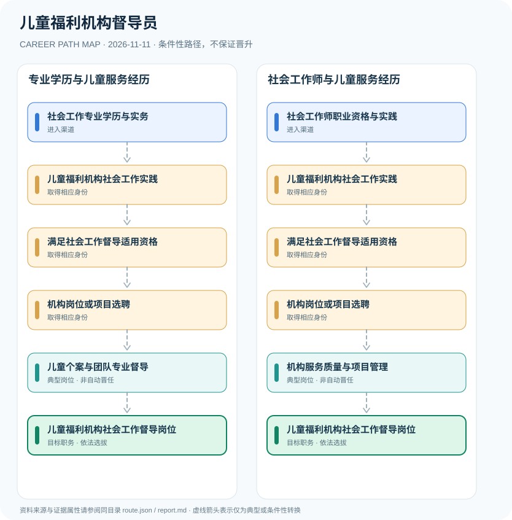

# 儿童福利机构督导员

> **批次**：B11 · JR-197 · **适用范围**：中国大陆·民政部门主管的儿童福利机构社会工作督导 · **核验日期**：2026-11-11

## 执行摘要

儿童福利机构的社会工作督导侧重儿童保护、个案评估、跨专业服务协同和社工专业支持；民政行业推荐性标准对督导者提出多条资格要求，不能误认为国家统一“督导员执业证”许可。

儿童福利机构社会工作督导是专业服务质量和人员指导岗位，核心是对儿童权益、评估与服务流程的专业支持。它与民政机关领导职务、采购项目经理和临床医疗资格互不等同。

## 一、准入方式及行政／招聘程序

2021年民政行业标准MZ/T 167提供督导条件和服务方法，国家标准公共平台标注其为推荐性行业标准；具体机构可在人才招聘或政府购买服务采购中细化资格。2026年儿童福利机构管理办法加强了人员资格与儿童保护要求。

- **社会工作专业学历与实务**：通过社会工作相关专业教育，并按机构标准积累儿童社会工作实践。
- **社会工作师职业资格与实践**：依法取得社会工作者职业资格并积累儿童社会工作经历，按标准核对督导资格。

## 二、常见路线与机构决定点

### 1. 专业学历与儿童服务经历

社会工作学历及实际儿童服务经验构成可能的资格组合，经机构选聘进入专业督导岗位。

**阶段示意**：社会工作专业学历与实务 → 儿童福利机构社会工作实践 → 满足社会工作督导适用资格 → 机构岗位或项目选聘 → 儿童个案与团队专业督导 → 儿童福利机构社会工作督导岗位

**解释**：上述转换由岗位条件、资格确认、招聘或任用程序控制。即使具有上一阶段经历，也不保证任职下一阶段。

### 2. 社会工作师与儿童服务经历

持职业资格并累计相应儿童服务工作经验，在满足项目或机构具体要求后承担督导。

**阶段示意**：社会工作师职业资格与实践 → 儿童福利机构社会工作实践 → 满足社会工作督导适用资格 → 机构岗位或项目选聘 → 机构服务质量与项目管理 → 儿童福利机构社会工作督导岗位

**解释**：上述转换由岗位条件、资格确认、招聘或任用程序控制。即使具有上一阶段经历，也不保证任职下一阶段。

## 三、关键职责与专业发展

督导可负责个案讨论、伦理与风险评估、督导记录和团队培训。实际机构岗位选聘、专业资格要求、项目招采合规属于不同流程，不存在通过单一职业资格考试直接晋升督导的统一规则。

- **儿童福利机构社会工作实践**：从儿童需求评估、家庭支持、个案管理、服务衔接等专业事务中积累儿童服务经验。
- **满足社会工作督导适用资格**：对照MZ/T 167—2021第9.2.2条的学历、职业资格与服务年限等多种要求，逐项审核。
- **机构岗位或项目选聘**：通过机构任职或依法采购服务项目的人员资格审查；项目条件可能比行业标准更具体。
- **儿童个案与团队专业督导**：开展社工实务指导、个案咨询、团队支持、服务质量评估和保密合规管理。
- **机构服务质量与项目管理**：可能承担专业服务质量控制、项目协调与继续教育组织，是否任管理负责人另由机构决定。

## 四、关键资格、执业条件与区别

- MZ/T 167—2021《儿童福利机构社会工作服务规范》第9.2.2条列出社会工作专业本科且儿童社工3年、硕士且2年、社会工作师且5年、高级社会工作师且1年等若干资格替代条件。
- 该MZ/T标准为推荐性行业标准，具体岗位招聘和项目采购可能另有更严格的经验或证书要求，不能当作全国统一的许可制度。
- 2026年修订《儿童福利机构管理办法》强调机构人员配备、专业资格和儿童保护、招聘背景审查等职责。
- 北京市丰台区2026年儿童福利社工服务项目设置了督导须有社会工作师等资格、服务经验及项目经验的示例性条件。

## 五、证据分类和路线关系

本图把制度依据和职业经历分开：`normative` 表示有明确法规支持的规则，`official_description` 表示官方公开职责，`illustrative` 代表示意经历，`conditional` 代表资格、招聘、考核或任用控制的转换。本研究**不会把职业图谱中的箭头写成保证晋升**；全图边均显式标为条件性职业转换。职业身份、岗位层级、职称、行政职级和证书不可互换。

| 转换关系 | 证据分类 | 约束说明 |
|:--|:--|:--|
| 社会工作专业学历与实务 → 儿童福利机构社会工作实践 | `conditional` | 从「社会工作专业学历与实务」转向「儿童福利机构社会工作实践」须依本岗资格、机构要求和实际程序审核；不是任何人的自动晋升。 |
| 儿童福利机构社会工作实践 → 满足社会工作督导适用资格 | `conditional` | 从「儿童福利机构社会工作实践」转向「满足社会工作督导适用资格」须依本岗资格、机构要求和实际程序审核；不是任何人的自动晋升。 |
| 满足社会工作督导适用资格 → 机构岗位或项目选聘 | `conditional` | 从「满足社会工作督导适用资格」转向「机构岗位或项目选聘」须依本岗资格、机构要求和实际程序审核；不是任何人的自动晋升。 |
| 机构岗位或项目选聘 → 儿童个案与团队专业督导 | `conditional` | 从「机构岗位或项目选聘」转向「儿童个案与团队专业督导」须依本岗资格、机构要求和实际程序审核；不是任何人的自动晋升。 |
| 儿童个案与团队专业督导 → 儿童福利机构社会工作督导岗位 | `conditional` | 从「儿童个案与团队专业督导」转向「儿童福利机构社会工作督导岗位」须依本岗资格、机构要求和实际程序审核；不是任何人的自动晋升。 |
| 社会工作师职业资格与实践 → 儿童福利机构社会工作实践 | `conditional` | 从「社会工作师职业资格与实践」转向「儿童福利机构社会工作实践」须依本岗资格、机构要求和实际程序审核；不是任何人的自动晋升。 |
| 机构岗位或项目选聘 → 机构服务质量与项目管理 | `conditional` | 从「机构岗位或项目选聘」转向「机构服务质量与项目管理」须依本岗资格、机构要求和实际程序审核；不是任何人的自动晋升。 |
| 机构服务质量与项目管理 → 儿童福利机构社会工作督导岗位 | `conditional` | 从「机构服务质量与项目管理」转向「儿童福利机构社会工作督导岗位」须依本岗资格、机构要求和实际程序审核；不是任何人的自动晋升。 |

## 六、适用边界与更新风险

- 儿童福利机构专业社工督导不等于机构负责人行政职务，也不等于社会工作者证书持有人自动成为督导。
- 社会工作督导岗位没有据此可推导的全国统一公务员级别或必然晋升年限。
- 从业须保护儿童隐私与权益，遵守2026年儿童福利管理规定，不公开个案身份信息。

## 七、官方和公开核验来源

1. [儿童福利机构社会工作服务规范（MZ/T 167—2021）](https://mzt.gansu.gov.cn/mzt/c107770/202107/1652042/files/69982582683349b1bfd124ea87280267.pdf) — 甘肃省民政厅（民政部行业标准全文），原文日期 2021-03-11。
2. [全国标准信息公共服务平台MZ/T 167—2021标准信息](https://std.samr.gov.cn/hb/search/stdHBDetailed?id=BEA9D53656E9370FE05397BE0A0A92B1) — 国家市场监督管理总局，原文日期 2021-03-11。
3. [儿童福利机构管理办法（2026年修订）](https://policy.mofcom.gov.cn/claw/clawContent.shtml?id=105048) — 商务部法规库（转载民政部规章），原文日期 2026-01-26。
4. [丰台区2026年儿童福利院专业社工服务项目比选公告](https://www.bjft.gov.cn/xxfb/zfgg/202601/t20260105_200861.shtml) — 北京市丰台区人民政府，原文日期 2026-01-05。

> **下一次更新检查**：实际申请时重新查当年岗位计划、地区特殊限制和新规替代情形。个人发展结果不作预测。
