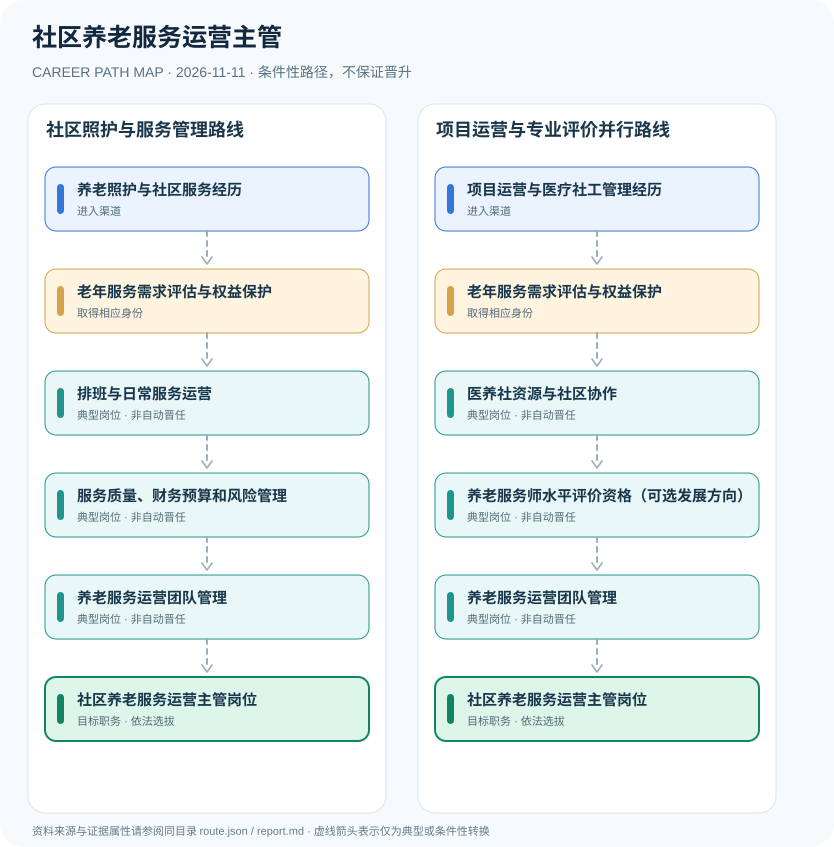

# 社区养老服务运营主管

> **批次 B13 · JR-195** · 研究范围：中国大陆·居家社区养老服务运营与相关机构；2026年养老服务师新职业资格另行区分 · **核验日期 2026-11-11**

## 职业定位与证据边界

社区养老服务运营主管负责日常运营、服务人员安排、质量控制、社区资源协同及风险管理，是机构聘用或项目任命岗位。2026年设置的养老服务师属于水平评价类职业资格，不能推导为担任社区运营主管的统一法定前置资格。

2026年设立的养老服务师制度是重要行业变化，但其**水平评价**定位决定它不等于岗位准入许可，雇主可将资格作为聘任条件之一。社区养老运营岗位属于企业或社会组织内部管理职务，不是民政机关行政领导职位。

## 一、两种主要职业进入方向

- **养老照护与社区服务经历**：通过养老护理、社区服务或老年社会工作积累实际照护与服务协调能力。
- **项目运营与医疗社工管理经历**：从机构项目运营、质量管理或相关医养协作背景转岗进入社区养老运营管理。

## 二、典型发展路线与适用条件

### 1. 社区照护与服务管理路线

从养老照护实践积累需求评估、排班服务和质量治理能力，再经机构聘任负责运营。

**路线图**：养老照护与社区服务经历 → 老年服务需求评估与权益保护 → 排班与日常服务运营 → 服务质量、财务预算和风险管理 → 养老服务运营团队管理 → 社区养老服务运营主管岗位

以上各岗位转换均受任用、选拔、执业资格或招聘控制，不构成保证晋升的链条。

### 2. 项目运营与专业评价并行路线

已有项目运营经验者学习专业需求评估，必要时取得水平评价证书，但独立经过机构岗位选聘。

**路线图**：项目运营与医疗社工管理经历 → 老年服务需求评估与权益保护 → 医养社资源与社区协作 → 养老服务师水平评价资格（可选发展方向） → 养老服务运营团队管理 → 社区养老服务运营主管岗位

以上各岗位转换均受任用、选拔、执业资格或招聘控制，不构成保证晋升的链条。

## 三、岗位职责与专业发展能力

运营需要老人需求评估、排班、上门服务质量、社区协作、志愿者与专业人员管理、数据隐私和财务服务结算。日后向区域运营或机构管理发展依业绩和组织任命。

- **老年服务需求评估与权益保护**：理解老年人能力与需求评估、隐私保护、服务风险及转介资源。
- **排班与日常服务运营**：安排人员、场地、服务时间和照护质量检查，持续保证服务安全与投诉处理。
- **医养社资源与社区协作**：协调家庭、社区组织、医疗和照护资源，在各方授权范围内开展服务。
- **服务质量、财务预算和风险管理**：维护服务台账、应急响应与合规记录，对投诉、不良事件和人员培训进行复盘。
- **养老服务师水平评价资格（可选发展方向）**：符合规定者可按2026年养老服务师职业资格制度参加评价；此资格不等同于机构领导职位。
- **养老服务运营团队管理**：按运营机构授权承担项目绩效、服务质量与团队管理，职位不由职业资格自动任命。

## 四、现行法规、任职资格及关键区别

- 民政部与人社部2026年印发《养老服务师职业资格制度暂行规定》，建立初级、中级、高级三个级别的水平评价职业资格，并非强制所有社区运营主管持证方可上岗。
- 民政部2026年11月发布会确认初中级统一考试制度推进实施，实际考试安排和报名门槛应以官方当期公告为准。
- 《养老机构管理办法》对依法属于养老机构的运营管理、服务保障、安全和监管作出规定；仅提供社区服务而不符合该机构定义者，不能机械套用全部条款。

## 五、法律与数据风险提示

- 养老服务师职业资格（2026新制度）、养老护理员职业技能等级和社区机构运营主管是三种不同维度。
- 并非所有社区养老站点都属于《养老机构管理办法》所称养老机构，必须以运营方式及登记属性确定适用规则。
- 不得通过社区老人个人健康信息进行不当分析或公开敏感服务记录。

## 六、证据分类和引用对应

**职业路径中所有转换为 `conditional`：满足条件时才可能发生。** `normative` 指法律明确规定的权利或义务；`official_description` 指官方发布的岗位事实；`illustrative` 只代表一种合理的示例经历。本报告不混淆行政领导职务、职级、执业资格、技术等级和雇主自行定义的岗位。

| 图中转换 | 证据属性 | 解释 |
|---|---|---|
| 养老照护与社区服务经历 → 老年服务需求评估与权益保护 | conditional | 从「养老照护与社区服务经历」到「老年服务需求评估与权益保护」取决于对应资格、空缺职位或机构选任，不是必然晋升。 |
| 老年服务需求评估与权益保护 → 排班与日常服务运营 | conditional | 从「老年服务需求评估与权益保护」到「排班与日常服务运营」取决于对应资格、空缺职位或机构选任，不是必然晋升。 |
| 排班与日常服务运营 → 服务质量、财务预算和风险管理 | conditional | 从「排班与日常服务运营」到「服务质量、财务预算和风险管理」取决于对应资格、空缺职位或机构选任，不是必然晋升。 |
| 服务质量、财务预算和风险管理 → 养老服务运营团队管理 | conditional | 从「服务质量、财务预算和风险管理」到「养老服务运营团队管理」取决于对应资格、空缺职位或机构选任，不是必然晋升。 |
| 养老服务运营团队管理 → 社区养老服务运营主管岗位 | conditional | 从「养老服务运营团队管理」到「社区养老服务运营主管岗位」取决于对应资格、空缺职位或机构选任，不是必然晋升。 |
| 项目运营与医疗社工管理经历 → 老年服务需求评估与权益保护 | conditional | 从「项目运营与医疗社工管理经历」到「老年服务需求评估与权益保护」取决于对应资格、空缺职位或机构选任，不是必然晋升。 |
| 老年服务需求评估与权益保护 → 医养社资源与社区协作 | conditional | 从「老年服务需求评估与权益保护」到「医养社资源与社区协作」取决于对应资格、空缺职位或机构选任，不是必然晋升。 |
| 医养社资源与社区协作 → 养老服务师水平评价资格（可选发展方向） | conditional | 从「医养社资源与社区协作」到「养老服务师水平评价资格（可选发展方向）」取决于对应资格、空缺职位或机构选任，不是必然晋升。 |
| 养老服务师水平评价资格（可选发展方向） → 养老服务运营团队管理 | conditional | 从「养老服务师水平评价资格（可选发展方向）」到「养老服务运营团队管理」取决于对应资格、空缺职位或机构选任，不是必然晋升。 |

## 七、官方和公开参考资料

1. [养老服务师职业资格制度暂行规定（民发〔2026〕25号）](https://policy.mofcom.gov.cn/claw/clawContent.shtml?id=106190) — 商务部法规库（转载民政部、人社部）（发布日期 2026-06-04）
2. [养老机构管理办法（民政部令第66号）](https://www.ahq.gov.cn/jczwgk/jczwgk_qbj/jczwgk_ylfw/jczwgk_ylfw_ssqk/202410/t20241031_2443177.html) — 陕西安康市汉滨区政府网站（转载）（发布日期 2020-09-01）
3. [养老服务师职业资格制度建设新闻发布会](https://www.mcagovcn.com/n152/n170/c4049/content.html) — 民政部（官方发布会文字实录）（发布日期 2026-11-05）

> 资料只反映所列地域、法规和核验日期的公开信息。报名、岗位计划或法规发生变化时，必须重新核对原文，不能沿用过时条件。
