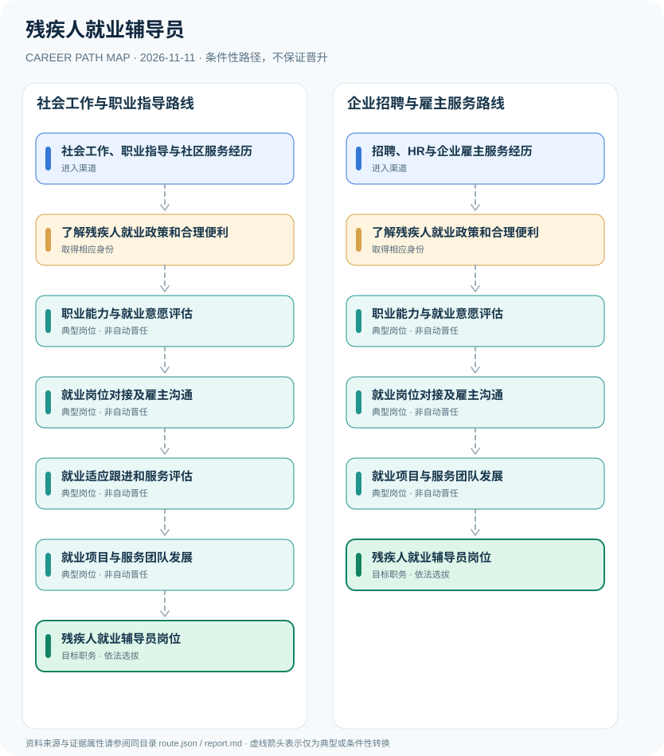

# 残疾人就业辅导员

> **B14 深度研究 · JR-196** · **适用范围**：中国大陆残疾人就业服务机构、残联支持项目与助残社会组织；依2025—2027行动方案 · **官方资料核验日期**：2026-11-11

## 研究摘要与制度性质

残疾人就业辅导员是为残疾人提供求职、就业适应、职业能力评估及雇主协调的服务人员，不是国家统一心理咨询执照或行政公务员身份。国务院2025—2027年行动方案明确支持各地利用社会力量普遍建立残疾人就业辅导员队伍。

2025—2027国务院行动方案明确使用“残疾人就业辅导员”名称，说明其服务方向具有政策基础，但政策并未由此创建全国统一限制性职业许可。职位可能由公共就业机构、公益组织或政府购买服务项目招聘，必须区分人员身份。

## 一、入职渠道与资格核验

- **社会工作、职业指导与社区服务经历**：从社会工作、公共就业服务或残疾人事务实践积累权益保护、沟通和就业服务能力。
- **招聘、HR与企业雇主服务经历**：从企业招聘、劳动力市场服务、员工支持或无障碍服务经验转入就业辅导项目。

## 二、两种职业发展路线

### 路线 1：社会工作与职业指导路线

从社会服务学习平等就业政策、职业能力评估和岗位匹配，逐步提供就业支持服务。

**节点序列**：社会工作、职业指导与社区服务经历 → 了解残疾人就业政策和合理便利 → 职业能力与就业意愿评估 → 就业岗位对接及雇主沟通 → 就业适应跟进和服务评估 → 就业项目与服务团队发展 → 残疾人就业辅导员岗位

**任用边界**：本路线是一种合理的条件性发展关系；不因完成上一个岗位或取得某张证书自动获得下一个岗位。

### 路线 2：企业招聘与雇主服务路线

从人力资源招聘转向无障碍招聘、就业岗位匹配和入职适应支持，参与服务项目管理。

**节点序列**：招聘、HR与企业雇主服务经历 → 了解残疾人就业政策和合理便利 → 职业能力与就业意愿评估 → 就业岗位对接及雇主沟通 → 就业项目与服务团队发展 → 残疾人就业辅导员岗位

**任用边界**：本路线是一种合理的条件性发展关系；不因完成上一个岗位或取得某张证书自动获得下一个岗位。

## 三、岗位职责与长期成长

以需求评估、求职技能训练、岗位匹配、无障碍沟通、雇主培训和稳定就业跟进的实际结果评估服务质量。工作不涉及未经授权的临床诊断；遇复杂情况应向医疗、法律或社工专业机构转介。

- **了解残疾人就业政策和合理便利**：掌握就业平等、合理便利、残疾类别差异及求职者知情选择，避免医疗化或歧视性筛选。
- **职业能力与就业意愿评估**：在授权范围协助建立技能、兴趣、岗位限制和职业发展目标档案，保护个人信息。
- **就业岗位对接及雇主沟通**：协助职业咨询、雇主岗位适配、辅助性就业及合理便利安排，促进双向选择。
- **就业适应跟进和服务评估**：对入职适应、岗位培训和就业稳定性提供持续支持，并在必要时联系专业社会服务。
- **就业项目与服务团队发展**：通过案例督导、项目评估和多机构协同积累管理能力；是否任项目骨干依组织安排。

## 四、正式政策、准入门槛及制度区分

- 国务院办公厅《促进残疾人就业三年行动方案（2025—2027年）》要求支持地方利用社会力量建立残疾人就业辅导员队伍。
- 国家发改委2026年残疾人事业发展规划强调加强就业辅导人员队伍、合理便利、职业能力评估及雇主支持服务。
- 2026年全国残疾人就业服务机构职业指导竞赛面向各类就业服务机构、社会机构与服务骨干，不构成全国统一的辅导员执业许可。

## 五、时效、地区和身份风险

- 残疾人就业辅导员不等同于持有国家统一心理咨询执业许可的临床心理治疗师，也不因工作在残联服务机构自动取得公务员身份。
- 支持性就业与雇主岗位安排需尊重本人意愿和个人信息保护，不能推断所有残疾人存在同一种就业能力。
- 各地政府购买服务、残联机构招聘和公益组织岗位存在不同学历、培训及经验要求，须按实际招标与招聘核查。

## 六、证据台账（图谱边）

每个转换都按 `conditional` 处理。法规和官方说明作为**节点依据**记入 `route.json` 的 `source_ids`；条件性箭头不代表法律保证、实际个人履历或确定晋升路径。任何法规变更均应同时更新数据与解释文本。

| 从 | 至 | 证据性质 | 适用限制 |
|---|---|---|---|
| 社会工作、职业指导与社区服务经历 | 了解残疾人就业政策和合理便利 | conditional | 从「社会工作、职业指导与社区服务经历」发展至「了解残疾人就业政策和合理便利」须独立满足职位、资格、考核及组织聘任要求，不能视为自动升级。 |
| 了解残疾人就业政策和合理便利 | 职业能力与就业意愿评估 | conditional | 从「了解残疾人就业政策和合理便利」发展至「职业能力与就业意愿评估」须独立满足职位、资格、考核及组织聘任要求，不能视为自动升级。 |
| 职业能力与就业意愿评估 | 就业岗位对接及雇主沟通 | conditional | 从「职业能力与就业意愿评估」发展至「就业岗位对接及雇主沟通」须独立满足职位、资格、考核及组织聘任要求，不能视为自动升级。 |
| 就业岗位对接及雇主沟通 | 就业适应跟进和服务评估 | conditional | 从「就业岗位对接及雇主沟通」发展至「就业适应跟进和服务评估」须独立满足职位、资格、考核及组织聘任要求，不能视为自动升级。 |
| 就业适应跟进和服务评估 | 就业项目与服务团队发展 | conditional | 从「就业适应跟进和服务评估」发展至「就业项目与服务团队发展」须独立满足职位、资格、考核及组织聘任要求，不能视为自动升级。 |
| 就业项目与服务团队发展 | 残疾人就业辅导员岗位 | conditional | 从「就业项目与服务团队发展」发展至「残疾人就业辅导员岗位」须独立满足职位、资格、考核及组织聘任要求，不能视为自动升级。 |
| 招聘、HR与企业雇主服务经历 | 了解残疾人就业政策和合理便利 | conditional | 从「招聘、HR与企业雇主服务经历」发展至「了解残疾人就业政策和合理便利」须独立满足职位、资格、考核及组织聘任要求，不能视为自动升级。 |
| 就业岗位对接及雇主沟通 | 就业项目与服务团队发展 | conditional | 从「就业岗位对接及雇主沟通」发展至「就业项目与服务团队发展」须独立满足职位、资格、考核及组织聘任要求，不能视为自动升级。 |

## 七、可核对来源（含发布日期）

1. **生态环境部政府网站（转载中国政府网）**：[国务院办公厅促进残疾人就业三年行动方案（2025—2027年）](https://www.mee.gov.cn/zcwj/gwywj/202507/t20250702_1122560.shtml)，原始发布日期 2025-06-25。
2. **国家发展和改革委员会**：[残疾人保障和发展十五五规划（2026年）](https://www.ndrc.gov.cn/fggz/fzzlgh/gjjzxgh/202609/t20260928_1407872.html)，原始发布日期 2026-09-28。
3. **中国残疾人联合会**：[2026年全国残疾人就业服务机构职业指导竞赛通知](https://www.cdpf.org.cn/xwzx/dfdt1/a82e72ba5ac44354b356a2412370bcbe.htm)，原始发布日期 2026-10-15。

> **复核提醒**：年度岗位招聘及地方制度变化较快，申请前必须重新核验公告原文、适用人群及有效期。本研究仅公开制度与职业路线，不推断个人晋升概率。
