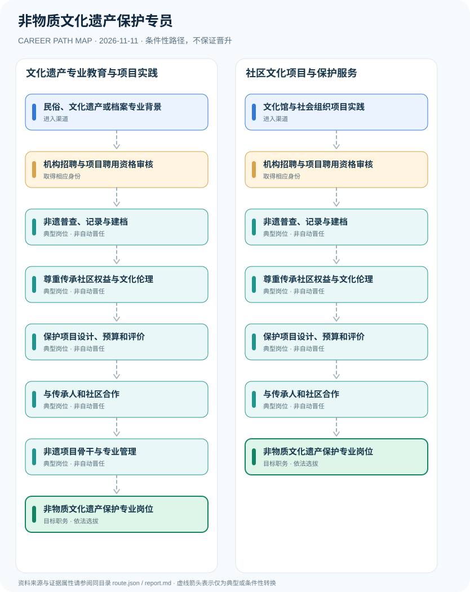

# 非物质文化遗产保护专员

> **B16 深度研究 · JR-200** · 机构与地域：中国大陆文化馆、非遗保护中心、文旅系统及依法开展保护项目的社会组织 · **核验日期：2026-11-11**

## 一、职业定义与现行制度

非物质文化遗产保护专员通常从事非遗资源调查、档案管理、公众教育、传承活动组织和项目绩效评估，聘用身份可能是文旅行政机关、事业单位或项目合同人员，须以具体单位招聘决定。《非物质文化遗产法》赋予非遗调查建档和保护职责，但保护专员岗位不等于国家级代表性传承人；2019年代表性传承人管理办法对其独立认定设有专门程序。

**制度分离的证据**：2011年的《非遗法》规定政府有权组织调查、建立非遗档案，同时允许民间组织依法参与。2019年的国家级传承人办法设立的是具有代表性和持续传承实践的独立认定身份，而非非遗中心员工职务。2021意见支持文化保护人才队伍，但岗位的公务员、事业编或社会聘用身份仍以具体机构招录确定。

## 二、两类准入与身份确认

- **民俗、文化遗产或档案专业背景**：具有人类学、民俗学、艺术史、档案、数字人文及文化保护学习经历者，可应聘非遗保护服务岗位。
- **文化馆与社会组织项目实践**：从社区文化服务、文化活动运营、田野调查协作或文化馆项目经验进入具体保护单位。

## 三、法规、资质和考试的判断

- 《中华人民共和国非物质文化遗产法》（2011年通过、6月1日施行）规定有关部门负责调查、认定、记录、建档和非遗信息数据库；并要求调查征得对象同意、尊重风俗习惯。
- 《国家级非物质文化遗产代表性传承人认定与管理办法》2019年公布、2020年3月1日起施行，规定申报、审核、评审、公示与审定等独立程序。
- 该管理办法第八条明确仅从事非遗资料收集、整理和研究的人员不因此被认定为国家级代表性传承人，工作人员与传承实践者应分别评价。
- 2021年中办国办文件提出强化非遗保护机构队伍建设和专业技术职称评价，但不等于“非遗保护专员”全国统一职业执业许可证。

## 四、职业发展路径与条件性节点

### 路线1｜文化遗产专业教育与项目实践

从非遗研究和档案训练进入保护机构，经调查建档、伦理学习和项目组织成为专业保护人员。

**条件性路径**：民俗、文化遗产或档案专业背景 → 机构招聘与项目聘用资格审核 → 非遗普查、记录与建档 → 尊重传承社区权益与文化伦理 → 保护项目设计、预算和评价 → 与传承人和社区合作 → 非遗项目骨干与专业管理 → 非物质文化遗产保护专业岗位

该路线仅表示可能存在的职业经历；下一阶段均须重新核查资格、机构岗位和考核任职制度，不意味着保证录用或晋升。

### 路线2｜社区文化项目与保护服务

从文化馆或社区实践切入，在合法调查、资料保护和项目组织中积累专业能力。

**条件性路径**：文化馆与社会组织项目实践 → 机构招聘与项目聘用资格审核 → 非遗普查、记录与建档 → 尊重传承社区权益与文化伦理 → 保护项目设计、预算和评价 → 与传承人和社区合作 → 非物质文化遗产保护专业岗位

该路线仅表示可能存在的职业经历；下一阶段均须重新核查资格、机构岗位和考核任职制度，不意味着保证录用或晋升。

## 五、工作能力、项目与成果评价

实践成果可包括高质量田野记录、符合授权的数字档案、社区传承活动反馈、预算规范与文化生态保护效果。项目成果必须尊重传承群体对材料公开范围的实际意愿。

- **机构招聘与项目聘用资格审核**：根据文旅机关、事业单位或社会组织的具体招聘与编制岗位决定身份，不因参与文化项目自动取得公务员身份。
- **非遗普查、记录与建档**：依法开展调查、记录、档案和数据库整理，注意获得调查对象许可并尊重社区文化习惯。
- **尊重传承社区权益与文化伦理**：按照法律保护非遗真实性、整体性与传承性，获取资料时保护传承人肖像和传统知识。
- **保护项目设计、预算和评价**：组织展演、技艺课堂、数字化保存、受众传播和公共经费合规，追踪保护目标。
- **与传承人和社区合作**：与依法认定的代表性传承人、项目保护单位合作，不将工作人员身份混成传承人的认定资格。
- **非遗项目骨干与专业管理**：依据机构岗位考核可能承担区域文化资源保护协调，是否晋升事业编或文旅行政机关职务另审。

## 六、适用地区、生效版本及风险

- 国家级代表性传承人、市级代表性传承人、项目保护单位工作人员及行政文化旅游公务员是不同制度角色。
- 非遗调查不得侵犯传承群体的知情权、文化权利与知识产权；传统技艺与场所信息不应无授权公开。
- 2026年各地传承人认定办法更新属于地区制度，不能直接替代2019国家级代表性传承人管理办法。

## 七、证据与图谱的映射

对每一节点，`route.json` 中的 `source_ids` 指向下文的可核查公开来源；每条转换边均标为 `conditional`，不会冒充有明确法律规定的 `normative` 自动晋升。不同的法定资格、机构选聘、职位级别及劳动关系各自独立。

| 转换前 | 转换后 | 证据属性 | 适用限制 |
|---|---|---|---|
| 民俗、文化遗产或档案专业背景 | 机构招聘与项目聘用资格审核 | `conditional` | 从「民俗、文化遗产或档案专业背景」至「机构招聘与项目聘用资格审核」取决于法定资格、岗位条件或独立选聘考核，绝非自动晋升。 |
| 机构招聘与项目聘用资格审核 | 非遗普查、记录与建档 | `conditional` | 从「机构招聘与项目聘用资格审核」至「非遗普查、记录与建档」取决于法定资格、岗位条件或独立选聘考核，绝非自动晋升。 |
| 非遗普查、记录与建档 | 尊重传承社区权益与文化伦理 | `conditional` | 从「非遗普查、记录与建档」至「尊重传承社区权益与文化伦理」取决于法定资格、岗位条件或独立选聘考核，绝非自动晋升。 |
| 尊重传承社区权益与文化伦理 | 保护项目设计、预算和评价 | `conditional` | 从「尊重传承社区权益与文化伦理」至「保护项目设计、预算和评价」取决于法定资格、岗位条件或独立选聘考核，绝非自动晋升。 |
| 保护项目设计、预算和评价 | 与传承人和社区合作 | `conditional` | 从「保护项目设计、预算和评价」至「与传承人和社区合作」取决于法定资格、岗位条件或独立选聘考核，绝非自动晋升。 |
| 与传承人和社区合作 | 非遗项目骨干与专业管理 | `conditional` | 从「与传承人和社区合作」至「非遗项目骨干与专业管理」取决于法定资格、岗位条件或独立选聘考核，绝非自动晋升。 |
| 非遗项目骨干与专业管理 | 非物质文化遗产保护专业岗位 | `conditional` | 从「非遗项目骨干与专业管理」至「非物质文化遗产保护专业岗位」取决于法定资格、岗位条件或独立选聘考核，绝非自动晋升。 |
| 文化馆与社会组织项目实践 | 机构招聘与项目聘用资格审核 | `conditional` | 从「文化馆与社会组织项目实践」至「机构招聘与项目聘用资格审核」取决于法定资格、岗位条件或独立选聘考核，绝非自动晋升。 |
| 与传承人和社区合作 | 非物质文化遗产保护专业岗位 | `conditional` | 从「与传承人和社区合作」至「非物质文化遗产保护专业岗位」取决于法定资格、岗位条件或独立选聘考核，绝非自动晋升。 |

## 八、来源及原始发布日期

1. **中华人民共和国文化和旅游部**：[中华人民共和国非物质文化遗产法](https://zwgk.mct.gov.cn/zfxxgkml/zcfg/fl/202012/t20201214_919523.html)（原文件或规定日期：2011-02-25）。
2. **中华人民共和国司法部（转载文旅部规章）**：[国家级非物质文化遗产代表性传承人认定与管理办法](https://www.moj.gov.cn/pub/sfbgw/flfggz/flfggzbmgz/202101/t20210105_146419.html)（原文件或规定日期：2019-11-29）。
3. **中华人民共和国文化和旅游部（转载中办国办）**：[关于进一步加强非物质文化遗产保护工作的意见](https://zwgk.mct.gov.cn/zfxxgkml/fwzwhyc/202108/t20210812_927120.html)（原文件或规定日期：2021-08-12）。
4. **烟台市文化和旅游局**：[烟台市2026年非遗代表性传承人认定办法修订公告](https://whlyj.yantai.gov.cn/col/col12421/art/2026/art_159e83d5810f42feacaed11eb4c362b9.html)（原文件或规定日期：2026-10-20）。

> **研究限制**：法规发布日期和实施日期可能不同；2027招录的专项条件以招聘公告实时版本及具体职位表为准。本研究不作个人晋升概率预测，不公开非公开的军队、警务、医疗或个人数据。
