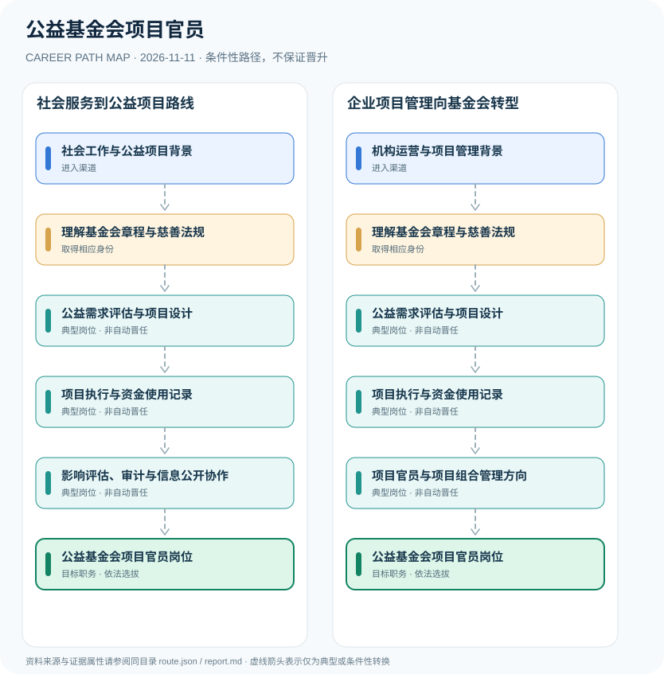

# 公益基金会项目官员

> **研究批次** B12 · JR-198　|　**范围**：中国大陆；依法登记的公益基金会及慈善组织（不同主体适用规则须分别核对）　|　**核验日期**：2026-11-11

## 摘要与职业定位

基金会项目官员是公益机构的项目策划、执行、评估及资助人沟通岗位；基金会法人治理和慈善财产使用受到法律法规约束，但项目官员本身不是国家统一发证的限制性执业资格。

**组织治理与职业身份**：基金会是法人主体，基金会理事会、管理人员、员工分别承担不同职权。项目官员通常负责实际项目设计和进展监控，慈善财产的法定管理责任不能简单赋予某位项目雇员。

## 进入职业的合法渠道

- **社会工作与公益项目背景**：从社会服务、项目评估、公益传播或社工实践积累项目执行与利益相关方沟通能力。
- **机构运营与项目管理背景**：从预算、财务协调、采购、合规或企业社会责任相关项目转入公益项目运营。

## 2 种代表性职业发展路线

### 1. 社会服务到公益项目路线

已有服务经验者熟悉基金会和慈善制度后，参与公益项目设计、执行和评估并进入项目官员岗位。

**岗位序列（条件性示意）**：社会工作与公益项目背景 → 理解基金会章程与慈善法规 → 公益需求评估与项目设计 → 项目执行与资金使用记录 → 影响评估、审计与信息公开协作 → 公益基金会项目官员岗位

### 2. 企业项目管理向基金会转型

从运营、财务及管理背景进入公益机构，补足慈善法规和项目执行知识后发展为项目官员。

**岗位序列（条件性示意）**：机构运营与项目管理背景 → 理解基金会章程与慈善法规 → 公益需求评估与项目设计 → 项目执行与资金使用记录 → 项目官员与项目组合管理方向 → 公益基金会项目官员岗位

## 重要职责、技能和岗位发展

**职业发展**：从项目助理、需求研究、资助评审、项目预算到影响评估及跨机构合作，逐步形成独立项目运营能力。是否成为基金会管理负责人属于另一套治理任用事项，不能由项目数量自动得出。

- **公益需求评估与项目设计**：围绕受助群体和实际问题开展需求评估、项目逻辑模型和实施预算设计。
- **项目执行与资金使用记录**：按照项目协议、捐赠约定和机构管理流程推进执行并保存证据和财务资料。
- **影响评估、审计与信息公开协作**：参与成果评估、项目透明度披露和合规审计，并保护受益人个人信息。
- **项目官员与项目组合管理方向**：依机构职位和业绩可能协调多个项目或项目团队，董事、理事和法定代表人身份另有制度。

## 准入门槛与任职规则

- 《基金会管理条例》规定基金会是依法登记的非营利性法人，财产应按照章程宗旨及捐赠协议用途使用。
- 《中华人民共和国慈善法》（2023年修正，2024年9月5日起施行）规定慈善组织相关活动、慈善财产和信息公开等规则。
- 法规义务针对基金会及慈善组织相应主体，不能推定普通员工自动具有理事、负责人或法定代表人身份。

## 证据状态与实际约束

路线图中的箭头均为 `conditional`：即使前一节点的经历成立，后续任用、考试、职业资格、选拔或招聘仍需独立满足制度要求。`normative` 专指法律直接规定的关系，`official_description` 指官方机构说明，`illustrative` 指仅用于理解的示例；具体证据来源链接见下文。

- 有些慈善组织并非法定基金会，登记类型与募捐资格可能不同；岗位涉及的机构范围须核对。
- 项目官员的学历、项目经验与薪资由具体组织招聘及治理规则决定，不存在全国统一的项目官员执业考试。
- 捐款用途变更、信息公开、受益人隐私与公益资金使用必须遵守机构章程及现行法。

## 可复核原始资料

1. [基金会管理条例（国务院令第400号）](https://www.moe.gov.cn/s78/A01/zclm/moe_968/moe_1040/tnull_10694.html)，中华人民共和国教育部（转载国务院法规），2004-03-08。
2. [中华人民共和国慈善法（2023年修正）](https://policy.mofcom.gov.cn/claw/clawContent.shtml?id=99528)，商务部法规库（转载全国人大法律），2023-12-29。

> **复核提醒**：跨地区、跨机构或新招录年度，必须重新核查原始政策、职位计划及生效状态。此报告不推测晋升概率和个人任职结果。
