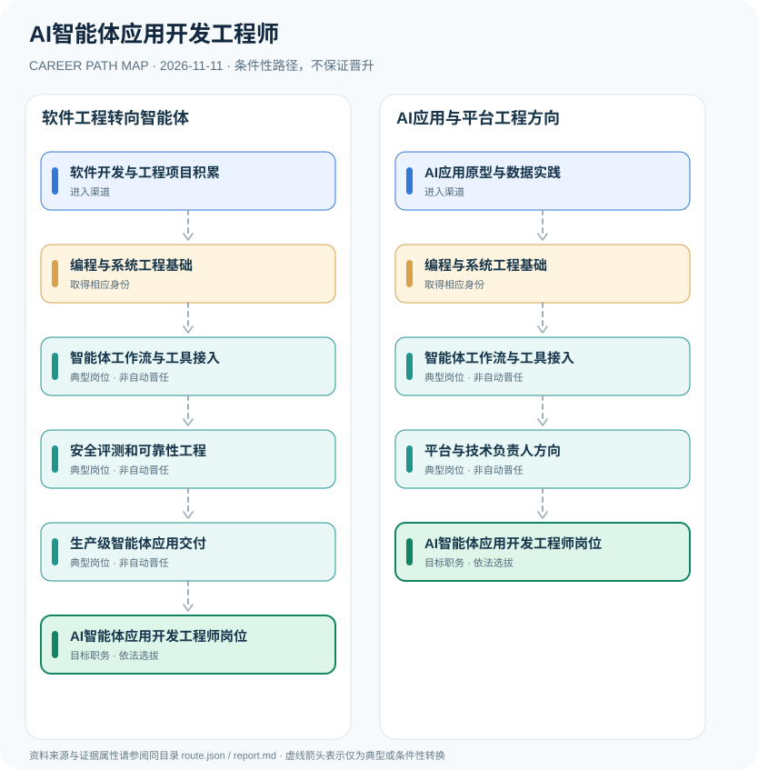

# AI智能体应用开发工程师

> **批次**：B11 · JR-169 · **适用范围**：中国大陆·企业AI应用开发岗位（对照2026年正式公布“智能体开发员”新工种） · **核验日期**：2026-11-11

## 执行摘要

AI智能体应用开发工程师是企业使用的技术岗位名称；2026年9月正式发布的“智能体开发员”属于新工种而非独立的新职业资格许可。职业发展侧重软件工程、模型调用、工具集成与可靠性评测。

该方向属于软件和AI交叉的企业技术岗位。官方“智能体开发员”作为2026年公布的新工种，与本项目展示的市场岗位称呼需区分。对外叙述以人社部门已正式发布的信息为准。

## 一、准入方式及行政／招聘程序

可以从软件工程、数据工程或AI应用实践进入，重点要有真实场景中的工具调用和模型集成经验。企业岗位用工并非凭一张行业培训证书自动上岗，也不能用新工种名称替代原岗位招聘条件。

- **软件开发与工程项目积累**：从软件开发、API、数据库与测试工程等领域切入，积累可部署应用和工程基础。
- **AI应用原型与数据实践**：从模型应用、知识检索或数据工程实践切入，逐渐具备智能体应用交付基础。

## 二、常见路线与机构决定点

### 1. 软件工程转向智能体

已有软件工程基础，通过工具工作流、质量评测和生产实践形成应用开发能力。

**阶段示意**：软件开发与工程项目积累 → 编程与系统工程基础 → 智能体工作流与工具接入 → 安全评测和可靠性工程 → 生产级智能体应用交付 → AI智能体应用开发工程师岗位

**解释**：上述转换由岗位条件、资格确认、招聘或任用程序控制。即使具有上一阶段经历，也不保证任职下一阶段。

### 2. AI应用与平台工程方向

AI应用背景人员积累软件基础和可靠性工程，再从项目能力走向应用开发岗位。

**阶段示意**：AI应用原型与数据实践 → 编程与系统工程基础 → 智能体工作流与工具接入 → 平台与技术负责人方向 → AI智能体应用开发工程师岗位

**解释**：上述转换由岗位条件、资格确认、招聘或任用程序控制。即使具有上一阶段经历，也不保证任职下一阶段。

## 三、关键职责与专业发展

关键能力分层为：基础软件工程、检索和工具调用、权限治理、模型与工具输出验证、线上质量与成本监控。工程师向平台负责人转变需证明系统性成果和跨团队协作，不能只累计模型使用时间。

- **编程与系统工程基础**：理解服务端接口、身份鉴权、数据治理、日志监控和基础软件质量流程。
- **智能体工作流与工具接入**：实现模型调用、检索、工具操作、多步任务编排和异常回退；不应依赖无法验证的演示效果。
- **安全评测和可靠性工程**：实施权限约束、测试集、运行追踪、人工确认、隐私保护和性能成本治理。
- **生产级智能体应用交付**：将智能体集成到真实业务流程，记录质量指标、故障应对及运维边界。
- **平台与技术负责人方向**：可能承担工程架构与团队协作职责，须基于企业真实岗位和项目成果选拔。

## 四、关键资格、执业条件与区别

- 人力资源社会保障部门于2026年9月正式发布“智能体开发员”等新工种；“AI智能体应用开发工程师”作为企业岗位称谓并不等于新设的法定准入职业。
- 新工种的正式发布并不意味着任何个人已经取得相应职业技能等级证书，具体职业标准、培训与评价须依后续制度。
- 工程能力需通过可运行的项目、测试结果、工具权限设计、数据安全与系统可维护性评估。

## 五、证据分类和路线关系

本图把制度依据和职业经历分开：`normative` 表示有明确法规支持的规则，`official_description` 表示官方公开职责，`illustrative` 代表示意经历，`conditional` 代表资格、招聘、考核或任用控制的转换。本研究**不会把职业图谱中的箭头写成保证晋升**；全图边均显式标为条件性职业转换。职业身份、岗位层级、职称、行政职级和证书不可互换。

| 转换关系 | 证据分类 | 约束说明 |
|:--|:--|:--|
| 软件开发与工程项目积累 → 编程与系统工程基础 | `conditional` | 从「软件开发与工程项目积累」转向「编程与系统工程基础」须依本岗资格、机构要求和实际程序审核；不是任何人的自动晋升。 |
| 编程与系统工程基础 → 智能体工作流与工具接入 | `conditional` | 从「编程与系统工程基础」转向「智能体工作流与工具接入」须依本岗资格、机构要求和实际程序审核；不是任何人的自动晋升。 |
| 智能体工作流与工具接入 → 安全评测和可靠性工程 | `conditional` | 从「智能体工作流与工具接入」转向「安全评测和可靠性工程」须依本岗资格、机构要求和实际程序审核；不是任何人的自动晋升。 |
| 安全评测和可靠性工程 → 生产级智能体应用交付 | `conditional` | 从「安全评测和可靠性工程」转向「生产级智能体应用交付」须依本岗资格、机构要求和实际程序审核；不是任何人的自动晋升。 |
| 生产级智能体应用交付 → AI智能体应用开发工程师岗位 | `conditional` | 从「生产级智能体应用交付」转向「AI智能体应用开发工程师岗位」须依本岗资格、机构要求和实际程序审核；不是任何人的自动晋升。 |
| AI应用原型与数据实践 → 编程与系统工程基础 | `conditional` | 从「AI应用原型与数据实践」转向「编程与系统工程基础」须依本岗资格、机构要求和实际程序审核；不是任何人的自动晋升。 |
| 智能体工作流与工具接入 → 平台与技术负责人方向 | `conditional` | 从「智能体工作流与工具接入」转向「平台与技术负责人方向」须依本岗资格、机构要求和实际程序审核；不是任何人的自动晋升。 |
| 平台与技术负责人方向 → AI智能体应用开发工程师岗位 | `conditional` | 从「平台与技术负责人方向」转向「AI智能体应用开发工程师岗位」须依本岗资格、机构要求和实际程序审核；不是任何人的自动晋升。 |

## 六、适用边界与更新风险

- 不能把2026年7月的“拟新增工种公示”当作最新状态：2026年9月9日已正式发布相关新工种。
- 不可宣传统一国家“AI智能体工程师执业资格”或固定年限晋升路线。
- 不同公司会分别使用Agent Engineer、AI应用工程师、平台工程师等岗位名称，职责边界由招聘要求决定。

## 七、官方和公开核验来源

1. [11个新职业、23个新工种正式发布](https://www.shanghai.gov.cn/nw17239/20260910/bef53eee2f334c9293315a5536047385.html) — 上海市人民政府·上海发布，原文日期 2026-09-09。
2. [数字引领绿色赋能服务升级：新职业助力高质量发展](https://chrm.mohrss.gov.cn/%E6%95%B0%E5%AD%97%E5%BC%95%E9%A2%86-%E7%BB%BF%E8%89%B2%E8%B5%8B%E8%83%BD-%E6%9C%8D%E5%8A%A1%E5%8D%87%E7%BA%A7%EF%BC%9A%E6%96%B0%E8%81%8C%E4%B8%9A%E5%8A%A9%E5%8A%9B%E9%AB%98%E8%B4%A8%E9%87%8F%E5%8F%91/) — 中国人力资源市场网（人社部），原文日期 2026-09-11。
3. [聚焦重点群体稳就业——AI与Agent岗位招聘趋势](https://chinajob.mohrss.gov.cn/h5/c/2026-09-08/601403.shtml) — 中国就业网（人社部），原文日期 2026-09-08。

> **下一次更新检查**：实际申请时重新查当年岗位计划、地区特殊限制和新规替代情形。个人发展结果不作预测。
