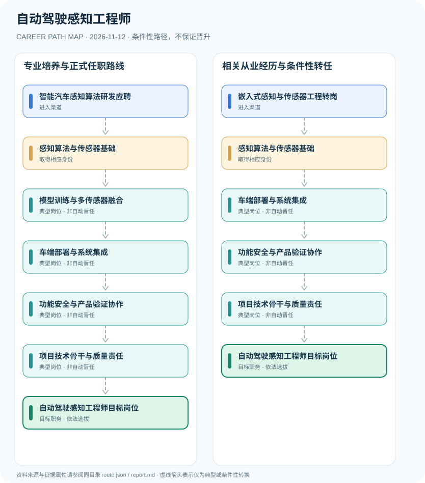

# 自动驾驶感知工程师

> **B18 深度职业研究 · JR-173** · 核验日期：2026-11-12 · 中国大陆自动驾驶与智能汽车工程研发岗位；清华2026研发招聘、工信部2026汽车准入制度

## 01 现行制度与职业身份

自动驾驶感知工程师是企业或科研机构从事相机、雷达、BEV感知、障碍物识别、车道线分析与车端模型部署的研发岗位。清华大学2026年公开招聘给出真实技术职责；工信部2026年新版车辆企业审查要求要到2027年1月1日才施行，GB 44721—2026自动驾驶系统安全强标要到2027年7月1日施行。这些是企业/产品安全要求，不是个人自动驾驶工程师执业许可证或驾驶证。

本批明确区分科研研发岗位与政府产品准入：2026清华原始岗位说明是能力证据，工信部准入审查及GB 44721是企业/产品合规义务，其生效期分别在2027年1月和7月。将公司要求误写为工程师的国家个人证照是不准确的。

## 02 两种进入渠道

- **智能汽车感知算法研发应聘**：从计算机视觉、机器学习、车辆工程等研究和实践背景参与2026清华相关工程岗位招聘。
- **嵌入式感知与传感器工程转岗**：已有摄像头、雷达、嵌入式C++和车载系统经验者补足模型与数据质量，按企业岗位需求转向感知系统。

## 03 职业路线与决定性环节

### 路径 1：专业培养与正式任职路线

从计算机视觉、机器学习、车辆工程等研究和实践背景参与2026清华相关工程岗位招聘。

**条件性链条**：智能汽车感知算法研发应聘 → 感知算法与传感器基础 → 模型训练与多传感器融合 → 车端部署与系统集成 → 功能安全与产品验证协作 → 项目技术骨干与质量责任 → 自动驾驶感知工程师目标岗位

各节点转换均需单独满足资格、岗位空缺、考核及组织任命要求。

### 路径 2：相关从业经历与条件性转任

已有摄像头、雷达、嵌入式C++和车载系统经验者补足模型与数据质量，按企业岗位需求转向感知系统。

**条件性链条**：嵌入式感知与传感器工程转岗 → 感知算法与传感器基础 → 车端部署与系统集成 → 功能安全与产品验证协作 → 项目技术骨干与质量责任 → 自动驾驶感知工程师目标岗位

各节点转换均需单独满足资格、岗位空缺、考核及组织任命要求。

## 04 职业任务及专业能力

可量化成果包括BEV场景准确性、数据分布与误差分析、端侧推理时延、系统集成测试覆盖、质量复盘和安全性评估。

- **感知算法与传感器基础**：掌握图像识别、BEV空间表示、摄像头/雷达数据校准与数据质量。
- **模型训练与多传感器融合**：研究目标检测、车道线与道路参与者识别，独立验证模型偏差及场景覆盖性。
- **车端部署与系统集成**：将感知推理部署到合适车载计算平台并监测性能、实时性及稳定性。
- **功能安全与产品验证协作**：按当时已施行要求完成工程测试；2027才施行的新版企业准入与强标属于即将实施要求。
- **项目技术骨干与质量责任**：统筹模型、车辆验证、数据安全和研发协作，法定车辆产品准入由相应生产企业承担。

## 05 法规、规范和真实岗位证据

- 清华大学2026年3月感知算法工程师招聘包括BEV研发、传感器、ROS、Orin与C++部署等具体技能，但学历门槛仅为该岗位例子。
- 工信部2026修订车辆生产企业与产品准入审查要求自2027年1月1日实施，不是2026年11月的既有生效文本。
- GB 44721—2026《智能网联汽车 自动驾驶系统安全要求》2026年7月30日发布，拟于2027年7月1日实施。
- 工信部2026年车辆产品质量提升行动强调组合驾驶辅助与自动驾驶功能的测试、数据及安全评估。

## 06 适用边界与不确定性

- 2027法规和产品强标的未来生效时间不能被提前改写为现行法律要求。
- 自动驾驶感知模型研发、车辆生产准入、驾驶员驾驶证与道路测试审批独立。
- 涉及车辆控制和道路安全，测试必须在合法授权与安全审查下进行，不提供危险的系统保护绕过程序。

## 07 全路径证据台账

每个节点的 `source_ids` 由 `route.json` 中可核查的法律、部门文件或岗位招聘支持，转换边统一采用 `conditional`，不创造自动晋升。发布日期与施行日期独立核验。

| 前置节点 | 后续节点 | 证据属性 | 适用限制 |
|---|---|---|---|
| 智能汽车感知算法研发应聘 | 感知算法与传感器基础 | `conditional` | 从「智能汽车感知算法研发应聘」到「感知算法与传感器基础」须独立满足招聘、资格、合规及组织任职要求，不能视为自动晋升。 |
| 感知算法与传感器基础 | 模型训练与多传感器融合 | `conditional` | 从「感知算法与传感器基础」到「模型训练与多传感器融合」须独立满足招聘、资格、合规及组织任职要求，不能视为自动晋升。 |
| 模型训练与多传感器融合 | 车端部署与系统集成 | `conditional` | 从「模型训练与多传感器融合」到「车端部署与系统集成」须独立满足招聘、资格、合规及组织任职要求，不能视为自动晋升。 |
| 车端部署与系统集成 | 功能安全与产品验证协作 | `conditional` | 从「车端部署与系统集成」到「功能安全与产品验证协作」须独立满足招聘、资格、合规及组织任职要求，不能视为自动晋升。 |
| 功能安全与产品验证协作 | 项目技术骨干与质量责任 | `conditional` | 从「功能安全与产品验证协作」到「项目技术骨干与质量责任」须独立满足招聘、资格、合规及组织任职要求，不能视为自动晋升。 |
| 项目技术骨干与质量责任 | 自动驾驶感知工程师目标岗位 | `conditional` | 从「项目技术骨干与质量责任」到「自动驾驶感知工程师目标岗位」须独立满足招聘、资格、合规及组织任职要求，不能视为自动晋升。 |
| 嵌入式感知与传感器工程转岗 | 感知算法与传感器基础 | `conditional` | 从「嵌入式感知与传感器工程转岗」到「感知算法与传感器基础」须独立满足招聘、资格、合规及组织任职要求，不能视为自动晋升。 |
| 感知算法与传感器基础 | 车端部署与系统集成 | `conditional` | 从「感知算法与传感器基础」到「车端部署与系统集成」须独立满足招聘、资格、合规及组织任职要求，不能视为自动晋升。 |

## 08 来源原文、发布机构及日期

1. **清华大学智能绿色车辆与交通全国重点实验室**：[清华大学智能绿色车辆与交通全国重点实验室2026年自动驾驶感知算法工程师招聘](https://www.ase.tsinghua.edu.cn/peoples/joinus/2026nianzhinenglusecheliangyujiaotongquanguozhongdianshiyanshiquanzhirenyuangangweizhaopin-zhinengwanglianzidongjiashiganzhisuanfagongchengshi)，文件日期 2026-03-05。
2. **工业和信息化部**：[道路机动车辆生产企业和产品准入审查要求解读（2027生效）](https://www.miit.gov.cn/jgsj/zbys/qcgy/art/2026/art_9b5b1e465c6742f6980a9ad90db3162a.html)，文件日期 2026-01-21。
3. **工业和信息化部江西省通信管理局（转载）**：[GB 44721—2026智能网联汽车自动驾驶系统安全要求发布](https://jxca.miit.gov.cn/xwdt/bwyw/art/2026/art_7d3731bf655b4635b4bdc73ac94362cb.html)，文件日期 2026-08-04。
4. **工业和信息化部**：[工信部等四部门道路机动车辆产品生产一致性和质量提升专项行动通知](https://www.miit.gov.cn/zwgk/zcwj/wjfb/tz/art/2026/art_8d0f546dabb440189c0ceea0bea099fc.html)，文件日期 2026-08-27。

> 不把学历或职称证书等同于行政任职，也不将单位或产品标准说成个人执业许可；具体招聘必须再查当年最新公告。
