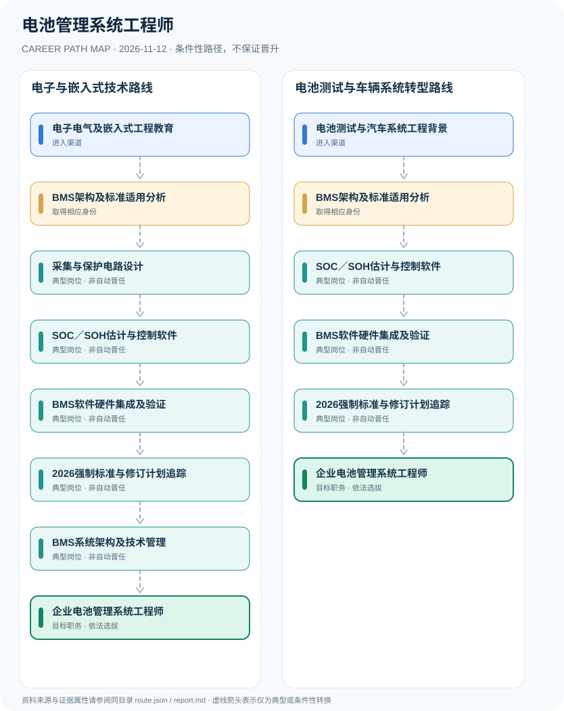

# 电池管理系统工程师

> **B17 深度调查 · JR-179**　|　**适用地域及机构**：中国大陆电动汽车动力电池及相关产品BMS研发企业；电化学储能等其他产品须重新核对标准　|　**核验时间**：2026-11-12

## 摘要：岗位身份、适用制度和效力

电池管理系统（BMS）工程师通常负责电池状态估计、采集电路、功能保护、通信、标定和系统验证，是企业工程研发岗位而非统一个人法定执业许可证。GB/T 38661-2020《电动汽车用电池管理系统技术条件》在2026年仍为现行标准，修订计划正在征求意见；GB 38031-2025动力蓄电池强制安全标准已于2026年7月1日实施，二者的规范对象和强制性不同。

**标准版次核对**：国家标准信息系统将GB/T 38661-2020标为‘现行’，2026年1月28日下达的20260594-T-339修订项目还在征求意见阶段；另一个强标GB 38031-2025已经于2026年7月实施。工信部装备工业发展中心另明确不同车型在新标准执行上的过渡日期，因此不能简单将全部存量车型自7月1日一视同仁。

## 进入行业的合法渠道

- **电子电气及嵌入式工程教育**：从电气工程、电子信息、控制系统或相关软件工程学习进入BMS采集与控制平台。
- **电池测试与汽车系统工程背景**：已有电池性能验证、汽车电子或质量测试经验者可根据企业需求补齐BMS软件和硬件集成能力。

## 两条可比较的职业发展路径

### 路径 1：电子与嵌入式技术路线

从数字采集、嵌入式控制学习BMS架构、软件和验证，并达到企业研发岗位所需能力。

**条件性节点序列**：电子电气及嵌入式工程教育 → BMS架构及标准适用分析 → 采集与保护电路设计 → SOC／SOH估计与控制软件 → BMS软件硬件集成及验证 → 2026强制标准与修订计划追踪 → BMS系统架构及技术管理 → 企业电池管理系统工程师

路径只说明一种可解释的可能经历，后续岗位须满足新的资质、招聘、考核或任用要求。

### 路径 2：电池测试与车辆系统转型路线

从动力电池测试与系统工程出发补齐BMS软件控制和标准验证能力，参与跨团队集成。

**条件性节点序列**：电池测试与汽车系统工程背景 → BMS架构及标准适用分析 → SOC／SOH估计与控制软件 → BMS软件硬件集成及验证 → 2026强制标准与修订计划追踪 → 企业电池管理系统工程师

路径只说明一种可解释的可能经历，后续岗位须满足新的资质、招聘、考核或任用要求。

## 关键技能、项目实践与考核

成果包括需求追踪、硬件设计评审、代码静态分析、SOC估算误差、覆盖性报告、台架数据治理与异常诊断质量。架构师由企业招聘及技术评审决定，不属于某张国家个人执业许可证授予。

- **采集与保护电路设计**：参与模拟采集、控制器硬件及通信接口设计，以安全和可靠性为基础进行工程评审。
- **SOC／SOH估计与控制软件**：设计电池状态估算、故障识别、诊断与控制策略，保留校准和测试记录。
- **BMS软件硬件集成及验证**：在合适授权实验设施完成测试用例、接口联调、缺陷复现和质量追踪，遵守电气安全制度。
- **2026强制标准与修订计划追踪**：按产品类型识别GB 38031-2025现行安全要求及GB/T 38661-2020的现行推荐性要求，未通过的修订计划不应提前生效。
- **BMS系统架构及技术管理**：在企业职务授权下负责跨硬件、软件和验证技术协作，工程职称与项目负责岗位独立。

## 法定资格、制度区别与核查条目

- GB 38031-2025《电动汽车用动力蓄电池安全要求》是强制性国家标准，于2026年7月1日实施、全部代替GB 38031-2020；新申请型式批准的车型从该日起适用，旧有车型存在适用过渡安排。
- GB/T 38661-2020《电动汽车用电池管理系统技术条件》截至2026年11月仍处于现行状态，2026国家标准修订计划尚在征求意见，不能将征求意见稿视为已正式替代。
- GB/T是推荐性国家标准，GB 38031-2025是产品安全强制标准，不应混淆，也不因此给工程师个人新增执照。
- 电动汽车、储能电站、电动两轮车等电池产品适用标准与测试权限有所不同，应以技术领域及当地法律重新核查。

## 风险与地区、年度限制

- 高压电池调试、热失控及破坏性测试存在严重人身安全风险，职业研究不提供测试操作步骤、保护绕过或故障触发程序。
- 产品认证、安全标准与个人工程岗位资格分属不同层级；持有BMS测试经验不能直接获得法定电工操作或工程施工资质。
- BMS功能ASIL、安全等级等需依据特定汽车功能、系统架构和适用标准核实，不可从单一职位名称自动断言。

## 来源映射及路径证据

`route.json` 记录规范性文件、政策或招聘公告的原文 URL 和发布机构；节点引用 `source_ids`，每条岗位转换保守标为 `conditional`，而非保证升迁的 `normative` 法律权利。涉及真实法定准入的说明见上述条款，避免将机构权责套用到员工个人。

| 前一节点 | 后一节点 | 边属性 | 适用条件 |
|---|---|---|---|
| 电子电气及嵌入式工程教育 | BMS架构及标准适用分析 | `conditional` | 「电子电气及嵌入式工程教育」到「BMS架构及标准适用分析」需要独立满足适用职位、资格、权限与机构安排，非自动晋升。 |
| BMS架构及标准适用分析 | 采集与保护电路设计 | `conditional` | 「BMS架构及标准适用分析」到「采集与保护电路设计」需要独立满足适用职位、资格、权限与机构安排，非自动晋升。 |
| 采集与保护电路设计 | SOC／SOH估计与控制软件 | `conditional` | 「采集与保护电路设计」到「SOC／SOH估计与控制软件」需要独立满足适用职位、资格、权限与机构安排，非自动晋升。 |
| SOC／SOH估计与控制软件 | BMS软件硬件集成及验证 | `conditional` | 「SOC／SOH估计与控制软件」到「BMS软件硬件集成及验证」需要独立满足适用职位、资格、权限与机构安排，非自动晋升。 |
| BMS软件硬件集成及验证 | 2026强制标准与修订计划追踪 | `conditional` | 「BMS软件硬件集成及验证」到「2026强制标准与修订计划追踪」需要独立满足适用职位、资格、权限与机构安排，非自动晋升。 |
| 2026强制标准与修订计划追踪 | BMS系统架构及技术管理 | `conditional` | 「2026强制标准与修订计划追踪」到「BMS系统架构及技术管理」需要独立满足适用职位、资格、权限与机构安排，非自动晋升。 |
| BMS系统架构及技术管理 | 企业电池管理系统工程师 | `conditional` | 「BMS系统架构及技术管理」到「企业电池管理系统工程师」需要独立满足适用职位、资格、权限与机构安排，非自动晋升。 |
| 电池测试与汽车系统工程背景 | BMS架构及标准适用分析 | `conditional` | 「电池测试与汽车系统工程背景」到「BMS架构及标准适用分析」需要独立满足适用职位、资格、权限与机构安排，非自动晋升。 |
| BMS架构及标准适用分析 | SOC／SOH估计与控制软件 | `conditional` | 「BMS架构及标准适用分析」到「SOC／SOH估计与控制软件」需要独立满足适用职位、资格、权限与机构安排，非自动晋升。 |
| 2026强制标准与修订计划追踪 | 企业电池管理系统工程师 | `conditional` | 「2026强制标准与修订计划追踪」到「企业电池管理系统工程师」需要独立满足适用职位、资格、权限与机构安排，非自动晋升。 |

## 可复核的公开来源

1. **国家市场监督管理总局国家标准全文公开系统**：[GB 38031-2025 电动汽车用动力蓄电池安全要求（现行）](https://openstd.samr.gov.cn/bzgk/std/newGbInfo?hcno=3AB693FAFF5D9716DF61C61D6FD2187A)（原始制度日期 2025-03-28）
2. **国家市场监督管理总局国家标准全文公开系统**：[GB/T 38661-2020 电动汽车用电池管理系统技术条件（现行）](https://openstd.samr.gov.cn/bzgk/std/newGbInfo?hcno=DB3ACC49AC4A146FAA311BB468ACA290)（原始制度日期 2020-03-31）
3. **全国标准信息公共服务平台**：[电动汽车用电池管理系统技术规范（2026修订计划，尚在征求意见）](https://std.samr.gov.cn/gb/search/gbDetailedCNF?id=49FD1852C7DFC31FE06397BE0A0A1304)（原始制度日期 2026-01-28）
4. **工业和信息化部装备工业发展中心**：[工信部装备工业发展中心关于做好有关标准实施工作的通知](https://www.miit-eidc.org.cn/art/2025/10/27/art_1657_11783.html)（原始制度日期 2025-10-27）

> **研究说明**：来源的发布日期不代表法规施行日期；招聘公告不保证报名窗口仍开放。涉及跨地区或新版本制度时须重新核验。本路线不承诺个人晋升概率。
