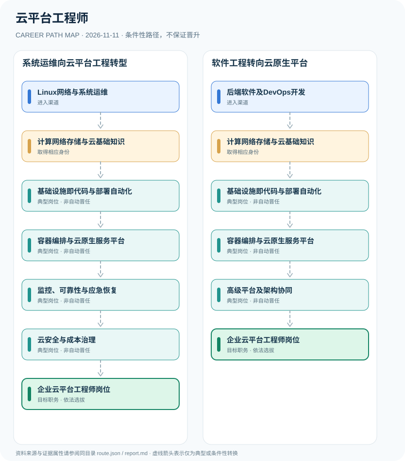

# 云平台工程师

> **B14 深度研究 · JR-167** · **适用范围**：中国大陆企业云平台工程岗位；参考人社部云计算工程技术人员职业技术标准 · **官方资料核验日期**：2026-11-11

## 研究摘要与制度性质

云平台工程师是企业云基础设施与平台软件研发运维岗位，和国家职业分类中的“云计算工程技术人员”有能力交集。职业技术标准规定初中高级能力评价方向，但不代表拥有某云厂商证书就能取得所有企业岗位或国家限制性执照。

官方云计算工程技术人员职业定义提供能力参考，而实际企业岗位职级取决于生产规模与技术栈。云厂商的初级专家认证不能自动换算成人社部门的职业等级或企业管理职务。

## 一、入职渠道与资格核验

- **Linux网络与系统运维**：从服务器、网络、数据库、虚拟化与系统运维岗位积累可靠性和安全管理基础。
- **后端软件及DevOps开发**：从软件工程、持续集成与服务端开发转向基础设施自动化和云原生平台工作。

## 二、两种职业发展路线

### 路线 1：系统运维向云平台工程转型

从系统网络运维基础逐步学习自动化、容器编排、可靠性和云安全形成云平台能力。

**节点序列**：Linux网络与系统运维 → 计算网络存储与云基础知识 → 基础设施即代码与部署自动化 → 容器编排与云原生服务平台 → 监控、可靠性与应急恢复 → 云安全与成本治理 → 企业云平台工程师岗位

**任用边界**：本路线是一种合理的条件性发展关系；不因完成上一个岗位或取得某张证书自动获得下一个岗位。

### 路线 2：软件工程转向云原生平台

由软件工程和DevOps能力进入云计算基础设施开发与架构协同。

**节点序列**：后端软件及DevOps开发 → 计算网络存储与云基础知识 → 基础设施即代码与部署自动化 → 容器编排与云原生服务平台 → 高级平台及架构协同 → 企业云平台工程师岗位

**任用边界**：本路线是一种合理的条件性发展关系；不因完成上一个岗位或取得某张证书自动获得下一个岗位。

## 三、岗位职责与长期成长

可验证成果包括声明式部署、IaC测试、集群升级回滚、SLI/SLO指标、灾备演练、资源成本优化和权限审计。优秀工程师向架构岗位成长需跨团队设计能力与系统可靠性证据。

- **计算网络存储与云基础知识**：掌握虚拟化、云计算IaaS/PaaS、计算存储与基础网络，并建立可复现的环境部署能力。
- **基础设施即代码与部署自动化**：利用自动化脚本、版本控制及配置管理降低环境漂移，建立部署与回滚流程。
- **容器编排与云原生服务平台**：设计容器平台部署、微服务网络、资源隔离和服务生命周期管理。
- **监控、可靠性与应急恢复**：建立服务可用性指标、日志追踪、容量规划和故障复盘，按操作权限处置生产故障。
- **云安全与成本治理**：通过身份权限、密钥管理、审计日志及资源预算治理控制风险。
- **高级平台及架构协同**：在企业岗位授权下设计多云或混合云架构、开发者平台与运维标准。

## 四、正式政策、准入门槛及制度区分

- 人社部2019年发布“云计算工程技术人员”职业编码2-02-10-12，描述云系统构建、部署、运维、云资源管理等职责。
- 2021年云计算工程技术人员国家职业技术技能标准设置初级、中级、高级能力评价，区分云计算运维与开发方向。
- 厂商云认证、职业技术评价和企业云平台工程师岗位三者不能互相替代。

## 五、时效、地区和身份风险

- 技术标准中的培训建议与能力等级不是对所有企业设立的强制入职学历门槛或个人执业许可。
- “云平台工程师”“SRE”“云安全工程师”和“DevOps工程师”在各企业职责范围有重叠但不相同。
- 生产系统操作必须基于正式授权，职业研究不描述越权访问或控制他人云资源的步骤。

## 六、证据台账（图谱边）

每个转换都按 `conditional` 处理。法规和官方说明作为**节点依据**记入 `route.json` 的 `source_ids`；条件性箭头不代表法律保证、实际个人履历或确定晋升路径。任何法规变更均应同时更新数据与解释文本。

| 从 | 至 | 证据性质 | 适用限制 |
|---|---|---|---|
| Linux网络与系统运维 | 计算网络存储与云基础知识 | conditional | 从「Linux网络与系统运维」发展至「计算网络存储与云基础知识」须独立满足职位、资格、考核及组织聘任要求，不能视为自动升级。 |
| 计算网络存储与云基础知识 | 基础设施即代码与部署自动化 | conditional | 从「计算网络存储与云基础知识」发展至「基础设施即代码与部署自动化」须独立满足职位、资格、考核及组织聘任要求，不能视为自动升级。 |
| 基础设施即代码与部署自动化 | 容器编排与云原生服务平台 | conditional | 从「基础设施即代码与部署自动化」发展至「容器编排与云原生服务平台」须独立满足职位、资格、考核及组织聘任要求，不能视为自动升级。 |
| 容器编排与云原生服务平台 | 监控、可靠性与应急恢复 | conditional | 从「容器编排与云原生服务平台」发展至「监控、可靠性与应急恢复」须独立满足职位、资格、考核及组织聘任要求，不能视为自动升级。 |
| 监控、可靠性与应急恢复 | 云安全与成本治理 | conditional | 从「监控、可靠性与应急恢复」发展至「云安全与成本治理」须独立满足职位、资格、考核及组织聘任要求，不能视为自动升级。 |
| 云安全与成本治理 | 企业云平台工程师岗位 | conditional | 从「云安全与成本治理」发展至「企业云平台工程师岗位」须独立满足职位、资格、考核及组织聘任要求，不能视为自动升级。 |
| 后端软件及DevOps开发 | 计算网络存储与云基础知识 | conditional | 从「后端软件及DevOps开发」发展至「计算网络存储与云基础知识」须独立满足职位、资格、考核及组织聘任要求，不能视为自动升级。 |
| 容器编排与云原生服务平台 | 高级平台及架构协同 | conditional | 从「容器编排与云原生服务平台」发展至「高级平台及架构协同」须独立满足职位、资格、考核及组织聘任要求，不能视为自动升级。 |
| 高级平台及架构协同 | 企业云平台工程师岗位 | conditional | 从「高级平台及架构协同」发展至「企业云平台工程师岗位」须独立满足职位、资格、考核及组织聘任要求，不能视为自动升级。 |

## 七、可核对来源（含发布日期）

1. **中华人民共和国人力资源和社会保障部**：[人社部发布云计算工程技术人员等新职业信息](https://www.mohrss.gov.cn/xxgk2020/fdzdgknr/rcrs_4225/jnrc/202112/t20211227_431368.html)，原始发布日期 2019-04-01。
2. **国家专业技术人才知识更新工程·人社部**：[云计算工程技术人员职业技术技能标准目录（2021年版）](https://zsgx.mohrss.gov.cn/zsgx/htmlDocument/category12500/index.html)，原始发布日期 2021-09-29。

> **复核提醒**：年度岗位招聘及地方制度变化较快，申请前必须重新核验公告原文、适用人群及有效期。本研究仅公开制度与职业路线，不推断个人晋升概率。
