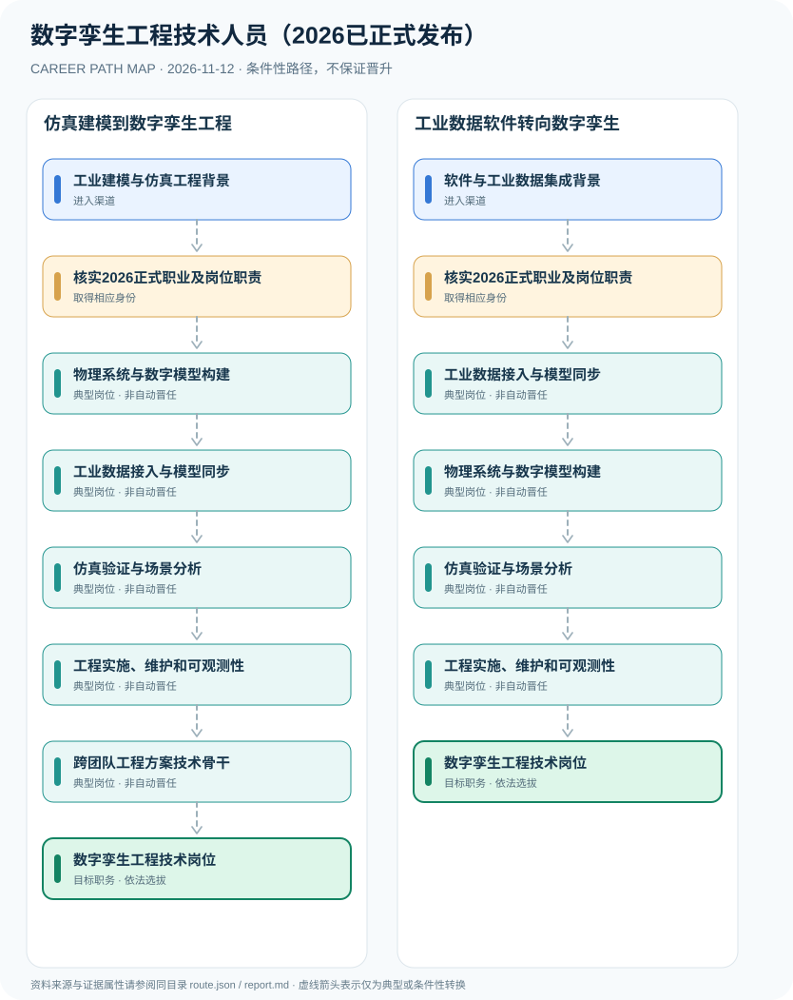

# 数字孪生工程技术人员（2026已正式发布）

> **B17 深度调查 · JR-182**　|　**适用地域及机构**：中国大陆智能制造、工业软件、智慧城市等数字孪生系统研发岗位；2026年9月第八批新职业　|　**核验时间**：2026-11-12

## 摘要：岗位身份、适用制度和效力

数字孪生工程技术人员已于2026年9月9日被人社部等部门正式发布为新职业，原候选清单中‘拟新增’属于2026年7月公示时的历史状态。正式新职业从事数字孪生技术研发、规划设计、工程实施、调试优化和运行维护。它不同于2024年已制定国家职业技能标准的‘数字孪生应用技术员’；不能把应用技术员技能等级直接视为新的工程技术人员岗位职业资格。

**分类状态纠偏**：官方2026年7月公示已结束，上海市政府刊载9月9日第八批职业发布，确定数字孪生工程技术人员为正式职业。人社部2024年曾为数字孪生应用技术员制定技能标准，名称仅一字之差但属于不同职业层次。为保持 B17 backlog 的稳定引用，保留原 slug `digital-twin-engineering-proposed`，但 JSON title 和网页标题纠正为‘已正式发布’，并在审计文件写明迁移原因。

## 进入行业的合法渠道

- **工业建模与仿真工程背景**：从工业控制、CAD/CAE、系统仿真与机械电子项目积累物理系统和数字模型对应关系。
- **软件与工业数据集成背景**：从工业数据平台、传感器、后端服务及三维可视化领域转型，掌握模型与实时系统集成。

## 两条可比较的职业发展路径

### 路径 1：仿真建模到数字孪生工程

通过工业系统建模、数据同步和仿真验证等能力进入数字孪生系统工程岗位。

**条件性节点序列**：工业建模与仿真工程背景 → 核实2026正式职业及岗位职责 → 物理系统与数字模型构建 → 工业数据接入与模型同步 → 仿真验证与场景分析 → 工程实施、维护和可观测性 → 跨团队工程方案技术骨干 → 数字孪生工程技术岗位

路径只说明一种可解释的可能经历，后续岗位须满足新的资质、招聘、考核或任用要求。

### 路径 2：工业数据软件转向数字孪生

由软件系统与数据集成基础学习数字孪生模型与验证，承担工程交付或持续维护。

**条件性节点序列**：软件与工业数据集成背景 → 核实2026正式职业及岗位职责 → 工业数据接入与模型同步 → 物理系统与数字模型构建 → 仿真验证与场景分析 → 工程实施、维护和可观测性 → 数字孪生工程技术岗位

路径只说明一种可解释的可能经历，后续岗位须满足新的资质、招聘、考核或任用要求。

## 关键技能、项目实践与考核

成果可以包括模型校验报告、设备数据同步质量、仿真情景可重复性、生产系统可观测性、协作工程文档与风险评估。负责人职位由企业任命，不以正式职业分类直接授予。

- **物理系统与数字模型构建**：建立与实际工艺或运营系统相联系的模型、参数和数据口径，记录不确定性。
- **工业数据接入与模型同步**：在合法授权下集成设备、传感器及业务系统数据，进行数据质量和权限核验。
- **仿真验证与场景分析**：通过模型校验与仿真运行支持风险预测、设备状态分析和运营方案比较。
- **工程实施、维护和可观测性**：持续监测孪生系统更新质量、延迟、模型漂移和平台可靠性，确保人机决策边界。
- **跨团队工程方案技术骨干**：经雇主技术岗位安排承担复杂系统架构或项目协调，职业正式发布不自动赋予某人专家称号。

## 法定资格、制度区别与核查条目

- 2026年7月人社部公示拟新增12职业，‘数字孪生工程技术人员’为候选；2026年9月9日正式公布的11项新职业名单中含该职位，因此截至本批研究不应再称‘拟新增’。
- 数字孪生应用技术员已有2024年版国家职业技能标准、职业代码4-04-05-10，为不同职业；不得将这一代码或技能等级直接移植给2026工程技术新职业。
- 国家职业正式发布只是分类和人才评价的基础，不意味着所有企业自动产生统一受限制的数字孪生工程师个人执业许可证。
- 企业数据与系统接入应具备合法授权，工业系统仿真结果必须经适用工程和生产安全流程评价。

## 风险与地区、年度限制

- 不要保留2026年7月公示状态作为当前事实；也不要擅自复制‘数字孪生应用技术员’技能证书或编码。
- 不同工业行业对三维模型、物理引擎、工业网络、同步精度和安全性要求差异大，不能凭职业名称统一约束。
- 工业控制与关键基础设施系统应以模拟或合法授权的测试环境验证，不涉及越权连接、控制真实设备。

## 来源映射及路径证据

`route.json` 记录规范性文件、政策或招聘公告的原文 URL 和发布机构；节点引用 `source_ids`，每条岗位转换保守标为 `conditional`，而非保证升迁的 `normative` 法律权利。涉及真实法定准入的说明见上述条款，避免将机构权责套用到员工个人。

| 前一节点 | 后一节点 | 边属性 | 适用条件 |
|---|---|---|---|
| 工业建模与仿真工程背景 | 核实2026正式职业及岗位职责 | `conditional` | 「工业建模与仿真工程背景」到「核实2026正式职业及岗位职责」需要独立满足适用职位、资格、权限与机构安排，非自动晋升。 |
| 核实2026正式职业及岗位职责 | 物理系统与数字模型构建 | `conditional` | 「核实2026正式职业及岗位职责」到「物理系统与数字模型构建」需要独立满足适用职位、资格、权限与机构安排，非自动晋升。 |
| 物理系统与数字模型构建 | 工业数据接入与模型同步 | `conditional` | 「物理系统与数字模型构建」到「工业数据接入与模型同步」需要独立满足适用职位、资格、权限与机构安排，非自动晋升。 |
| 工业数据接入与模型同步 | 仿真验证与场景分析 | `conditional` | 「工业数据接入与模型同步」到「仿真验证与场景分析」需要独立满足适用职位、资格、权限与机构安排，非自动晋升。 |
| 仿真验证与场景分析 | 工程实施、维护和可观测性 | `conditional` | 「仿真验证与场景分析」到「工程实施、维护和可观测性」需要独立满足适用职位、资格、权限与机构安排，非自动晋升。 |
| 工程实施、维护和可观测性 | 跨团队工程方案技术骨干 | `conditional` | 「工程实施、维护和可观测性」到「跨团队工程方案技术骨干」需要独立满足适用职位、资格、权限与机构安排，非自动晋升。 |
| 跨团队工程方案技术骨干 | 数字孪生工程技术岗位 | `conditional` | 「跨团队工程方案技术骨干」到「数字孪生工程技术岗位」需要独立满足适用职位、资格、权限与机构安排，非自动晋升。 |
| 软件与工业数据集成背景 | 核实2026正式职业及岗位职责 | `conditional` | 「软件与工业数据集成背景」到「核实2026正式职业及岗位职责」需要独立满足适用职位、资格、权限与机构安排，非自动晋升。 |
| 核实2026正式职业及岗位职责 | 工业数据接入与模型同步 | `conditional` | 「核实2026正式职业及岗位职责」到「工业数据接入与模型同步」需要独立满足适用职位、资格、权限与机构安排，非自动晋升。 |
| 工业数据接入与模型同步 | 物理系统与数字模型构建 | `conditional` | 「工业数据接入与模型同步」到「物理系统与数字模型构建」需要独立满足适用职位、资格、权限与机构安排，非自动晋升。 |
| 物理系统与数字模型构建 | 仿真验证与场景分析 | `conditional` | 「物理系统与数字模型构建」到「仿真验证与场景分析」需要独立满足适用职位、资格、权限与机构安排，非自动晋升。 |
| 工程实施、维护和可观测性 | 数字孪生工程技术岗位 | `conditional` | 「工程实施、维护和可观测性」到「数字孪生工程技术岗位」需要独立满足适用职位、资格、权限与机构安排，非自动晋升。 |

## 可复核的公开来源

1. **中国就业网（人社部）**：[12个新职业向社会公示（含数字孪生工程技术人员）](https://chinajob.mohrss.gov.cn/h5/c/2026-07-10/569764.shtml)（原始制度日期 2026-07-10）
2. **上海市人民政府（转载上海发布）**：[11个新职业正式发布（含数字孪生工程技术人员）](https://www.shanghai.gov.cn/nw17239/20260910/bef53eee2f334c9293315a5536047385.html)（原始制度日期 2026-09-09）
3. **中华人民共和国人力资源和社会保障部**：[数字孪生应用技术员国家职业标准（2024版，不同职业）](https://www.mohrss.gov.cn/xxgk2020/fdzdgknr/rcrs_4225/jnrc/202402/W020240228316863990674.pdf)（原始制度日期 2024-02-28）

> **研究说明**：来源的发布日期不代表法规施行日期；招聘公告不保证报名窗口仍开放。涉及跨地区或新版本制度时须重新核验。本路线不承诺个人晋升概率。
