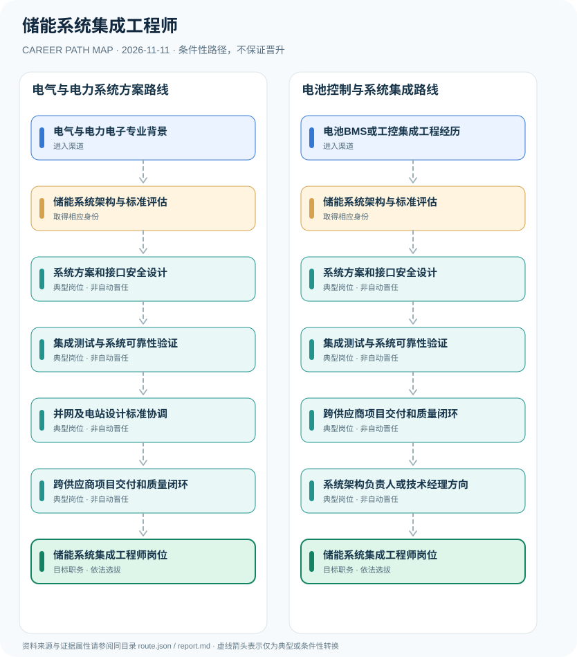

# 储能系统集成工程师

> **B15 深度研究 · JR-180**　｜　**地域与机构**：中国大陆储能系统设备制造与新能源项目集成工程企业；适用电化学储能国家标准　｜　**核验日期**：2026-11-11

## 01 职业定位与现行制度版本

储能系统集成工程师是工程企业按照产品需求设置的系统设计与集成岗位，负责储能电池、电力变换系统PCS、能量管理EMS、保护控制等模块集成验证。GB/T 36558-2023《电力系统电化学储能系统通用技术条件》已于2024年7月实施；2026年发布的若干DL/T标准须区分“已发布”与2026年12月26日“尚未施行”，不能提前写成2026年11月的强制执行依据。

**标准时间轴**：GB/T 36558-2023已实施；全国标准信息平台对2026年6月发布的站用电及监控系统DL/T标准仍标记“即将实施”。这一区别是工程选型和投标合规的核心风险点。职业技能与产品技术标准属于不同领域，不可从系统标准推导统一的个人工程师许可证。

## 02 两类准入及真实制度门槛

- **电气与电力电子专业背景**：从电气工程、控制工程、电力电子和储能相关教育进入，掌握电气安全和电力系统原理。
- **电池BMS或工控集成工程经历**：有电池管理、嵌入式工控、功率变换器、测试验证及系统交付经验者可按雇主需求转向储能系统集成。

- GB/T 36558-2023为现行推荐性国家标准，2023年12月28日发布、2024年7月1日实施，不等于个人职业执业许可证。
- DL/T 5913-2026与DL/T 5912-2026于2026年6月26日发布，但均从2026年12月26日实施；截至本研究日仍属于即将实施标准。
- 2024年国家正式公布的“储能电站运维管理员”为另一职业，与企业内储能系统集成工程师岗位不同。
- 企业岗位职责与工程项目电气安装、持证操作及施工许可等法定活动应分别识别。

## 03 典型发展路线及任职决定点

### 路线1：电气与电力系统方案路线

从电气工程基础切入，形成系统架构、集成测试和交付能力后独立承担储能集成工程岗位。

**条件性节点**：电气与电力电子专业背景 → 储能系统架构与标准评估 → 系统方案和接口安全设计 → 集成测试与系统可靠性验证 → 并网及电站设计标准协调 → 跨供应商项目交付和质量闭环 → 储能系统集成工程师岗位

应在每次考试、身份取得、聘用、晋升或岗位任命时重新审核条件；不能把这条示意路径当作法律规定的必然晋升链条。

### 路线2：电池控制与系统集成路线

已有BMS/嵌入式经验者补全电力系统标准、系统验证和跨供应商协调，向集成工程方向发展。

**条件性节点**：电池BMS或工控集成工程经历 → 储能系统架构与标准评估 → 系统方案和接口安全设计 → 集成测试与系统可靠性验证 → 跨供应商项目交付和质量闭环 → 系统架构负责人或技术经理方向 → 储能系统集成工程师岗位

应在每次考试、身份取得、聘用、晋升或岗位任命时重新审核条件；不能把这条示意路径当作法律规定的必然晋升链条。

## 04 工作职责、核心能力与评价方式

可用于展示工程能力的证据包括风险分析与FMEA、接口控制文档、系统需求追踪、功能与安全测试报告、运行日志及缺陷闭环。进入架构或项目技术负责人岗位仍取决于真实工程经验和企业组织任用。

- **储能系统架构与标准评估**：理解BMS、PCS、EMS、热管理、保护及系统调度关系，核实标准适用范围与当时生效时间。
- **系统方案和接口安全设计**：根据项目功率容量、安全要求、设备接口与运行环境形成设计文档及技术规格。
- **集成测试与系统可靠性验证**：进行硬软件接口检查、环境测试、保护功能联动和测试记录，按安全制度控制调试风险。
- **并网及电站设计标准协调**：核对接网、运行安全、站用电和监控等适用技术标准，与电网单位和监管要求协调。
- **跨供应商项目交付和质量闭环**：统筹系统BOM、可测试性、现场验收资料和故障改进，具体电力安装或操作活动需具备相应授权。
- **系统架构负责人或技术经理方向**：按项目经验与企业聘用承担集成方案和团队技术协调，工程师称谓不等于行政许可或电站操作资格。

## 05 适用边界、时效与容易混淆的身份

- 不得用尚未实施的2026年12月储能行业标准声称现已强制适用于所有系统；并须按储能技术路线和项目规模核查条款适用性。
- 储能系统集成工程师、储能电站运维管理员和电气工程师职业资格体系不完全对应。
- 涉及高压电力、储能电池与消防风险的调试操作必须由具备资质的专业人员依法进行，不提供危险测试或绕开保护装置的操作指令。

## 06 证据台账与图谱解释

规范性文件、机构职责和招聘公告分别记录在 `route.json` 的 `sources` 中，并由岗位节点使用 `source_ids` 引用。所有边标记为 `conditional`（条件性转换），**不得因来源中存在某项资格就推定本人必获后续岗位**。若需要标注法律明确规定的资格，应在研究说明中具体引用相关条款，而不能把一个推测性职位转换伪装成 `normative`。

| 转换前 | 转换后 | 证据类型 | 约束说明 |
|---|---|---|---|
| 电气与电力电子专业背景 | 储能系统架构与标准评估 | `conditional` | 从「电气与电力电子专业背景」到「储能系统架构与标准评估」须独立满足资格、岗位要求及考试或组织安排；示意路线不构成保证晋任。 |
| 储能系统架构与标准评估 | 系统方案和接口安全设计 | `conditional` | 从「储能系统架构与标准评估」到「系统方案和接口安全设计」须独立满足资格、岗位要求及考试或组织安排；示意路线不构成保证晋任。 |
| 系统方案和接口安全设计 | 集成测试与系统可靠性验证 | `conditional` | 从「系统方案和接口安全设计」到「集成测试与系统可靠性验证」须独立满足资格、岗位要求及考试或组织安排；示意路线不构成保证晋任。 |
| 集成测试与系统可靠性验证 | 并网及电站设计标准协调 | `conditional` | 从「集成测试与系统可靠性验证」到「并网及电站设计标准协调」须独立满足资格、岗位要求及考试或组织安排；示意路线不构成保证晋任。 |
| 并网及电站设计标准协调 | 跨供应商项目交付和质量闭环 | `conditional` | 从「并网及电站设计标准协调」到「跨供应商项目交付和质量闭环」须独立满足资格、岗位要求及考试或组织安排；示意路线不构成保证晋任。 |
| 跨供应商项目交付和质量闭环 | 储能系统集成工程师岗位 | `conditional` | 从「跨供应商项目交付和质量闭环」到「储能系统集成工程师岗位」须独立满足资格、岗位要求及考试或组织安排；示意路线不构成保证晋任。 |
| 电池BMS或工控集成工程经历 | 储能系统架构与标准评估 | `conditional` | 从「电池BMS或工控集成工程经历」到「储能系统架构与标准评估」须独立满足资格、岗位要求及考试或组织安排；示意路线不构成保证晋任。 |
| 集成测试与系统可靠性验证 | 跨供应商项目交付和质量闭环 | `conditional` | 从「集成测试与系统可靠性验证」到「跨供应商项目交付和质量闭环」须独立满足资格、岗位要求及考试或组织安排；示意路线不构成保证晋任。 |
| 跨供应商项目交付和质量闭环 | 系统架构负责人或技术经理方向 | `conditional` | 从「跨供应商项目交付和质量闭环」到「系统架构负责人或技术经理方向」须独立满足资格、岗位要求及考试或组织安排；示意路线不构成保证晋任。 |
| 系统架构负责人或技术经理方向 | 储能系统集成工程师岗位 | `conditional` | 从「系统架构负责人或技术经理方向」到「储能系统集成工程师岗位」须独立满足资格、岗位要求及考试或组织安排；示意路线不构成保证晋任。 |

## 07 官方与公开资料（可追溯）

1. [GB/T 36558-2023 电力系统电化学储能系统通用技术条件](https://openstd.samr.gov.cn/bzgk/gb/newGbInfo?hcno=CFC9F95B159C4ADA8945379C00D042A6) — 国家市场监督管理总局国家标准全文公开系统；来源原始日期 2023-12-28。
2. [DL/T 5913—2026 电化学储能电站站用电设计规范（2026-12-26实施）](https://std.samr.gov.cn/hb/search/stdHBDetailed?id=5B957AE5C6DB432CE06397BE0A0A659F) — 全国标准信息公共服务平台；来源原始日期 2026-06-26。
3. [DL/T 5912—2026 电化学储能电站监控系统设计规范（2026-12-26实施）](https://hbba.sacinfo.org.cn/stdDetail/bc4128c7dea53ff07ae9df0d75dc3a67e3e398552a9baeeae7302529003b90a2) — 全国标准信息公共服务平台；来源原始日期 2026-06-26。
4. [2024年正式公布的19个新职业信息](https://chinajob.mohrss.gov.cn/c/2024-08-01/413001.shtml) — 中国就业网（人社部）；来源原始日期 2024-08-01。

> **复核协议**：跨年度招生公告、法律修订、专业等级与机构设置可能变化。实际申请和转岗前，须核对当前官方原文、所在地文件及单位职位要求，尤其注意来源发布日期与生效日期未必一致。
