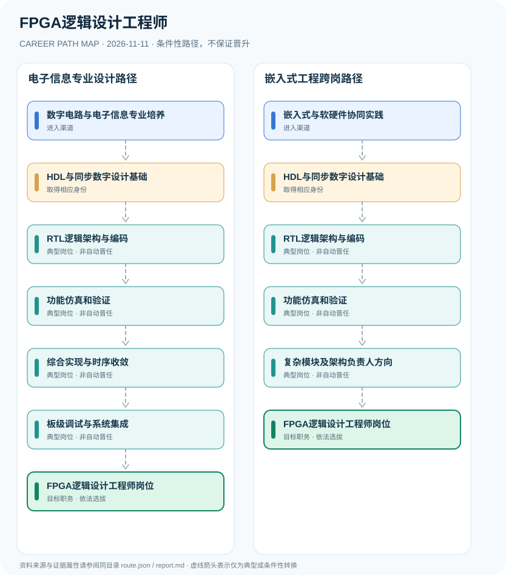

# FPGA逻辑设计工程师

> **批次 B13 · JR-178** · 研究范围：中国大陆·FPGA电子工程与软硬件开发企业岗位；2026公开招聘为实例 · **核验日期 2026-11-11**

## 职业定位与证据边界

FPGA逻辑设计工程师是雇主依据数字硬件和可编程逻辑能力招聘的工程技术岗位，不存在全国统一的FPGA执业许可。典型工作包含RTL编码、仿真验证、综合布局布线、时序收敛和板级联调，与ASIC芯片流片职位有共通技能但非相同身份。

该岗位由企业产品、芯片与设备架构决定，核心证据来自2026年高校就业中心转载的具体企业招聘，不能把这些企业经验要求上升为法定职业准入。

## 一、两种主要职业进入方向

- **数字电路与电子信息专业培养**：电子信息、自动化、通信等相关专业训练可建立数字逻辑、计算机体系结构和信号处理基础。
- **嵌入式与软硬件协同实践**：有嵌入式开发、接口协议和板级调试项目经验者可按企业岗位要求转向FPGA设计。

## 二、典型发展路线与适用条件

### 1. 电子信息专业设计路径

专业培养后依次经历RTL、验证、时序优化和板级集成，按能力应聘FPGA岗位。

**路线图**：数字电路与电子信息专业培养 → HDL与同步数字设计基础 → RTL逻辑架构与编码 → 功能仿真和验证 → 综合实现与时序收敛 → 板级调试与系统集成 → FPGA逻辑设计工程师岗位

以上各岗位转换均受任用、选拔、执业资格或招聘控制，不构成保证晋升的链条。

### 2. 嵌入式工程跨岗路径

具备嵌入式接口与板级调试基础者，补足硬件描述语言与验证能力后承担FPGA模块。

**路线图**：嵌入式与软硬件协同实践 → HDL与同步数字设计基础 → RTL逻辑架构与编码 → 功能仿真和验证 → 复杂模块及架构负责人方向 → FPGA逻辑设计工程师岗位

以上各岗位转换均受任用、选拔、执业资格或招聘控制，不构成保证晋升的链条。

## 三、岗位职责与专业发展能力

专业成长的可验证项目包括UART/SPI接口、AXI总线模块、数字滤波器或高速接口设计；需留存设计文档、仿真覆盖、时序报告与板级测试记录，优先证明真实可复现的工程能力。

- **HDL与同步数字设计基础**：熟练掌握Verilog或SystemVerilog、时钟复位、状态机与时序路径基本原则。
- **RTL逻辑架构与编码**：根据功能需求实现模块设计、信号接口、寄存器传输逻辑和代码审查。
- **功能仿真和验证**：编写testbench、约束和验证测试，排查跨时钟域、复位及接口协议故障。
- **综合实现与时序收敛**：进行资源与约束分析，结合布局布线结果优化面积、功耗及关键路径。
- **板级调试与系统集成**：配合硬件、固件和系统团队完成实际板卡调试与软硬件联调。
- **复杂模块及架构负责人方向**：根据团队项目需求承担模块接口和系统架构协调，企业职级另由雇主选任。

## 四、现行法规、任职资格及关键区别

- 2026年公开招聘岗位示例具体要求包括Verilog/SystemVerilog、Testbench、Vivado/Quartus、时序分析、跨时钟域和板级调试等技能；这些是雇主示例而非全国强制要求。
- FPGA可编程逻辑开发、ASIC设计与芯片量产验证存在交集，但工艺、流程和职业组织角色并不相同。
- 某雇主要求硕士学历不代表每个FPGA职位都具有同样学历门槛。

## 五、法律与数据风险提示

- 不将厂商工具证书或电子设计竞赛奖项表述成全国法定FPGA工程师资格。
- 逻辑仿真通过不等于系统交付成功，实际必须经过时序、板级和软硬件验证。
- 企业复杂模块负责人需要项目经验与管理授权，并不是固定工作年限的自动晋升。

## 六、证据分类和引用对应

**职业路径中所有转换为 `conditional`：满足条件时才可能发生。** `normative` 指法律明确规定的权利或义务；`official_description` 指官方发布的岗位事实；`illustrative` 只代表一种合理的示例经历。本报告不混淆行政领导职务、职级、执业资格、技术等级和雇主自行定义的岗位。

| 图中转换 | 证据属性 | 解释 |
|---|---|---|
| 数字电路与电子信息专业培养 → HDL与同步数字设计基础 | conditional | 从「数字电路与电子信息专业培养」到「HDL与同步数字设计基础」取决于对应资格、空缺职位或机构选任，不是必然晋升。 |
| HDL与同步数字设计基础 → RTL逻辑架构与编码 | conditional | 从「HDL与同步数字设计基础」到「RTL逻辑架构与编码」取决于对应资格、空缺职位或机构选任，不是必然晋升。 |
| RTL逻辑架构与编码 → 功能仿真和验证 | conditional | 从「RTL逻辑架构与编码」到「功能仿真和验证」取决于对应资格、空缺职位或机构选任，不是必然晋升。 |
| 功能仿真和验证 → 综合实现与时序收敛 | conditional | 从「功能仿真和验证」到「综合实现与时序收敛」取决于对应资格、空缺职位或机构选任，不是必然晋升。 |
| 综合实现与时序收敛 → 板级调试与系统集成 | conditional | 从「综合实现与时序收敛」到「板级调试与系统集成」取决于对应资格、空缺职位或机构选任，不是必然晋升。 |
| 板级调试与系统集成 → FPGA逻辑设计工程师岗位 | conditional | 从「板级调试与系统集成」到「FPGA逻辑设计工程师岗位」取决于对应资格、空缺职位或机构选任，不是必然晋升。 |
| 嵌入式与软硬件协同实践 → HDL与同步数字设计基础 | conditional | 从「嵌入式与软硬件协同实践」到「HDL与同步数字设计基础」取决于对应资格、空缺职位或机构选任，不是必然晋升。 |
| 功能仿真和验证 → 复杂模块及架构负责人方向 | conditional | 从「功能仿真和验证」到「复杂模块及架构负责人方向」取决于对应资格、空缺职位或机构选任，不是必然晋升。 |
| 复杂模块及架构负责人方向 → FPGA逻辑设计工程师岗位 | conditional | 从「复杂模块及架构负责人方向」到「FPGA逻辑设计工程师岗位」取决于对应资格、空缺职位或机构选任，不是必然晋升。 |

## 七、官方和公开参考资料

1. [软件工程师（FPGA方向）岗位招聘——银河航天](https://career.hebut.edu.cn/home/correcruit/content/id/80804.html) — 河北工业大学就业服务中心（发布日期 2026-09-17）
2. [嵌入式固件工程师（FPGA方向）招聘——天准科技](https://career.nankai.edu.cn/correcruit/content/id/117879.html) — 南开大学就业服务中心（发布日期 2026-09-04）

> 资料只反映所列地域、法规和核验日期的公开信息。报名、岗位计划或法规发生变化时，必须重新核对原文，不能沿用过时条件。
