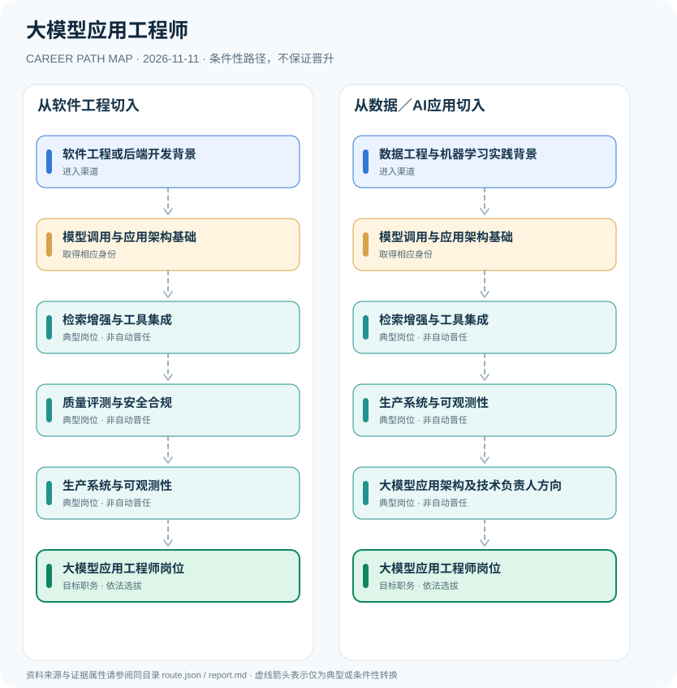

# 大模型应用工程师

> **研究批次** B12 · JR-168　|　**范围**：中国大陆；企业大模型应用研发和部署岗位（区分面向公众提供生成式AI服务）　|　**核验日期**：2026-11-11

## 摘要与职业定位

大模型应用工程师属于企业研发和软件应用开发岗位，常见入口为软件开发、数据工程或AI项目实践。系统集成、检索增强生成和可信评测是能力方向；《生成式人工智能服务管理暂行办法》对面向境内公众提供相关服务的主体有特定监管范围，并非人人需申请个人工程师许可证。

**适用边界**：七部门令第15号监管的是特定范围内的生成式人工智能服务，个人雇员不因此必须取得所谓“LLM应用工程师执业证”。软件开发岗位由雇主自主招聘，涉及面向公众的服务则须由提供者落实适用法律责任。

## 进入职业的合法渠道

- **软件工程或后端开发背景**：积累Python或相关编程、API服务、数据存储、测试部署及工程协作基础。
- **数据工程与机器学习实践背景**：从数据清洗、向量检索、机器学习实践和模型接口使用进入应用工程。

## 2 种代表性职业发展路线

### 1. 从软件工程切入

通过软件后端和模型调用能力进入RAG与应用质量工作，形成生产交付能力。

**岗位序列（条件性示意）**：软件工程或后端开发背景 → 模型调用与应用架构基础 → 检索增强与工具集成 → 质量评测与安全合规 → 生产系统与可观测性 → 大模型应用工程师岗位

### 2. 从数据／AI应用切入

结合数据模型基础学习应用架构、检索和系统部署，向平台应用工程发展。

**岗位序列（条件性示意）**：数据工程与机器学习实践背景 → 模型调用与应用架构基础 → 检索增强与工具集成 → 生产系统与可观测性 → 大模型应用架构及技术负责人方向 → 大模型应用工程师岗位

## 重要职责、技能和岗位发展

**工程成长路线**：软件工程 → 模型接口服务 → 企业知识检索与RAG → 评测和隐私保护 → 生产监控与治理。需要通过实际性能基准和安全质量数据评估能力，而不是凭模型参数规模或提示词数量推断工程职级。

- **检索增强与工具集成**：建立检索索引、数据更新、权限隔离及引用校验机制，连接模型与企业知识系统。
- **质量评测与安全合规**：构建离线测试集、幻觉率评估、敏感数据保护、越权调用检查与人机协作审批。
- **生产系统与可观测性**：管理服务延迟、成本、监控告警、模型版本、失败降级和数据更新，持续改进业务质量。
- **大模型应用架构及技术负责人方向**：根据企业岗位条件推进跨项目架构与团队协作，不等于国家统一工程职称等级。

## 准入门槛与任职规则

- 《生成式人工智能服务管理暂行办法》第二条规定：向境内公众提供生成式AI服务适用，企业内部研发应用而不向公众提供服务并非一律适用该办法。
- 第七条要求相关服务提供者依法管理训练数据来源、知识产权、个人信息与数据质量；具体工程工作应在企业主体合规要求下开展。
- 企业岗位名称“大模型应用工程师”不等于全国统一限制性职业资格，亦不等于独立从事基础模型训练研究。

## 证据状态与实际约束

路线图中的箭头均为 `conditional`：即使前一节点的经历成立，后续任用、考试、职业资格、选拔或招聘仍需独立满足制度要求。`normative` 专指法律直接规定的关系，`official_description` 指官方机构说明，`illustrative` 指仅用于理解的示例；具体证据来源链接见下文。

- RAG、提示词、微调与智能体编排是工程方法，不是现行法律规定每个雇员必须取得的单一准入证书。
- 模型提供者、面向公众服务者及内部使用方具有不同监管责任，具体业务需结合法规适用条件界定。
- 生产落地需要数据安全、用户授权与可复现实验评测，不应以仅能展示的Demo代替真实工程能力。

## 可复核原始资料

1. [生成式人工智能服务管理暂行办法](https://www.cac.gov.cn/2023-07/13/c_1690898327029107.htm)，中央网信办等七部门，2023-07-10。
2. [职业分类大典（2022年版）官方解读](https://chinajob.mohrss.gov.cn/h5/c/2022-10-08/361551.shtml)，人力资源和社会保障部中国就业网，2022-10-08。

> **复核提醒**：跨地区、跨机构或新招录年度，必须重新核查原始政策、职位计划及生效状态。此报告不推测晋升概率和个人任职结果。
