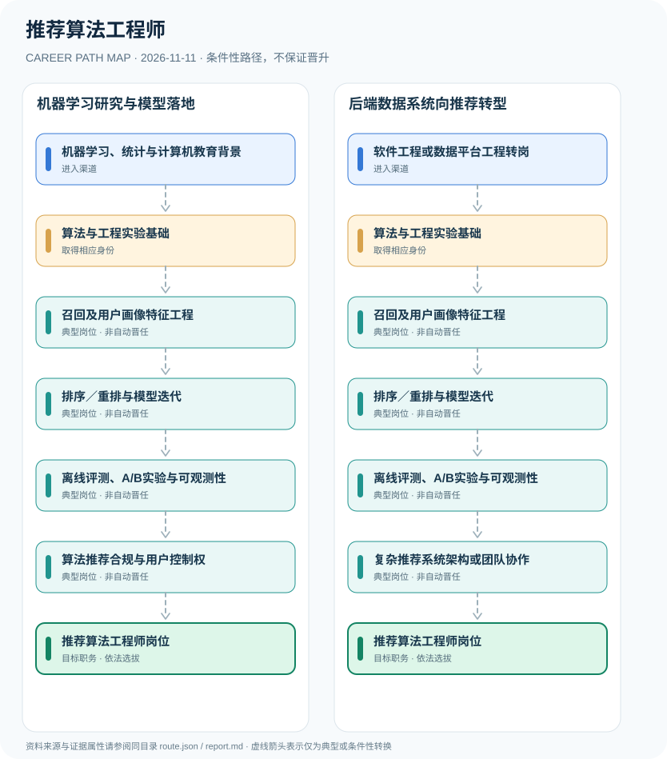

# 推荐算法工程师

> **B16 深度研究 · JR-172** · 机构与地域：中国大陆互联网企业、电商及内容平台推荐算法技术岗位 · **核验日期：2026-11-11**

## 一、职业定义与现行制度

推荐算法工程师是企业模型研发和线上推荐系统优化岗位，负责召回、排序、重排、用户理解和离线在线评测。2022年《互联网信息服务算法推荐管理规定》监管的是在中国境内使用推荐算法向用户提供互联网信息服务的服务提供者，并按特定条件实施备案要求；这不等于个人工程师必须取得全国统一算法执业许可证。

**法律与岗位双源审查**：国家网信办第9号令定义了算法推荐服务及提供者的义务；2026年百度招聘岗位给出工程能力实例，两者属于不同证据等级。法律未要求每个员工因开发推荐算法自动取得国家职业许可；但公司面向公众提供服务时须落实适用透明度、用户控制及备案制度。

## 二、两类准入与身份确认

- **机器学习、统计与计算机教育背景**：从计算机、统计、人工智能与数学学习进入推荐模型、数据结构、编程与概率建模工作。
- **软件工程或数据平台工程转岗**：具有后端服务、特征工程、日志数据管道及大规模分布式系统经验者可逐步转向推荐算法系统。

## 三、法规、资质和考试的判断

- 《互联网信息服务算法推荐管理规定》自2022年3月1日实施，适用于在境内应用算法推荐技术提供互联网信息服务者，不是所有离线科研项目或员工的个人职业许可证。
- 规定第十六至十七条要求算法推荐服务提供者告知服务及提供不针对个人特征或关闭算法推荐的选项；对具舆论属性或社会动员能力的特定提供者规定备案。
- 百度2026年搜广推算法校招职位强调召回、粗排、精排、用户建模、离线训练、在线推理和A/B实验，具体学历和技术栈只是该雇主样例。
- 小红书公开推荐算法岗位同样强调个性化分发与协作研发，具体模型、指标由用人单位和业务场景决定。

## 四、职业发展路径与条件性节点

### 路线1｜机器学习研究与模型落地

算法背景人员经召回排序训练和离线在线实验，积累符合用户权益要求的推荐系统经验。

**条件性路径**：机器学习、统计与计算机教育背景 → 算法与工程实验基础 → 召回及用户画像特征工程 → 排序／重排与模型迭代 → 离线评测、A/B实验与可观测性 → 算法推荐合规与用户控制权 → 推荐算法工程师岗位

该路线仅表示可能存在的职业经历；下一阶段均须重新核查资格、机构岗位和考核任职制度，不意味着保证录用或晋升。

### 路线2｜后端数据系统向推荐转型

软件与数据工程人员积累推荐特征和排序业务知识，推进模型服务与在线质量后承担研发工作。

**条件性路径**：软件工程或数据平台工程转岗 → 算法与工程实验基础 → 召回及用户画像特征工程 → 排序／重排与模型迭代 → 离线评测、A/B实验与可观测性 → 复杂推荐系统架构或团队协作 → 推荐算法工程师岗位

该路线仅表示可能存在的职业经历；下一阶段均须重新核查资格、机构岗位和考核任职制度，不意味着保证录用或晋升。

## 五、工作能力、项目与成果评价

客观成果应包括召回覆盖率、离线NDCG/AUC、线上A/B显著性、用户满意度、多样性与偏差检查、延迟和成本治理。大规模团队负责人还需具备跨平台工程组织能力，不能只凭模型论文发表自动晋任。

- **算法与工程实验基础**：掌握模型训练、数据分割、评测指标、统计显著性及在线服务的质量与安全约束。
- **召回及用户画像特征工程**：从日志和内容数据构建合法的特征、向量索引和多路候选召回，控制隐私与数据偏差。
- **排序／重排与模型迭代**：参与CTR/CVR、粗精排、多目标排序、多样性及冷启动，设计对用户体验的可测评价。
- **离线评测、A/B实验与可观测性**：将离线准确性和线上点击、留存等指标区分，监测实验效果、稳定性和负向外部性。
- **算法推荐合规与用户控制权**：在平台法人主体合规框架下支持透明度、用户关闭个性化推荐及未成年人保护，备案责任不等于个人牌照。
- **复杂推荐系统架构或团队协作**：按公司实际招聘或晋任承担大规模服务架构与研发协作，企业岗位职级由组织确定。

## 六、适用地区、生效版本及风险

- 算法备案制度的对象是符合法定条件的算法推荐服务提供者，不能写成工程师个人通过备案后方能就业。
- 模型效果优化不得代替隐私保护、用户选择权和未成年人网络保护义务；个人信息处理应在合法基础上开展。
- 企业内部“推荐算法工程师”“搜索广告算法工程师”“推荐平台架构师”职责交叉但不完全等同。

## 七、证据与图谱的映射

对每一节点，`route.json` 中的 `source_ids` 指向下文的可核查公开来源；每条转换边均标为 `conditional`，不会冒充有明确法律规定的 `normative` 自动晋升。不同的法定资格、机构选聘、职位级别及劳动关系各自独立。

| 转换前 | 转换后 | 证据属性 | 适用限制 |
|---|---|---|---|
| 机器学习、统计与计算机教育背景 | 算法与工程实验基础 | `conditional` | 从「机器学习、统计与计算机教育背景」至「算法与工程实验基础」取决于法定资格、岗位条件或独立选聘考核，绝非自动晋升。 |
| 算法与工程实验基础 | 召回及用户画像特征工程 | `conditional` | 从「算法与工程实验基础」至「召回及用户画像特征工程」取决于法定资格、岗位条件或独立选聘考核，绝非自动晋升。 |
| 召回及用户画像特征工程 | 排序／重排与模型迭代 | `conditional` | 从「召回及用户画像特征工程」至「排序／重排与模型迭代」取决于法定资格、岗位条件或独立选聘考核，绝非自动晋升。 |
| 排序／重排与模型迭代 | 离线评测、A/B实验与可观测性 | `conditional` | 从「排序／重排与模型迭代」至「离线评测、A/B实验与可观测性」取决于法定资格、岗位条件或独立选聘考核，绝非自动晋升。 |
| 离线评测、A/B实验与可观测性 | 算法推荐合规与用户控制权 | `conditional` | 从「离线评测、A/B实验与可观测性」至「算法推荐合规与用户控制权」取决于法定资格、岗位条件或独立选聘考核，绝非自动晋升。 |
| 算法推荐合规与用户控制权 | 推荐算法工程师岗位 | `conditional` | 从「算法推荐合规与用户控制权」至「推荐算法工程师岗位」取决于法定资格、岗位条件或独立选聘考核，绝非自动晋升。 |
| 软件工程或数据平台工程转岗 | 算法与工程实验基础 | `conditional` | 从「软件工程或数据平台工程转岗」至「算法与工程实验基础」取决于法定资格、岗位条件或独立选聘考核，绝非自动晋升。 |
| 离线评测、A/B实验与可观测性 | 复杂推荐系统架构或团队协作 | `conditional` | 从「离线评测、A/B实验与可观测性」至「复杂推荐系统架构或团队协作」取决于法定资格、岗位条件或独立选聘考核，绝非自动晋升。 |
| 复杂推荐系统架构或团队协作 | 推荐算法工程师岗位 | `conditional` | 从「复杂推荐系统架构或团队协作」至「推荐算法工程师岗位」取决于法定资格、岗位条件或独立选聘考核，绝非自动晋升。 |

## 八、来源及原始发布日期

1. **中央网络安全和信息化委员会办公室**：[互联网信息服务算法推荐管理规定（网信办等四部门令第9号）](https://www.cac.gov.cn/2022-01/04/c_1642894606364259.htm)（原文件或规定日期：2022-01-04）。
2. **百度人才招聘官网**：[百度2026校园招聘：搜广推算法工程师](https://talent.baidu.com/jobs/detail/GRADUATE/1d6833eb-77b2-4e03-99d6-8a42d43dbae3)（原文件或规定日期：2026-07-21）。
3. **小红书校招官网**：[小红书2026 REDstar推荐算法工程师岗位](https://job.xiaohongshu.com/campus/position/16621?referer_code=0985BDC7JEZM)（原文件或规定日期：2026-01-01）。

> **研究限制**：法规发布日期和实施日期可能不同；2027招录的专项条件以招聘公告实时版本及具体职位表为准。本研究不作个人晋升概率预测，不公开非公开的军队、警务、医疗或个人数据。
